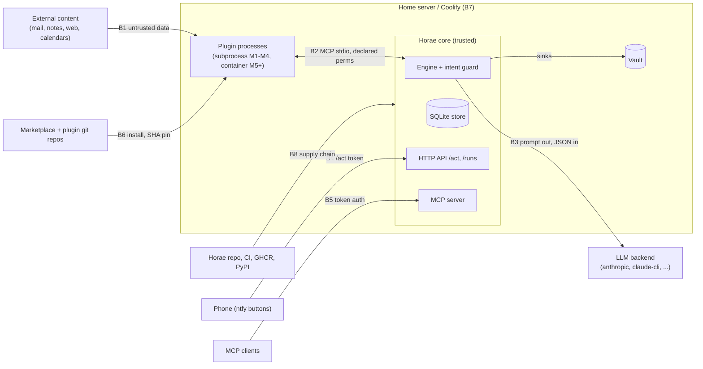

# Design note: threat model (`docs/security.md`)

> **Superseded by [docs/security.md](../security.md).** Kept as the record of the proposal; the
> maintainer's answers to its questions are on [PR #84](https://github.com/horae-dev/horae/pull/84).

- **Issue:** [#14](https://github.com/horae-dev/horae/issues/14) (Human-led, M0)
- **Status:** Superseded by [docs/security.md](../security.md).
- **Sources:** [PLAN.md](../PLAN.md) §2, §3.3–3.5, §4, §7, §9, §10;
  [ADRs 0001–0006](../adr/README.md); [schemas decisions](../../schemas/README.md#decisions).

This note proposes the structure, scope and first threat table of `docs/security.md`. Every control
below comes from PLAN.md, an accepted ADR or a backlog story, except where it is marked
**(proposed)**: those are new and need a decision.

## 1. Method (recommendation)

**STRIDE per trust boundary**, with the assets and attacker models as front matter.

- Horae's controls are boundary-shaped: the plugin host, the LLM backend, `/act`, the marketplace
  client and the container runtime are each one choke point (ADRs 0002–0004). Walking each
  boundary with STRIDE gives a finite, reviewable table where each row lands on one story.
- An attacker-only model would mix tiers: the same malicious plugin is "trusted by policy" in M1–M4
  and "contained" from M5. Each row therefore has a **tier column** (`declared` M1–M4, `isolated`
  M5+) so residual risk before M5 is written down, not implied.
- Alternative considered: LINDDUN for privacy. Not worth a separate pass; the privacy threats
  (LLM inputs to a cloud backend, run-record retention) fit as Information-disclosure rows.

## 2. Proposed outline of `docs/security.md`

1. Scope and security promise (what §2.2 guarantees, what §2.3 excludes: single user, no SaaS).
2. Assets.
3. Trust boundaries (diagram).
4. Attacker models.
5. Threat table: ID, boundary, STRIDE, threat, control, tier/milestone, test story.
6. Residual risks and accepted risks, per tier (honest, like PLAN §10).
7. Operator checklist for the reference deployment (Coolify, backups, secrets).
8. Malicious-plugin suite: what each fixture proves (#52 AC: "Suite documented in docs/security.md").
9. Reporting a vulnerability (link to the org `SECURITY.md`) and how the model is kept current.

## 3. Assets

| ID | Asset | Where it lives |
|---|---|---|
| A1 | Plugin secrets (`GITHUB_TOKEN`, CalDAV app passwords, IMAP, school credentials) | Coolify env vars, `/run/secrets` |
| A2 | LLM credentials: API keys, `CLAUDE_CODE_OAUTH_TOKEN` or the user's logged-in Claude Code | env, Claude Code config |
| A3 | `/act` HMAC key | env (§3.5) |
| A4 | Vault content (notes, tasks): personal and family data | vault mount, LiveSync CouchDB |
| A5 | Store: run records with LLM inputs, journal, LLM cache, task index | SQLite in the state dir (ADR 0006) |
| A6 | Instance definition: `horae.yaml`, `pipelines/`, `horae.lock` (approved permissions) | instance repo, state |
| A7 | Integrity of what runs: Horae image, plugin code at a pinned SHA, plugin venvs | GHCR, git, plugin dir |
| A8 | Outbound channels: ntfy topics, `http.post` targets, MCP server | network |
| A9 | Host: the home server, Docker, Coolify, other resources on shared networks | §7 |
| A10 | Budget: LLM spend (per step, per day) | provider account (#33, #63) |

## 4. Trust boundaries

B1 untrusted content → plugins and LLM; B2 plugin ↔ core; B3 core ↔ LLM backend; B4 phone ↔ `/act`;
B5 MCP clients ↔ MCP server; B6 marketplace/git → installed plugin; B7 Horae ↔ host (Docker,
Coolify, neighbours, backups); B8 Horae's own supply chain → image.

## 5. Attacker models

| ID | Attacker | Capability | Goal |
|---|---|---|---|
| M1 | Content author | Writes text Horae reads (email, shared calendar, web page, a note) | Prompt injection: add an action, a recipient, a URL; exfiltrate via a link |
| M2 | Malicious or compromised plugin | Arbitrary code inside a plugin process, within its declared manifest | Steal secrets, reach undeclared hosts/paths, propose undeclared intents |
| M3 | Marketplace or git-host compromise | Can change `marketplace.json`, a tag, a repo | Get malicious code installed or upgraded |
| M4 | Network/notification-path observer | Sees ntfy payloads, push relays, logs, link previews | Replay or forge `/act` tokens; read data in transit |
| M5 | Upstream dependency compromise | Malicious release of a Python package, action or base image | Code execution in CI or the Horae image |
| M6 | Neighbour on the host | Another Coolify resource or container on a shared network | Reach Horae's API, store or plugins |
| M7 | Curious LLM provider / provider breach | Sees prompts and responses | Personal data disclosure (A4) |

Out of scope (stated in the doc): a malicious operator/root on the host; multi-tenant attacks
(single user, §2.3); physical access.

## 6. Draft threat table

Tier: **D** = declared (M1–M4), **I** = isolated (M5+). "no story yet" = a gap to raise.

| ID | B | STRIDE | Threat | Planned control (source) | Tier | Test story |
|---|---|---|---|---|---|---|
| T01 | B1/B3 | T, E | Injected text makes the LLM add an intent, recipient or URL | LLM has no tools, at most one `llm` step (ADR 0001); output schema-validated, one retry, else `degraded` (§2.2); untrusted tagging + action guard: no URL/recipient absent from the input set (tenet 5) | D | #31, #35, #52 (injection fixture) |
| T02 | B1 | T | Untrusted text breaks out of its field in the note (Obsidian Tasks signifiers `📅 ⏰`, `obsidian://` links, owned-block markers) | Note-path rules (schemas); sinks escape signifiers (schemas README); `notify.push.link` scheme allow-list | D | #20 for paths; **no story yet** for escaping (plugin-obsidian has no issue) |
| T03 | B2 | I | Plugin reads secrets of other plugins or of the core | Clean env with only declared secrets (§3.3); secret names deny loader vars (decision 8) | D | #24 |
| T04 | B2 | I | Pre-M5 plugin reads `/run/secrets`, the store, other venvs or `horae.yaml` from the filesystem (same uid) | None in M1–M4 ("acceptable for first-party only", ADR 0003); declared mounts in M5 | D→I | #51; **no story yet** for a D-tier policy (proposed: refuse non-first-party installs before M5, or warn) |
| T05 | B2 | I | Plugin exfiltrates to an undeclared host | Egress proxy from `permissions.network` (M5) | I | #50, #52 |
| T06 | B2 | E | Plugin proposes intents it did not declare, or `http.post` to an undeclared host | Intent check against manifest (ADR 0002); same parsed host as the manifest (schemas README) | D | #20, #52 |
| T07 | B2 | I | `http.post` to a declared name that resolves to a private/link-local address (SSRF, DNS rebinding) | Resolve through the egress proxy, block private ranges (schemas README) | I | #50 (AC does not say private ranges); **no D-tier control** |
| T08 | B2 | D | Plugin hangs, floods output or crashes the run | Tool-call timeouts (#24); size bounds in schemas; resource limits (#51) | D/I | #24, #51 |
| T09 | B2/B3 | I | Declared secret values land in logs, stderr captures, run records | Never log resolved secrets (#16); stderr redacted (#24); redaction everywhere (#53, M5) | D/I | #16, #24, #53 |
| T10 | B3 | I | A secret or personal data inside source output is sent to a cloud LLM | De-identification of declared fields (#34); **(proposed)** refuse to send a request containing a declared secret value | D | #34; **no story yet** for secret scanning of prompts |
| T11 | B3 | I, E | `claude-cli` exposes user config, tools or the OAuth token | Env allowlist, tools disabled, no user settings (ADR 0005); token storage left to #29 | D | #29 (fake-binary test); re-verify per Claude Code version: **no story yet** |
| T12 | B3 | D | Runaway spend (loop, injection-inflated input) | Budget per step/day, ledger (#33), $0 path (#32), provider spend limit (#63) | D | #32, #33 |
| T13 | B4 | S | Stolen or replayed `/act` token | HMAC, single use, 24 h expiry, bound to one intent, no secrets or free-form URLs, rate limit (#38) | D | #38 |
| T14 | B4 | T | Link-preview or prefetch consumes a single-use token; CSRF on `/act` | **(proposed)** GET shows a confirmation, POST applies | D | **no story yet** (#38 AC silent) |
| T15 | B4 | I | `/act` reachable without SSO (§7) exposes more than one route | Only `/act/` bypasses SSO; `/runs` and `/healthz` behind SSO; no secrets in responses | D | #37, #41; SSO exemption test: **no story yet** |
| T16 | B4 | S | HMAC key leaked or never rotated | Key from env (§3.5); **(proposed)** dedicated key, rotation invalidates tokens | D | **no story yet** |
| T17 | B5 | S, E | Unauthenticated MCP client runs a pipeline or reads tasks | Token auth, hashed, revocable (#56); read-only tools (#54); `pipeline.run` dry-run + expiring approval (#55) | I | #54, #55, #56 |
| T18 | B6 | T | Moved tag or rewritten branch changes installed code | Full SHA pin, refuse tag/SHA mismatch, lockfile commit (ADR 0004) | D | #44, #48 |
| T19 | B6 | T, E | Compromised marketplace points a name at a malicious commit | Permission approval at install is the main defence (ADR 0004); signed tags "later" (§4) | D | #46; signing: **no story yet** |
| T20 | B6 | E | Upgrade silently widens permissions; run uses unapproved permissions | Permission diff and re-approval (#47); run refuses mismatch with lock (#46) | D | #46, #47 |
| T21 | B6 | T | Malicious URL/protocol in a clone (`ext::`, `file://`, option injection) | `git clone -- <repo>`, `protocol.allow=https`, https-only `repo` (schemas README) | D | #44 (AC silent on these): add to AC |
| T22 | B6 | T | Plugin dependencies resolved unpinned at install time | Per-plugin venv (#45); **(proposed)** require the plugin's `uv.lock` with hashes | D | #45 (AC silent) |
| T23 | B6 | R | No trace of which plugin did what | Run records carry plugin commit, `lock_digest`, `proposed_by` (ADR 0002/0004); `audit` (#47) | D | #23, #47 |
| T24 | B8 | T | Compromised dependency, action or base image in Horae | `uv.lock`, Renovate, pinned action SHAs, checksum-verified gitleaks, CodeQL (#11); SBOM (#40); cosign + PyPI trusted publishing (M8, #58); org 2FA, push protection (#62) | — | #11, #40, #58, #62 |
| T25 | B8 | T | Insecure security code written by agents | Human-led stories, Graft sensitive paths, malicious-plugin suite (#69, #15, #61) | — | #52, #61 |
| T26 | B7 | E | Container runtime needs the Docker socket: a Horae compromise becomes host root | **no control in plan** | I | **no story yet** (#49 silent) |
| T27 | B7 | I | Neighbour container on a shared Coolify network reaches Horae or plugins | `internal: true` plugin network (M5); `mcp-http` is https only (decision 6); fallback bearer token + IP allow-list (#74) | D/I | #49, #74 |
| T28 | B7 | I | Backups or long-lived run records leak LLM inputs and vault data | Local-only LLM inputs, configurable retention (§9); offsite backup (§7) | D | **no story yet** for retention or backup encryption |
| T29 | B7 | I | Vault CouchDB exposed without SSO | E2EE and path obfuscation on (§7) | D | #64, #65 (manual); LiveSync parity risk #71 |

## 7. Gaps to raise (from the table)

1. Escaping of Obsidian Tasks signifiers and owned-block markers has no story (T02).
2. No D-tier policy for third-party plugins, though M4 ships before M5 (T04).
3. Secret redaction (#53) is in M5, while PLAN §9 states it as a baseline and M1 already captures
   stderr and LLM requests (T09).
4. Nothing stops a declared secret value from being sent to a cloud LLM (T10).
5. `/act`: GET/POST semantics, HMAC key rotation and the SSO-exemption test are not in #38 (T14–T16).
6. Clone hardening and plugin dependency locking are not in #44/#45 ACs (T21, T22).
7. Docker-socket exposure for the M5 container runtime (T26).
8. Run-record retention and backup encryption (T28).
9. `claude-cli` isolation must be re-verified per Claude Code release (T11).

## Questions for the maintainer

1. Is **STRIDE per trust boundary** with a tier column the method you want, or an attacker-first model?
2. Between M4 and M5, should Horae **refuse** non-`first-party` plugins (opt-in flag), **warn**, or
   allow them as PLAN reads today?
3. Should #53 (secret redaction) move to M1/M2, keeping only the "seeded secrets" CI test in M5?
4. Do you want the proposed controls (T10 prompt secret scan, T14 GET-confirm/POST-apply, T16 key
   rotation, T22 locked plugin deps) as new stories, or as AC additions to #34, #38 and #45?
5. For M5, is a Docker socket proxy or rootless Docker acceptable, or should the threat model
   accept host-root as a residual risk of hard isolation?
6. Should run-record retention and encrypted offsite backups get a story (M3), or stay operator docs?
7. Image signing is M8 (#58), while the reference instance runs `edge` from M3. Sign `edge` earlier?
8. Are M6 (existing MCP services) and M7 (mail, school credentials) in scope for v1 of
   `docs/security.md`, or added when those milestones start?
9. `docs/security.md` is not in `graft.yaml` `sensitive_paths`. Should it be (a change only you can
   make or request)?
