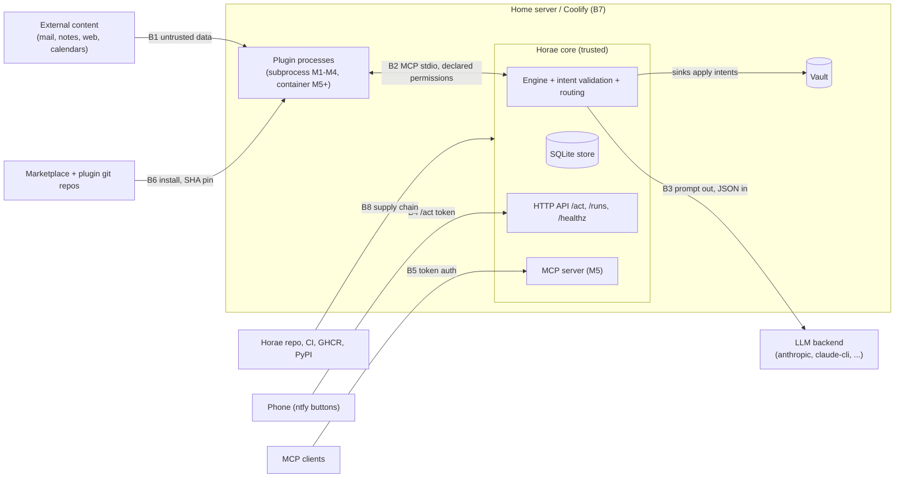

# Security model and threat model

- **Issue:** [#14](https://github.com/horae-dev/horae/issues/14) (M0). Supersedes the design note
  [0014](design/0014-threat-model-note.md); the maintainer's answers to its questions are on
  [PR #84](https://github.com/horae-dev/horae/pull/84).
- **Sources:** [PLAN.md](PLAN.md) §2, §3.3–3.5, §4, §7, §9, §10;
  [ADRs 0001–0006](adr/README.md); [schemas decisions](../schemas/README.md#decisions); the code in
  `src/horae/` and its tests.
- **Reporting a vulnerability:** see [Reporting a vulnerability](#reporting-a-vulnerability). Do not
  open a public issue.

This document says what Horae protects, from whom, and how: every threat names its control (code,
ADR or schemas decision), the test that pins it (an existing test file, or the issue that must add
one), the enforcement tier, and whether it is implemented, planned or an accepted risk. A control
without a test is not counted as implemented.

## 1. Scope and security promise

Horae is a **single-user**, self-hosted runtime ([PLAN §2.3](PLAN.md): no multi-tenancy, no SaaS).
The promise of [PLAN §2.2](PLAN.md) is what this model defends:

- control flow is declared, never chosen by an LLM; the LLM step has no tools
  ([ADR 0001](adr/0001-pipelines-not-agent-loops.md));
- plugins and the LLM never write; they propose intents from a closed set, which the core
  validates, diffs, journals and applies through a sink
  ([ADR 0002](adr/0002-intents-applied-by-the-core.md));
- a plugin gets only what its manifest declares, approved at install and pinned in `horae.lock`
  ([ADR 0003](adr/0003-mcp-as-the-plugin-protocol.md),
  [ADR 0004](adr/0004-git-marketplace-with-sha-pinning.md));
- untrusted content stays data: it can fill fields, never choose an action, a recipient or a URL
  that was not already in the input set (PLAN §2.1, tenet 5).

## 2. Method

**STRIDE per trust boundary** (confirmed on PR #84), with assets and attacker models as front
matter.

- Horae's controls are boundary-shaped (plugin host, LLM backend, `/act`, marketplace client,
  container runtime), so each boundary is walked once with STRIDE (Spoofing, Tampering,
  Repudiation, Information disclosure, Denial of service, Elevation of privilege).
- Every row has a **tier**: **D** = *declared* (M1–M4: subprocess plugins, clean environment,
  intents checked against the manifest) or **I** = *isolated* (M5+: one container per plugin,
  egress proxy, declared mounts, read-only, non-root). The residual risk before M5 is written
  down, not implied.
- Privacy threats (LLM inputs sent to a cloud backend, run-record retention) are Information
  disclosure rows; a separate LINDDUN pass was not worth it.
- **Status** is one of: **implemented** (code and a test on `main`), **planned #N** (the story
  that delivers it, with the acceptance criterion to add listed in
  [§10](#10-story-updates-requested) when it is missing), **accepted risk** (see
  [§7](#7-accepted-risks)).

## 3. Assets

| ID | Asset | Where it lives |
|---|---|---|
| A1 | Plugin secrets (`GITHUB_TOKEN`, CalDAV app passwords, IMAP credentials) | `/run/secrets` files (default) or explicit `{env: VAR}` references ([decision 25](../schemas/README.md#decisions)) |
| A2 | LLM credentials: API keys, `CLAUDE_CODE_OAUTH_TOKEN` or the user's logged-in Claude Code | secrets, Claude Code config ([ADR 0005](adr/0005-claude-cli-backend-and-its-terms.md)) |
| A3 | `/act` HMAC key | environment (PLAN §3.5) |
| A4 | Vault content (notes, tasks): personal and family data | vault mount, LiveSync CouchDB |
| A5 | Store: run records with LLM inputs, journal with note bytes before and after, LLM cache, task index, notification state | `<state_dir>/horae.db` ([ADR 0006](adr/0006-sqlite-as-the-store.md)) |
| A6 | Instance definition: `horae.yaml`, `pipelines/`, `horae.lock` (approved permissions) | instance repo, state |
| A7 | Integrity of what runs: Horae image, plugin code at a pinned commit, plugin venvs | GHCR, git, plugin directory |
| A8 | Outbound channels: ntfy topics, `http.post` targets, the MCP server | network |
| A9 | The host: home server, Docker, Coolify, other resources on shared networks | PLAN §7 |
| A10 | Budget: LLM spend per step and per day | provider account |

## 4. Trust boundaries

| Boundary | Between | Choke point |
|---|---|---|
| B1 | External content → plugins, LLM, notes | `horae.intents` validation, engine routing (`horae.engine.executor`), sinks |
| B2 | Plugin process ↔ core | plugin host (#24), `horae.intents.validate` |
| B3 | Core ↔ LLM backend | backend adapters (#28–#30), schema validation (#31) |
| B4 | Phone ↔ `/act` | `/act` endpoint (#38), SSO middleware (#41) |
| B5 | MCP clients ↔ Horae's MCP server | MCP server auth (#56) |
| B6 | Marketplace and git → installed plugin | `horae plugin add` (#43–#48), `horae.lock` |
| B7 | Horae ↔ host (Docker, Coolify, neighbours, backups) | compose files (#41), container runtime (#49) |
| B8 | Horae's own supply chain → image | CI (#11), image build (#40), release (#58) |

## 5. Attacker models

| ID | Attacker | Capability | Goal |
|---|---|---|---|
| M1 | Content author | Writes text Horae reads (email, shared calendar, web page, a note) | Prompt injection: add an action, recipient or URL; break out of a field; exfiltrate via a link |
| M2 | Malicious or compromised plugin | Arbitrary code inside a plugin process, within its declared manifest | Steal secrets, reach undeclared hosts or paths, propose undeclared intents |
| M3 | Marketplace or git-host compromise | Can change `marketplace.json`, a tag, a repo | Get malicious code installed or upgraded |
| M4 | Network or notification-path observer | Sees ntfy payloads, push relays, logs, link previews | Replay or forge `/act` tokens; read data in transit |
| M5 | Upstream dependency compromise | Malicious release of a Python package, action or base image | Code execution in CI or in the Horae image |
| M6 | Neighbour on the host | Another Coolify resource or container on a shared network | Reach Horae's API, store or plugins |
| M7 | Curious LLM provider or provider breach | Sees prompts and responses | Disclosure of personal data (A4) |

**Not defended against:** a malicious operator or root on the host; multi-tenant attacks (single
user, PLAN §2.3); physical access to the server.

## 6. Threats per boundary

Columns: **Threat → Control** (where it lives) **→ Test** (existing test file, or the issue that
must add it) **→ Tier → Status**. IDs `T01`–`T29` keep the numbering of design note 0014; `T30`
and later are new.

### B1: untrusted content → plugins, LLM, notes

| ID | STRIDE | Threat | Control | Test | Tier | Status |
|---|---|---|---|---|---|---|
| T01 | T, E | Injected text makes the LLM or a plugin add an intent, a recipient or a URL | Closed intent set ([ADR 0002](adr/0002-intents-applied-by-the-core.md)); at most one tool-less `llm` step ([ADR 0001](adr/0001-pipelines-not-agent-loops.md), [decision 14](../schemas/README.md#decisions)); routing binds every target to a trusted `act`/`notify` entry, untrusted data never chooses between entries (`intent_ambiguous`), `task.update_status` only for a fingerprint present in the collected input ([decision 30](../schemas/README.md#decisions), `horae.engine.executor`); LLM output validated against the skill's full output schema (not the provider's transformed copy) in a killable child process, with one repair retry whose errors carry only a path, a keyword and Horae's own words (never a value of the output, so no second-order injection), else `degraded`; an invalid output's intents are dropped and never routed, and a validator timeout or failure is never a pass: the step degrades at once (`validator_unavailable`, no repair, the attempt's cost charged); the validator is `ModelBackends`' default, only an explicit `UNVALIDATED` (test doubles) skips it ([decision 44](../schemas/README.md#decisions), #31); a cached output is validated again by the same validator on every reuse (an invalid entry, or one the validator cannot check, is a miss and is deleted) and its intents are validated and routed again in the reusing pipeline ([decision 45](../schemas/README.md#decisions) F and C, #32); the action guard on every LLM proposal, fresh or reused, after schema validation and before routing (`horae.engine.guard`, [decision 46](../schemas/README.md#decisions), #35): at most the skill's `intents: {type: max}` per type, every URL in note, task, notification and `http.post` text an exact string of the viewed input, a violation degrades the whole step (nothing routed) with a content-free `guard` violation naming only the pipeline's `skill:<namespace>/<skill>`, a refused cache entry is a miss and is deleted (`discard` is a member of the `LlmCache` port, so mypy enforces it; `NoDiscardCache` is the documented no-op) | `tests/test_engine.py` (`test_explicit_target_must_match_the_binding`, `test_task_status_needs_a_collected_fingerprint`, `test_two_notifiers_for_the_same_type_are_ambiguous`), `tests/test_contracts.py`, `tests/test_llm_validate.py` (`test_an_output_invalid_twice_is_never_applied`, `test_the_repair_prompt_holds_only_the_validation_errors`, `test_errors_name_the_path_and_keyword_and_never_a_value`, `test_a_slow_validation_is_killed_and_the_loop_stays_responsive`, `test_a_failing_worker_is_an_error_never_a_pass`, `test_a_validator_failure_degrades_at_once_without_a_repair`, `test_the_production_backends_install_the_validator`), `tests/test_llm_anthropic.py` (`test_the_validator_enforces_a_constraint_transform_schema_moved`), `tests/test_llm_cache.py` (`test_a_cached_output_is_validated_again_on_read`, `test_cross_pipeline_reuse_rechecks_the_bindings`, `test_a_cached_entry_the_validator_refuses_is_a_miss_and_deleted`), `tests/test_action_guard.py` (`test_an_injected_url_or_embed_degrades_the_whole_step`, `test_urls_must_be_in_the_input`, `test_a_guarded_cache_hit_is_a_miss_and_is_deleted`, `test_per_type_limits`, `test_the_source_must_be_a_skill_reference`), `tests/test_engine_skills.py` (`test_intent_limits_are_enforced_per_step`); #52 (injection fixture) | D | implemented (routing, closed set, schema validation #31, cache re-validation #32, action guard #35); planned #52 (plugin proposals) |
| T02 | T | Untrusted text breaks out of its field in the note: owned-block markers, line breaks in headings, Obsidian Tasks signifiers (`📅 ⏰ ✅ 🔁`), terminal control characters in `horae diff` | Note paths reject `.` segments ([decision 4](../schemas/README.md#decisions)); `horae.apply.notes.check_text` refuses markers in content and markers or line breaks in headings; `horae.apply.render.safe` escapes Cc, Cf, Zl, Zp in diff output; notification links `https://` or `obsidian://` only ([decision 7](../schemas/README.md#decisions)) and only under a trusted `link_prefix` ([decision 30](../schemas/README.md#decisions)); in LLM text, control and format characters (tab, zero-width, bidi), Markdown images and Obsidian `![[…]]` embeds, any tag-like token other than an exact attribute-less inert tag (`<b>`, `
`, ` `…) or a plain autolink, link destinations or tags holding whitespace or a backslash (every check also runs with Markdown escapes removed), `javascript:` / `vbscript:` / `data:` / `file:` / `blob:` links and protocol-relative (`//`, `\\`) links are always refused, also entity-encoded, in mixed case or split by whitespace, and a text still holding entities after three decoding passes is refused (fails closed); link definitions are found behind blockquote and list prefixes, footnotes get no exemption; the Obsidian rendering surface in note and notification text: Dataview, Templater, Mermaid, script, HTML, button and query code fences, Templater `<%` `%>` markers, Dataview inline queries, Mermaid `click` directives, wikilinks to URLs and, in note content, a frontmatter block are refused (provisional hardening, [decision 46](../schemas/README.md#decisions), #35); Tasks signifier and Markdown escaping of task titles: `horae_sdk.tasks.escape_title` (signifiers as character references, markup backslash-escaped, no `::` / `%%` / `==` pair, no bare-URL autolink, idempotent, total), used by the SDK's `intents.task_create` and by `tasks.task_line` for sinks writing Tasks syntax (#42, [decision 50](../schemas/README.md#decisions)) | `tests/test_apply.py` (`test_untrusted_content_cannot_hold_a_marker`, `test_untrusted_headings_cannot_hold_a_marker_or_a_line_break`, `test_text_output_escapes_untrusted_control_characters`), `tests/test_engine.py` (`test_notification_links_need_a_trusted_prefix`), `tests/test_action_guard.py` (`test_embeds_are_refused_even_with_a_known_url`, `test_script_data_file_and_relative_links_are_refused`, `test_html_outside_the_inert_allowlist_or_with_attributes_is_refused`, `test_control_and_format_characters_are_refused`, `test_tag_like_tokens_must_be_exact_inert_tags_or_autolinks`, `test_random_obfuscations_never_pass`, `test_backslashes_and_markdown_escapes_never_hide_a_link`, `test_obsidian_active_constructs_are_refused`, `test_a_frontmatter_block_is_refused_in_note_content_only`, `test_blockquote_and_list_prefixed_link_definitions_are_checked`, `test_footnotes_get_no_exemption_from_the_url_checks`, `test_entity_decoding_fails_closed`, `test_one_mib_for_the_obsidian_scans_in_linear_time`); `sdk/tests/test_sdk_tasks.py` (`test_a_title_with_every_signifier_and_markdown_is_inert`, `test_the_intent_builder_escapes_and_the_core_accepts_it`, `test_a_tasks_sink_line_holds_only_its_own_fields`, `test_escaping_is_idempotent_and_inert`, `test_escaping_hostile_alphabets`, `test_the_ported_regexes_see_every_hostile_field`), `sdk/tests/test_sdk_e2e.py` (`test_a_tasks_sink_written_with_the_sdk_escapes_titles_end_to_end`) | D | implemented (markers, paths, links, terminal, embeds #35; signifier escaping in the SDK #42, a plugin not built with the SDK must escape itself) |
| T30 | T, E | A note intent writes outside the vault or into a note Horae does not own (symlink, `..`, hidden file, someone else's note) | Owned notes only: `*.assistant.md`, decided on the path resolved without following symlinks ([decision 32](../schemas/README.md#decisions) D2); `LocalSink` / `LocalFileSink` open every segment `O_NOFOLLOW` relative to the parent descriptor, compare-and-swap on the planned SHA-256 (`src/horae/apply/local.py`) | `tests/test_apply.py` (`test_only_owned_notes_are_created_or_appended_to`, `test_local_sink_never_follows_symlinks`), `tests/test_local_file_sink.py` | D | implemented |

### B2: plugin process ↔ core

| ID | STRIDE | Threat | Control | Test | Tier | Status |
|---|---|---|---|---|---|---|
| T03 | I | A plugin reads the secrets of another plugin or of the core | Secrets resolved per name from `/run/secrets/<NAME>` only, env only through an explicit `{env: VAR}` reference ([decision 25](../schemas/README.md#decisions), `horae.secrets.SecretResolver`); secret names reject loader variables and `HORAE_` ([decision 8](../schemas/README.md#decisions)); the LLM backends (`anthropic`, `openai-compatible`, `ollama`) take their key only from the alias' declared `secret`, never from `ANTHROPIC_API_KEY`, `OPENAI_API_KEY`, `OLLAMA_HOST` or any other ambient variable (decisions 38 and 40); clean child environment with only declared secrets and the full deny list (`NODE_OPTIONS`, `*_PROXY`, `GIT_*`…) owned by the host ([decision 28](../schemas/README.md#decisions), #24) | `tests/test_secrets.py` (`test_default_lookup_is_the_secrets_directory_only`, `test_invalid_names_are_refused_before_any_lookup`), `tests/test_llm_backends_shared.py` (`test_the_ambient_environment_is_ignored`, `test_an_unresolvable_secret_fails_without_a_request`, every backend); probe plugin: #24 | D | implemented (resolution, LLM backends); planned #24 (clean environment) |
| T04 | I | Before M5 a plugin, running as the same uid, reads `/run/secrets`, the store, other venvs or `horae.yaml` from the filesystem | **Refuse non-first-party plugins until M5** (maintainer decision, PR #84): only marketplace entries with `tier: first-party` (PLAN §4) install while the runtime is `subprocess`; declared mounts from M5 (#51) | #46, #48 (refusal); #51, #52 (mounts) | D→I | planned #46, #48; planned #51 |
| T05 | I | A plugin exfiltrates to an undeclared host (or injected text makes the LLM write a URL that leaks data when the note renders or a link is tapped) | Egress only through the allow-listing proxy built from `permissions.network` (M5); before M5, T04's refusal limits this to first-party code; LLM text may hold only URLs copied exactly from its viewed input (`obsidian:` URIs included) and never an embed that fetches on render, a wikilink to a URL or an active Obsidian block (Dataview, Templater, Mermaid, query) that reads or fetches on render ([decision 46](../schemas/README.md#decisions), #35) | #50, #52; `tests/test_action_guard.py` (`test_urls_must_be_in_the_input`, `test_embeds_are_refused_even_with_a_known_url`, `test_obsidian_uris_must_be_exactly_in_the_input`, `test_obsidian_active_constructs_are_refused`) | I | implemented for LLM text (#35); planned #50; accepted risk in D tier (first-party only) |
| T06 | E | A plugin proposes an intent it did not declare, or `http.post` to an undeclared host | `horae.intents.validate`: every intent checked against `permissions.intents`, `http.post` host checked with the same parsed host (`horae.contracts.url_host`) as the manifest; one invalid intent rejects the batch; permissions checked before routing | `tests/test_intent_validation.py` (`test_undeclared_intent_fails_the_step`, `test_http_post_to_undeclared_host_fails`, `test_host_undeclared_names_the_parsed_host`), `tests/test_engine.py` (`test_permissions_are_checked_before_routing`); #52 | D | implemented |
| T07 | I | `http.post` to a declared name that resolves to a private or link-local address (SSRF, DNS rebinding); a redirect to an undeclared host | URLs are `https` only, no IP literals or `localhost` ([decision 6](../schemas/README.md#decisions)); resolution through the egress proxy blocking private ranges and no redirects (schemas README, "Contracts constrain shape") | `tests/test_contracts.py` (URL rules); #50 | D/I | implemented (contract); planned #50 (private ranges, see [§10](#10-story-updates-requested)) |
| T08 | D | A plugin hangs, floods its output or crashes the run; a skill's output schema or an LLM output makes the validation hang, eat memory or flood its answer | Run timeout `runs.timeout_s` with a 5 s grace ([decision 31](../schemas/README.md#decisions)); every sink call bounded by `call_timeout_s` ([decision 34](../schemas/README.md#decisions)); stderr capped at 64 KiB per step (`horae.engine.executor`); intent payloads bounded (`MAX_INTENTS`, `MAX_BODY`, nesting 64); tool-call timeouts (#24); the LLM output validator runs in a killable child process (`python -I -B`, empty environment, `cwd` `/`, its own session, `RLIMIT_CPU` and a 256 MiB `RLIMIT_AS` on Linux), within the step's deadline, its answer read with a 64 KiB bound, and the loader caps nested `anyOf` / `oneOf` alternatives at 1024 paths ([decision 44](../schemas/README.md#decisions) C, G; #31); CPU and memory limits for plugins (#51) | `tests/test_runner.py` (`test_run_timeout_stops_the_step_and_marks_the_run`), `tests/test_undo_hardening.py` (`test_a_sink_call_past_its_timeout_stops_the_apply`), `tests/test_engine.py` (`test_stderr_is_shared_between_calls_head_and_tail`), `tests/test_intent_validation.py` (`test_huge_payloads_are_rejected_fast`), `tests/test_llm_validate.py` (`test_a_slow_validation_is_killed_and_the_loop_stays_responsive`, `test_an_error_heavy_validation_hits_the_worker_memory_ceiling`, `test_nested_alternatives_through_defs_are_refused_by_the_loader`, `test_an_endless_answer_is_read_with_a_bound_and_killed`, `test_the_worker_is_isolated`); #24, #51 | D/I | implemented (run, sink, size bounds, LLM output validator #31); planned #24, #51 |
| T09 | I | Declared secret values land in logs, stderr captures, error messages or run records | `horae.secrets.Secret` redacts `repr`, `str`, `format` and serialization, refuses pickling and copying into a subclass; resolution logs nothing; errors name the secret, never the value; `horae doctor` prints only the exception type on an internal error ([decision 27](../schemas/README.md#decisions)) and never echoes a key that may be a pasted secret ([decision 29](../schemas/README.md#decisions)); a crashed run records the exception type only ([decision 31](../schemas/README.md#decisions)); LLM backend errors are written by Horae (status and a short API error type, never the provider's text) and raised with no `__cause__` / `__context__` leading to the request that holds the key, and `horae doctor` warns when an alias sends its `secret` to an `http://` `base_url` ([decision 40](../schemas/README.md#decisions) M); the plugin host redacts stderr, messages, outputs and intents (#24, decision 35). **Redaction everywhere (#53, [decision 43](../schemas/README.md#decisions))**: a declared secret shorter than 8 bytes is refused when it is resolved (`horae doctor` reports it as an error, a run needing it is refused; decision 43 H, superseding decision 35 D); every resolved secret joins a process registry (`horae.secrets.redact`), primed with every secret the instance names; a log record factory scrubs **every** logger (message redacted, arguments and tracebacks dropped), warnings are captured into it, and `sys.excepthook` / `threading.excepthook` redact what they print; the HTTP loggers are pinned at `WARNING`; the store redacts the **free text** of every table before writing it (an allowlist: step output, parameters, error messages, stderr, input data, intent payload fields, variables, LLM output and schema errors, notification and task text) and flags the hit as a `secret_in_output` violation on the run (kept in a `secret_flags` table until the record is saved, so another `Store` still records it; a colliding redacted key is renamed, not lost); identifiers the system needs (run ids, pipeline and plugin names, kinds, timestamps, digests, journal targets, fingerprints) and a number equal to a secret are kept as written and flagged; an LLM cache entry holding a secret (string, key or number) is refused (not cached); every writable connection sets `PRAGMA secure_delete = FAST` (a one-off `VACUUM` for older databases: [retention and backups](operations/retention-and-backups.md)); a `--var` or a rendered parameter holding a secret (also as a number) refuses the run at plan time, a skill prompt or output schema holding one refuses the `llm` step before anything is sent (`params_invalid`, name only); the LLM layer redacts errors, stderr and responses; every CLI output, text and JSON, goes through the redactor, before escaping and before truncation. **Documented exceptions**: the journalled `before` bytes (and those a forced undo overwrote) are the user's own note and are kept byte for byte so that undo restores it exactly: a secret the user wrote in a note is stored in the journal as it was; the `after` bytes Horae wrote (and a sink's `actual_after`) are kept too, flagged only for a secret not already in `before` (maintainer decision); a secret equal to an identifier stays in the store (flagged), never in logs or CLI output | `tests/test_secrets.py` (`test_secret_never_shows_its_value`, `test_resolution_logs_nothing`, `test_bad_secret_files_fail_without_keeping_the_value`), `tests/test_doctor.py`, `tests/test_llm_backends_shared.py` (`test_logging_stays_quiet_and_the_secret_never_leaks`, `test_http_errors_are_mapped`), `tests/test_llm_wiring.py` (`test_doctor_warns_about_a_key_sent_over_http`), `tests/test_secret_redaction.py` (`test_every_table_redacts_free_text_and_flags_identifiers`, `test_every_encoding_is_redacted_in_the_store`, `test_every_logger_is_scrubbed_with_no_host_open`, `test_warnings_are_captured_and_scrubbed`, `test_uncaught_exceptions_are_reported_redacted`, `test_a_short_secret_is_refused_at_resolution_without_its_value`, `test_doctor_reports_a_short_secret_as_an_error`, `test_secrets_equal_to_structural_words_never_break_a_run_or_undo`, `test_journal_after_is_flagged_only_for_a_secret_new_since_before`, `test_findings_survive_another_store_instance_and_abandon_drops_them`, `test_a_parameter_holding_a_secret_refuses_the_run`, `test_safe_redacts_before_it_escapes_and_before_text_is_cut`, `test_an_llm_cache_entry_holding_a_secret_is_not_cached`, `test_journal_before_bytes_restore_byte_exact`, `test_the_walking_skeleton_never_stores_logs_or_prints_an_echoed_secret`, with an independent decoding oracle), `tests/test_plugin_host.py` (`test_a_short_declared_secret_is_refused_and_never_shown`) | D | implemented (#24, #53) |
| T31 | T | A source plugin has side effects during `horae run --dry-run` (it writes or posts itself) | A dry run calls no sink and applies nothing ([decision 32](../schemas/README.md#decisions) D5); what the plugin process itself does is outside the guard (see [§7](#7-accepted-risks)); read-only filesystem and egress proxy in M5 | `tests/test_dry_run.py` (`test_the_engine_calls_no_sink_during_a_dry_run`, `test_horae_diff_writes_nothing`); #49, #50 | D→I | implemented (core); accepted risk in D tier |

### B3: core ↔ LLM backend

| ID | STRIDE | Threat | Control | Test | Tier | Status |
|---|---|---|---|---|---|---|
| T10 | I | A secret or personal data inside source output is sent to a cloud LLM, or to an endpoint other than the one declared | **De-identification (#34, [decision 47](../schemas/README.md#decisions))**: the fields a skill classifies in its input view (`person`, `email`, `phone`, `place`, `amount`, `free_text`) are pseudonymized before any **cloud** alias (`ModelAlias.local`, explicit; default: `ollama` local, every other backend cloud; never inferred from `base_url`): `[PERSON_1]`-style pseudonyms, stable per run and deterministic from the input, amounts as buckets, and in every other string and object key of the viewed input the known values: the instance vocabulary (a file in `secrets.dir`, never in the instance repo), the classed values and a person's name parts, matched token by token after NFKC (format characters dropped, case-folded, any white-space run equal, whole letter runs only), a phone by its last 9 digits whatever the separators, an amount's renderings as its bucket; pseudonym-shaped input text is neutralized first; keys under a token class become pseudonyms; a classed value over 1 KiB is withheld; the mapping exists only in memory (the record keeps what the provider saw, a digest and counts; the cache stores the pseudonymized output; the ledger holds no data); the accepted output and intents are re-identified after validation, after the call and its cost are recorded, and before routing (as text: a string stays a string; the growth is summed first and an output that would pass 256 KiB is `output_too_large`; unknown or mangled pseudonyms are left and noted); a cached or replayed output is reused only with the same de-identified input digest; a classified request to a cloud alias that was not de-identified is refused (`deid_required`), an unreadable vocabulary degrades the step (`deid_unavailable`) and is a `horae doctor` error. **No secret in a request (T10)**: render, then send (decision 38): before any backend sends, the exact frozen body (`RenderedRequest.body()`) is scanned for every secret the instance declares (primed, #53) and every other resolved one, in all its encodings (raw bytes and decoded JSON strings, keys, numbers); a match refuses the attempt with `secret_in_request` (names only; the log gives their count), nothing is sent or billed (the ledger releases the reservation), the step is `degraded` and a `secret_in_request` violation is recorded. The engine runs the same check on the **real viewed input before de-identification** ([decision 47](../schemas/README.md#decisions) J, after the security review of PR #110): pseudonymization could rewrite part of a secret (a classed value or an amount rendering inside it) so that the rendered-body scan no longer matched while the rest was sent; a match degrades the step the same way before anything is pseudonymized, rendered, sent or billed, and the pseudonymizer additionally never replaces a match overlapping a resolved secret; `horae eval` runs the same check on each case, offline and live. Limits: values in unclassed fields that equal no known value are sent as they are (the input view is the primary control); matching misses nicknames, initials and typos; `horae doctor` warns about an `ollama` alias with `local` unset that points at a non-local host or a `-cloud` model. Each alias sends to one endpoint only: `anthropic` to `/v1/messages`, `openai-compatible` to `<base_url>/chat/completions` (OpenRouter, Mistral, vLLM...), `ollama` to `<base_url>/api/chat`; any other origin, path or query is refused, no redirect is followed, no ambient proxy is used, and a `base_url` with `.` / `..` segments or `%2F` / `%2E` / `%5C` is refused ([decision 40](../schemas/README.md#decisions) B, N). `http://` is allowed to loopback, private and single-label host names only (decision 24) **and** is checked when connecting: every resolved address must be loopback, RFC 1918 or IPv6 ULA (not link-local or CGNAT), then the connection goes to that address (no rebinding) ([decision 40](../schemas/README.md#decisions) L). OpenRouter routing to sub-providers is not configurable yet | `tests/test_llm_backends_shared.py` (`test_a_tampered_request_is_refused_with_its_reason`, `test_a_redirect_is_not_followed`, `test_an_http_endpoint_resolving_off_the_lan_is_refused`, `test_an_http_backend_resolving_to_a_public_address_sends_nothing`), `tests/test_llm_openai_ollama.py` (`test_plain_http_to_a_public_host_is_refused`, `test_a_base_url_path_that_could_traverse_is_refused`), `tests/test_deid.py` (`test_classed_fields_never_reach_a_cloud_request`, `test_a_local_alias_is_sent_the_viewed_input_unchanged`, `test_without_a_policy_a_classified_cloud_request_is_refused`, `test_the_store_keeps_no_original_of_a_classed_value`, `test_a_request_holding_a_secret_is_refused_by_every_backend`, `test_a_refused_request_is_not_billed`, `test_the_engine_degrades_and_records_a_violation`), `tests/test_deid_hardening.py` (`test_known_values_are_found_through_evasions`, `test_a_phone_is_found_whatever_its_separators`, `test_an_amount_written_in_text_becomes_its_bucket`, `test_pseudonym_shaped_input_is_neutralized`, `test_a_repeated_pseudonym_is_refused_before_substituting`, `test_a_declared_secret_never_resolved_is_still_refused`, `test_a_secret_overlapping_a_classed_value_is_refused_before_deid`, `test_the_pseudonymizer_never_rewrites_part_of_a_secret`, `test_matching_is_fast_on_a_large_input_and_a_full_vocabulary`), `tests/test_evals.py` (`test_a_secret_in_the_viewed_input_is_refused_before_deid_live`, `test_a_secret_in_the_viewed_input_is_refused_before_deid_offline`) | D | implemented (endpoints, LAN check, #34 de-identification and secret check) |
| T11 | I, E | `claude-cli` exposes user configuration, tools or the OAuth token | Token mode only: `CLAUDE_CODE_OAUTH_TOKEN` from the alias' declared `secret`, revealed into the child's environment only; exact environment (fixed `PATH`, empty per-call `HOME` / `TMPDIR`, `LANG`, `TZ`, the auto-update / telemetry / non-essential-traffic / `CLAUDE.md` / auto-memory / extended-thinking switches, `GIT_CEILING_DIRECTORIES`, `CLAUDE_CODE_MAX_OUTPUT_TOKENS`; nothing inherited), empty per-call working directory under the Horae-owned 0700 `<state_dir>/llm-runs` (not the shared system temporary directory), umask 077, own process group (killed and the workspace removed on timeout and on cancellation), argv only (no shell; `send` accepts only the exact argv template, same length); `--tools ""`, `--strict-mcp-config` with an empty `--mcp-config`, `--setting-sources ""`, `--no-session-persistence`, `--disable-slash-commands`, `--permission-mode dontAsk`, `--max-turns 1`, `--system-prompt`; untrusted input on stdin, never in argv; timeout with SIGTERM then SIGKILL to the group, stdout capped at `response_cap(4 × max_tokens)` (1 to 8 MiB, as T33; Claude Code retries a truncated output up to 3 times by itself, so the reservation covers 4 outputs, #113), stderr capped (its tail drained after the exit) and redacted; a success needs `subtype: "success"` and reported output within `max_tokens`; `price` required (doctor error, refused at the first call) so every call has a dollar reservation (T12); version pinned to **Claude Code `>=2.1.284,<2.2`** (refused outside it, `horae doctor` checks it); Horae never handles OAuth ([ADR 0005](adr/0005-claude-cli-backend-and-its-terms.md), [decision 42](../schemas/README.md#decisions)); the live isolation test, each negative assertion with a positive control, is re-run against each release before the range is bumped, its output in the bump PR's body. **Accepted residuals**: administrator-managed settings (`/etc/claude-code/managed-settings.json`, `managed-mcp.json`, their macOS `/Library/Application Support/ClaudeCode/` twins; `horae doctor` warns when one exists, never reads it) and remote-managed settings pushed by the plan's organisation can add hooks, environment variables and MCP servers that no flag turns off (set by the machine's administrator or the organisation, both already trusted with the token); that the auto-update / telemetry / non-essential-traffic switches stop that traffic is not verified (no network capture in the live test) | `tests/test_llm_claude_cli.py` (fake `claude`: `test_the_environment_is_exactly_the_allowlist`, `test_home_tmp_and_cwd_are_private_empty_and_removed`, `test_no_shell_ever`, `test_a_timeout_kills_the_whole_group`, `test_an_oversized_stdout_is_refused`, `test_a_version_outside_the_range_is_refused`, `test_the_token_is_redacted_from_stderr_and_errors`, `test_the_workspace_is_under_the_private_work_dir`, `test_a_cancelled_call_kills_the_group_and_removes_the_workspace`, `test_the_stderr_tail_is_drained_after_the_exit`, `test_an_output_over_the_limit_is_output_invalid_with_its_usage`, `test_an_alias_without_a_price_runs_nothing`, `test_extended_thinking_is_off`, `test_the_reservation_covers_every_output_attempt`, `test_an_output_truncated_at_the_limit_is_output_invalid_with_its_usage`, `test_the_truncation_signal_is_the_reported_output`, `test_a_retried_truncation_is_charged_every_output`, `test_unfenced_strips_exactly_one_enclosing_fence`, `test_unfenced_is_linear_on_a_large_whitespace_result`, `test_an_unusable_output_attempts_fails_closed`), `tests/test_llm_wiring.py` (`test_doctor_warns_about_managed_claude_code_settings`), `tests/test_llm_backends_shared.py` (`test_claude_cli_*`, `test_every_built_in_backend_declares_the_expected_output_attempts`), `tests/test_llm_claude_cli_live.py` (`live`, manual: each flag's behaviour with a positive control, including `test_live_a_completion_through_the_backend` (a fenced answer parsed), `test_live_extended_thinking_is_off` (with its control) and `test_live_the_output_limit_is_honoured` (the retried truncation is `output_invalid` within 4 × `max_tokens`); **last run: Claude Code 2.1.284, 17 passed, every positive control fired**, #113, decision 42's amendment) | D | implemented #29, #113 (isolation flags and switches verified live on 2.1.284) |
| T12 | D | Runaway spend (loop, injection-inflated input), or spend hidden by a provider that under-reports its usage | One LLM step, `on_unchanged_input: skip` ([decision 15](../schemas/README.md#decisions)); a pre-flight check that the attempt can afford one output token and `max_tokens` sized from the step budget (decision 38 B); reported usage is untrusted: counts above `10**12` are unusable and charged conservatively (the input bound and the whole `max_tokens`), and a usable report is floored at a quarter of the request bytes and of the output bytes ([decision 40](../schemas/README.md#decisions) K); a failed call is charged too (`output_invalid` carries its usage); budgets per step and per day with a usage ledger, the day's allowance reserved before each call so that concurrent runs cannot jointly exceed it, a settled cost above its reservation flagged ([decision 41](../schemas/README.md#decisions), #33); a `claude-cli` alias must have a `price` (its notional cost is known only after the call), and its reported output above `max_tokens` is `output_invalid`, charged as reported ([decision 42](../schemas/README.md#decisions) A, F); input-hash cache, the $0 path: an unchanged input makes no call within `cache.ttl_s` (default 7 days) and a hit is charged zero, an expired entry asks the model once per `ttl_s` ([decision 45](../schemas/README.md#decisions), #32); provider spend limits (#63) | `tests/test_contracts.py` (budget fields required), `tests/test_llm_backends_shared.py` (`test_an_exhausted_budget_sends_nothing`, `test_absurd_token_counts_are_charged_conservatively`, `test_a_zero_usage_is_floored_by_the_request_and_output_sizes`, `test_missing_usage_is_charged_conservatively`), `tests/test_budgets.py` (step and daily ceilings, two processes), `tests/test_llm_claude_cli.py` (`test_an_alias_without_a_price_runs_nothing`), `tests/test_llm_cache.py` (`test_unchanged_input_makes_no_llm_call`, `test_unchanged_input_makes_no_call_across_processes`) | D | implemented (pre-flight, untrusted usage), done #33, #32; planned #63 |
| T33 | D | A malicious or compromised LLM endpoint exhausts memory or crashes the run with its response (huge or chunked body, gzip bomb, non-UTF-8, absurd numbers, an unexpected shape) | `accept-encoding: identity`; every backend's transport is wrapped by `BoundedTransport`: a success body at most `min(8 MiB, max(1 MiB, 64 × max_tokens))` bytes once decoded, refused on its `content-length` or as soon as it passes the cap; `gzip` / `deflate` inflated by Horae in bounded steps, other encodings refused; error bodies cut at 64 KiB; strict UTF-8 and strict JSON; any unexpected failure reading the result is `output_invalid` with the conservative usage, never a crash ([decision 40](../schemas/README.md#decisions) I, J); the `claude-cli` process's stdout has the same cap and the same strict parsing ([decision 42](../schemas/README.md#decisions)) | `tests/test_llm_backends_shared.py` (`test_a_gzip_bomb_is_refused_with_bounded_memory`, `test_a_body_announced_over_the_cap_is_refused_unread`, `test_a_streamed_body_over_the_cap_is_refused`, `test_an_error_body_is_cut_at_64_kib`, `test_a_body_that_is_not_utf8_is_output_invalid`, `test_an_unexpected_failure_reading_the_result_is_output_invalid`), `tests/test_llm_claude_cli.py` (`test_an_oversized_stdout_is_refused`) | D | implemented |

### B4: phone ↔ `/act`

| ID | STRIDE | Threat | Control | Test | Tier | Status |
|---|---|---|---|---|---|---|
| T13 | S | A stolen or replayed `/act` token | HMAC-signed, single use, 24 h expiry, bound to one intent, no secrets or free-form URLs, rate limited (#38) | #38 | D | planned #38 |
| T14 | T | A link preview or prefetch consumes a single-use token; CSRF on `/act` | `GET /act/<token>` only shows a confirmation and changes nothing; `POST` applies | #38 | D | planned #38 (see [§10](#10-story-updates-requested)) |
| T15 | I | `/act` is reachable without SSO (PLAN §7); a misconfiguration exempts more than `/act/`; the API (`/healthz`, `/runs`) leaks secrets, paths or configuration, is reachable by a neighbour (M6) or a browser page (CORS, caching, framing, DNS rebinding of a page's own name to 127.0.0.1), or writes to the store | **Only `/act/` bypasses SSO; `/runs`, `/healthz` and everything else are behind SSO (#41)**: the Coolify template (`deploy/coolify/docker-compose.yaml`) defines one forwardAuth middleware by label (`horae-sso`), which Coolify adds to every router it generates for the domain, and one router of its own without it, `Host(<domain>) && PathPrefix(/act/)` at a higher priority; the plain compose override (`deploy/compose/traefik.yaml`) has the same two routers; a misconfiguration fails closed (Coolify's label escaping leaves the `/act/` host and the forwardAuth address literal: `/act/` falls back to SSO, the SSO router errors); no published port (plain compose: `127.0.0.1` only), no `networks:` (Coolify's per-resource network, shared only with its proxy; "Connect to predefined network" off) or, with plain compose, a network shared only by Horae and Traefik; `HORAE_ALLOWED_HOSTS` set from the domain ([operations/coolify.md](operations/coolify.md), [operations/compose.md](operations/compose.md)). **The API (#37, [decision 51](../schemas/README.md#decisions))** has no authentication of its own and must never be exposed without the proxy: `horae serve` binds `127.0.0.1` by default (`--host` / `HORAE_HOST`; the image sets `0.0.0.0` for the proxy on the container network and only `EXPOSE`s the port); `GET` routes only, read-only store access (`Store.open(read_only=True, immutable=False)`: plain `mode=ro`, `query_only`, a WAL reader that never blocks the scheduler and is never torn by its checkpoints; at most an empty `-wal` and a `-shm` left behind, which the next writer removes); runs shown as `horae runs --json` shows them (never the run record, `pid` or `host`); every body, errors included, redacted as data then as text with the process registry (primed with every secret the instance names); error bodies written by Horae (an exception's type only, a parameter's name only, never a request value, a path or an exception message); `/healthz` gives a closed store reason and the scheduler state, no path or configuration; `Cache-Control: no-store`, `nosniff`, CSP `default-src 'none'; frame-ancestors 'none'`, `Referrer-Policy: no-referrer`, `X-Frame-Options: DENY` on every response from the app; no CORS; no slash redirect; OpenAPI and docs pages disabled; no `Server` header, no access log, no proxy-header rewriting; **a `Host` check against DNS rebinding**: only `localhost`, `127.0.0.1`, `::1` and the `--allowed-host` names (`HORAE_ALLOWED_HOSTS`, the proxy's public hostname; exact match, no wildcard) are served, anything else (missing, malformed or repeated `Host` too) is `400 invalid_host` ("host not allowed (see HORAE_ALLOWED_HOSTS)") before any route, the host never echoed; `_` allowed in names (Docker service names); a wrong setting is visible: a start-up warning when listening on `0.0.0.0` / `::` with no allowed host, and each refused value logged once (`ascii()`-escaped, truncated, at most 32 values, redacted); **the Docker network is trusted**: the Host check stops browsers, not a neighbour container, which can send any `Host` directly, so #41's template must put Horae on a network shared only with the proxy; the `/healthz` body (the scheduler state) is kept as is, behind SSO (#41, decision 51 C); page cursors are total (any tampered cursor is `400`, never `500`) | `tests/test_api.py` (`test_no_response_ever_holds_a_secret`, with a secret planted raw in a run's error, a journal entry, a run id, a pipeline name, the scheduler state and the request; `test_the_api_is_read_only`, `test_reading_does_not_wait_for_a_writer`, `test_a_tampered_cursor_is_400_never_500`, `test_each_refused_host_is_logged_once_sanitised_and_bounded`, `test_a_trailing_slash_is_404_not_a_redirect`, `test_every_response_has_the_security_headers`, `test_no_cors_preflight_and_no_docs`, `test_bad_parameters_are_refused_without_echoing_them`, `test_an_internal_error_shows_only_its_type`, `test_healthz_is_503_when_the_store_cannot_be_read`, `test_a_request_for_another_host_is_refused`, `test_loopback_and_configured_hosts_are_accepted`, `test_several_host_headers_are_refused`), `tests/test_api_server.py` (`test_serve_announces_the_api_and_binds_loopback_by_default`, `test_the_api_answers_on_a_real_socket_and_stops_with_the_scheduler` with a rebinding `Host` on the real socket, `test_a_bad_allowed_host_is_a_usage_error`, `test_a_wildcard_bind_without_an_allowed_host_warns`), `tests/test_store_lifecycle.py` (`test_plain_read_only_reads_are_correct_while_a_writer_checkpoints_on_close`); the image's `HEALTHCHECK` (loopback `Host`) in `scripts/smoke-image.sh`; SSO exemption against the rendered templates: `tests/test_deploy_templates.py` (`test_coolify_only_act_is_exempt_from_sso`, `test_coolify_with_escaped_labels_everything_fails_closed`, `test_coolify_the_template_defines_no_other_middleware`, `test_coolify_publishes_no_port_and_stays_on_its_own_network`, `test_compose_with_traefik_only_act_is_exempt_from_sso`, `test_compose_binds_only_to_loopback`), `docker compose config` in `ci.yml` job `deploy` | D | implemented (#37, #41); the Coolify deployment itself is verified by hand (#41) |
| T16 | S | The HMAC key leaks or is never rotated | A dedicated key (a secret, not a shared one); rotation invalidates every outstanding token | #38 | D | planned #38 (see [§10](#10-story-updates-requested)) |

### B5: MCP clients ↔ Horae's MCP server

| ID | STRIDE | Threat | Control | Test | Tier | Status |
|---|---|---|---|---|---|---|
| T17 | S, E | An unauthenticated MCP client runs a pipeline or reads tasks | Token auth, hashed and revocable (#56); read-only tools (#54); `pipeline.run` only as a dry run plus an expiring approval (#55) | #54, #55, #56 | I | planned #54, #55, #56 |

### B6: marketplace and git → installed plugin

| ID | STRIDE | Threat | Control | Test | Tier | Status |
|---|---|---|---|---|---|---|
| T18 | T | A moved tag or rewritten branch changes installed code | `horae.lock` `commit` is a full 40- or 64-hex id, never a tag or short SHA ([decision 20](../schemas/README.md#decisions), `horae.contracts.lockfile`); checkout of the pinned SHA, refusal on tag/SHA mismatch ([ADR 0004](adr/0004-git-marketplace-with-sha-pinning.md)) | `tests/test_contracts.py` (lockfile examples); #44, #48 | D | implemented (contract); planned #44, #48 |
| T19 | T, E | A compromised marketplace points a name at a malicious commit | Permission approval at install is the main defence ([ADR 0004](adr/0004-git-marketplace-with-sha-pinning.md)); non-first-party refused before M5 (T04); signed tags are "later" (PLAN §4) | #46 | D | planned #46; accepted risk (no signed tags yet) |
| T20 | E | An upgrade silently widens permissions; a run uses permissions that were not approved | Permission diff and re-approval (#47); a run refuses plugins whose permissions differ from the lock (#46); run records carry `lock_digest` and replay refuses a changed lock ([decision 33](../schemas/README.md#decisions)) | `tests/test_runner.py` (`test_the_record_keeps_lock_config_digests_models_and_definition`), `tests/test_replay.py`; #46, #47 | D | implemented (digests); planned #46, #47 |
| T21 | T | A malicious URL or protocol in a clone (`ext::`, `file://`, option injection) | Lockfile `repo` is `https://` only ([decision 6](../schemas/README.md#decisions), [decision 20](../schemas/README.md#decisions)); `git clone -- <repo>` with `protocol.allow` restricted to `https` ([ADR 0004](adr/0004-git-marketplace-with-sha-pinning.md)) | `tests/test_contracts.py`; #44 | D | implemented (contract); planned #44 (see [§10](#10-story-updates-requested)) |
| T22 | T | Plugin dependencies are resolved unpinned at install time | Per-plugin venv (#45) built from the plugin's lock file with hashes | #45 | D | planned #45 (see [§10](#10-story-updates-requested)) |
| T23 | R | No trace of which plugin did what | Run records carry each plugin's version and commit, `lock_digest`, `intents[].proposed_by` and `applied_by` ([decision 21](../schemas/README.md#decisions), [decision 30](../schemas/README.md#decisions)); the journal records `applied_by` and `sink_identity` ([decision 34](../schemas/README.md#decisions)); `horae plugin audit` (#47) | `tests/test_engine.py` (`test_run_record_rejects_impossible_routes`), `tests/test_undo_hardening.py` (`test_the_journal_records_where_each_change_was_written`); #47 | D | implemented (records, journal); planned #47 |

### B7: Horae ↔ host

| ID | STRIDE | Threat | Control | Test | Tier | Status |
|---|---|---|---|---|---|---|
| T26 | E | The container runtime needs the Docker socket: a Horae compromise becomes host root | None beyond keeping the core small and reviewed; documented in the deployment docs | #49 (documentation) | I | **accepted risk** ([§7](#7-accepted-risks)) |
| T27 | I | A neighbour container on a shared Coolify network reaches Horae or its plugins | `internal: true` plugin network (M5, #49); `mcp-http` is `https` only ([decision 6](../schemas/README.md#decisions)); fallback bearer token and IP allow-list for cross-resource networking (#74) | #49; #74 | D/I | planned #49; risk #74 |
| T28 | I | Backups or long-lived run records leak LLM inputs, journal note bytes and vault data | State directory 0700, database and its `-wal`/`-shm` 0600 (`Store.open`, umask 0077); `Store.prune_runs` deletes old runs with their steps, journal and unreferenced blobs; LLM cache retention: entries expire after `cache.ttl_s` (default 7 days), at most `cache.max_entries` (default 1000) are kept, both purged at the start of every non-dry run, the entries of an undone run are deleted, and `horae cache purge` deletes on demand ([decision 45](../schemas/README.md#decisions), #32); interim operator guidance in [operations/retention-and-backups.md](operations/retention-and-backups.md); a retention workflow to revisit in [design note 0014a](design/0014a-retention-workflow.md) | `tests/test_store.py` (`test_state_files_are_private`, `test_prune_runs_cascades_and_collects_orphan_blobs`), `tests/test_llm_cache.py` (`test_runs_purge_expired_and_surplus_entries`, `test_horae_cache_purge`, `test_undo_invalidates_the_entry_of_the_run`) | D | implemented (file modes, pruning API, LLM cache expiry and purge #32); accepted risk until 0014a is decided |
| T29 | I | The vault CouchDB is exposed without SSO | LiveSync E2EE and path obfuscation on (PLAN §7) | #64, #65 (manual); risk #71 | D | planned #64, #65 |
| T32 | T | Two processes apply or undo at once and corrupt a note or the journal | Per-pipeline `flock` and the instance-wide apply lock (lock files 0600, directory 0700, `O_NOFOLLOW`) ([decision 31](../schemas/README.md#decisions), [decision 34](../schemas/README.md#decisions)); compare-and-swap writes | `tests/test_runner.py` (`test_lock_files_are_private_and_probing_creates_nothing`, `test_two_processes_one_pipeline_the_second_exits_with_a_lock_message`), `tests/test_undo_hardening.py` (`test_a_run_waits_for_the_apply_lock_then_fails`) | D | implemented |
| T34 | I, D, S | The push-monitor ping (#39) leaks the push URL and its token (logs, errors, output), is sent through an ambient proxy or redirected, reaches a host off the LAN over plain `http`, hangs or floods a run, or a failing monitor fails runs; scheduled runs overlap manual ones | The URL is a **secret** (`scheduler.monitors.<pipeline>.secret`, resolved like any secret, primed for redaction; `horae doctor` resolves it and checks its shape with the ping's own validator, never echoing it), never written in `horae.yaml`; Horae writes every warning itself (pipeline and a closed reason, never the URL, response or exception text); the URL must be a `BackendUrl` (`https://` anywhere, `http://` only to loopback, private or single-label hosts) and an `http://` host is re-checked at connect time (`LanOnlyNetwork`, no rebinding); one `GET`, `trust_env=False` (no proxy, `.netrc`, `SSL_CERT_*`), TLS verified, no redirect, no retry, 10 s for the whole exchange, body bounded at 64 KiB (`BoundedTransport`) and unused; a ping failure never changes a run's outcome or exit code; the ping of an interrupted `horae run` is bounded to 2 s and a second signal to `horae serve` stops waiting for pings; a scheduled run takes the same per-pipeline `flock` as `horae run`, scheduled runs are serialised by default (`scheduler.max_concurrent: 1`) and every apply holds the instance's apply lock, and a fire time while the pipeline runs is skipped and logged; an invalid `HORAE_SCHEDULER` is refused by `horae serve` and reported by `horae doctor` ([decision 49](../schemas/README.md#decisions) D, D3, E2, F) | `tests/test_push_monitor.py` (`test_a_failed_ping_is_a_warning_and_the_run_still_succeeds`, `test_a_slow_monitor_is_bounded`, `test_an_unreachable_monitor_is_a_warning`, `test_an_ambient_proxy_is_ignored`, `test_a_url_outside_the_network_rules_is_refused_without_showing_it`, `test_the_url_is_redacted_if_it_is_ever_printed`, `test_a_scheduled_run_never_overlaps_a_manual_run`, `test_the_ping_of_an_interrupted_run_is_bounded`), `tests/test_scheduler.py` (`test_a_fire_time_while_the_previous_run_runs_is_skipped_and_recorded`, `test_a_run_locked_by_another_process_is_skipped_without_a_ping`, `test_scheduled_runs_are_serialised_first_in_first_out`, `test_doctor_checks_the_push_url_and_horae_scheduler`), `tests/test_cli_serve.py` (`test_a_second_signal_stops_waiting_for_the_pings`) | D | implemented (#39) |

### B8: Horae's own supply chain

| ID | STRIDE | Threat | Control | Test | Tier | Status |
|---|---|---|---|---|---|---|
| T24 | T | A compromised dependency, action or base image in Horae | `uv.lock` and Renovate; actions pinned to commit SHAs, checksum-verified gitleaks, CodeQL (`.github/workflows/ci.yml`, #11); multi-stage image pinned by digest, non-root, tini as PID 1, no pip/ensurepip/uv, read-only root filesystem, smoke-tested on every PR (`Dockerfile`, `scripts/smoke-image.sh`, `ci.yml` job `image`); published (amd64 and arm64) only after CI OK on `main`, each platform smoke-tested before the push, pushed by digest with an SPDX SBOM and provenance checked per platform, **signed with cosign (keyless) and the signature verified before any tag is applied** (`ci.yml` job `publish`); release tags never rebuild: they re-tag the signed `main` digest of a commit on `main` after verifying its signature (`.github/workflows/image.yml`, [operations/container-image.md](operations/container-image.md), #40; maintainer decision, PR #84; was M8 in #58); PyPI trusted publishing (#58); org 2FA and push protection (#62) | CI itself (#11); `scripts/smoke-image.sh`, the `cosign verify` steps of `ci.yml` job `publish` and of `image.yml` (#40; they run only on pushes to main and on tags); #58, #62 | — | implemented (#11, #40); planned #58, #62 |
| T25 | T | Insecure security code written by agents | Human-led stories and Graft sensitive paths (`graft.yaml`, [AGENTS.md](../AGENTS.md#review)), `docs/security.md` added to them (maintainer decision, PR #84); malicious-plugin suite (#52); risk #69 | `tests/test_graft_policy.py`; #52, #61 | — | implemented (policy); planned #52, #61 |

## 7. Accepted risks

Recorded as accepted by the maintainer (PR #84) or by an accepted decision. Each is revisited at the
milestone named.

1. **Docker socket = host root (T26), until further notice.** The M5 container runtime (#49) needs
   to start containers; with the Docker socket mounted, code execution in the Horae core is root on
   the host. A socket proxy or rootless Docker were considered and not required for now. Keep the
   core's attack surface small (B2 and B4 are the entry points) and keep Horae on a host that holds
   nothing more valuable than what Horae already reads.
2. **The dry-run write guard does not cover `ctypes`, C extensions or plugin subprocesses (T31).**
   `tests/test_dry_run.py` proves that the core writes nothing but its own store during a dry run:
   Python-level writes, metadata changes, sockets, name resolution, SQLite connections and process
   creation ([decision 32](../schemas/README.md#decisions) D5). Writes made below Python, and
   anything a plugin process does itself, are outside it. A dry run guarantees that no intent is
   applied, not that a plugin has no side effects; the M5 read-only filesystem and egress proxy
   narrow this.
3. **`/proc/<horae-pid>/environ` before M5.** A plugin subprocess running as Horae's uid can read
   Horae's environment. Mitigated by file-based secrets: a secret is read from
   `/run/secrets/<NAME>` unless an explicit `{env: VAR}` reference says otherwise
   ([decision 25](../schemas/README.md#decisions)), so a deployment that uses secret files keeps
   secret values out of the environment. The files themselves stay readable by the same uid until
   M5 mounts, which is why non-first-party plugins are refused before M5 (T04).
4. **First-party trust in the D tier (T04, T05).** Between M1 and M4 a plugin is a subprocess with
   the core's uid and network: the D tier constrains what it can make the core do, not what the
   process can do. Accepted for first-party plugins only (PLAN §3.3, ADR 0003); others are refused
   until M5.
5. **No signed marketplace tags (T19).** Approval of permissions at install and SHA pinning are the
   defence; signed tags are "later" (PLAN §4).
6. **Retention is manual (T28).** Until the workflow of [design note
   0014a](design/0014a-retention-workflow.md) is decided, pruning and backup encryption are operator
   tasks ([operations/retention-and-backups.md](operations/retention-and-backups.md)).
7. **A secret written in a note is journalled as it is (T09, #53).** Undo restores a note byte for
   byte, so the store keeps the note's `before` bytes (and the bytes a forced undo overwrote)
   without redaction ([decision 43](../schemas/README.md#decisions) C, maintainer answer 2 on
   PR #100). A secret the user pasted in a note Horae changes is therefore in the store, as it
   is in the vault; the `after` bytes Horae wrote are kept too, and a secret there is recorded
   as a `secret_in_output` violation only when it is not already in `before` (maintainer
   decision on PR #106). Identifiers the system needs (a run id, a pipeline or plugin name, a
   journal target, a task fingerprint...) are kept as written too and flagged, never rewritten
   ([decision 43](../schemas/README.md#decisions) B): a secret equal to one of them is in the
   store (not in the logs or the CLI output). The rest of what the store writes, its free
   text, is redacted.

## 8. Out of scope (for now)

- **M6, existing MCP services** (`plugin-mcp-brief`, the finance and training coaches, joining
  their Coolify networks) and **M7, mail and school** (`plugin-imap`, `plugin-gmail`,
  `plugin-school-fr`, school credentials, Proton Mail Bridge). Their boundaries are added to this
  document when those milestones start (maintainer decision, PR #84).
- A malicious operator or root on the host, multi-tenancy and physical access (see §5).

## 9. Reporting a vulnerability

**Do not open a public issue.** Use GitHub's private vulnerability reporting: the **Security** tab
of this repository, then **Report a vulnerability**. The policy (what to include, response time,
scope, supported versions) is the organisation's
[`SECURITY.md`](https://github.com/horae-dev/.github/blob/main/SECURITY.md), which GitHub applies to
every `horae-dev` repository.

**Keeping this document current:** a PR that adds or changes a control on a boundary updates its
row (control, test, status). A new boundary, plugin runtime or interface gets its rows before it is
merged. `docs/security.md` is a Graft sensitive path, so changes need the maintainer.

## 10. Story updates requested

The maintainer chose to extend existing stories rather than open new ones (PR #84). Acceptance
criteria to add, per issue:

- **#42 Plugin SDK (Python)**, T02:
  - [x] Intent builders escape the Obsidian Tasks emoji signifiers (`📅`, `⏰`, `✅`, `🔁`, `➕`,
        `⏳`, `🛫`, priorities) and Markdown in task titles, and sinks writing Tasks syntax use
        them (tested with a title holding every signifier; rules and trade-offs in
        [decision 50](../schemas/README.md#decisions))
- **#46 Permission approval and lockfile**, T04:
  - [ ] While plugins run as subprocesses (before M5), installing a marketplace plugin whose tier is
        not `first-party` is refused (tested)
- **#48 Direct install from a git URL**, T04:
  - [ ] Before M5, a direct install (no marketplace tier) is refused (tested)
- **#34 De-identification transform**, T10:
  - [x] A request to a cloud backend that contains the value of any resolved secret is refused
        before it is sent, and the run is marked `degraded` without logging the value (tested)
- **#38 Signed single-use action links (/act)**, T14, T16:
  - [ ] `GET /act/<token>` only shows a confirmation page and consumes nothing; `POST` applies
        (tested: a GET, as a link preview does, leaves the token usable)
  - [ ] The HMAC key is a dedicated secret; rotating it invalidates every outstanding token (tested)
- **#41 Coolify template and plain compose**, T15:
  - [x] Only `/act/` is exempt from the SSO middleware; `/runs` and `/healthz` require SSO (tested
        against the rendered template: `tests/test_deploy_templates.py`)
  - [x] Horae is on a Docker network shared only with the proxy (a neighbour container can send
        any `Host` straight to port 8080; decision 51 B): Coolify's per-resource network with
        "Connect to predefined network" off; plain compose, a network for Horae and Traefik only
        ([operations/coolify.md](operations/coolify.md), [operations/compose.md](operations/compose.md))
- **#44 Install from git with pinned commit**, T21:
  - [ ] Clones run as `git clone -- <repo>` with `protocol.allow` limited to `https`; `ext::`,
        `file://` and option-like URLs are refused (tested)
- **#45 Per-plugin virtual environments**, T22:
  - [ ] A plugin's dependencies install only from its committed lock file with hashes
        (`uv sync --locked`); a plugin without one is refused (tested)
- **#49 Per-plugin container runtime**, T26:
  - [ ] The deployment docs state that mounting the Docker socket makes a Horae compromise
        equivalent to host root, an accepted risk (docs/security.md §7)
- **#29 claude-cli backend with isolation**, T11:
  - [ ] The isolation test is re-run against each new Claude Code release before the pinned
        version is bumped
  - [ ] The bump re-verifies how many times the release retries a truncated output
        (`OUTPUT_ATTEMPTS`, 4 on 2.1.284: the reservation covers that many outputs, #113)
  - [ ] Every negative assertion of the live test has a positive control that fired in the
        same run (its output pasted in the PR)
- **#40 Container image and GHCR publishing**, T24:
  - [ ] `edge` and release images are signed with cosign and the signature is verified in CI
- **#53 Secret redaction in logs and run records**, T09: move from **M5 Hard isolation** to **M1
  Walking skeleton** (or M2 at the latest); its AC is unchanged.

Also suggested (from the table, not in the maintainer's answers):

- **#50 Egress allow-list proxy**, T07:
  - [ ] A declared host that resolves to a private, loopback or link-local address is blocked
        (tested)
