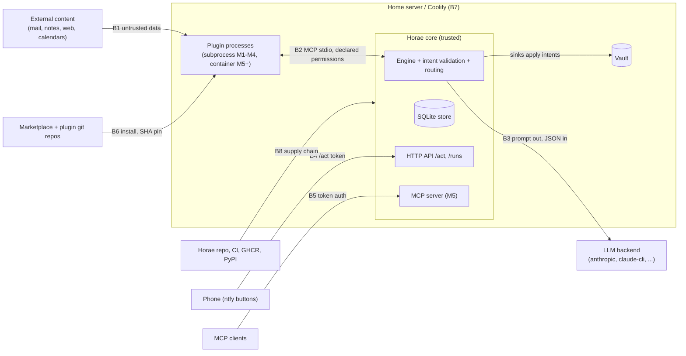

# Security model and threat model

- **Issue:** [#14](https://github.com/horae-dev/horae/issues/14) (M0). Supersedes the design note
  [0014](design/0014-threat-model-note.md); the maintainer's answers to its questions are on
  [PR #84](https://github.com/horae-dev/horae/pull/84).
- **Sources:** [PLAN.md](PLAN.md) §2, §3.3–3.5, §4, §7, §9, §10;
  [ADRs 0001–0006](adr/README.md); [schemas decisions](../schemas/README.md#decisions); the code in
  `src/horae/` and its tests.
- **Reporting a vulnerability:** see [Reporting a vulnerability](#reporting-a-vulnerability). Do not
  open a public issue.

This document says what Horae protects, from whom, and how: every threat names its control (code,
ADR or schemas decision), the test that pins it (an existing test file, or the issue that must add
one), the enforcement tier, and whether it is implemented, planned or an accepted risk. A control
without a test is not counted as implemented.

## 1. Scope and security promise

Horae is a **single-user**, self-hosted runtime ([PLAN §2.3](PLAN.md): no multi-tenancy, no SaaS).
The promise of [PLAN §2.2](PLAN.md) is what this model defends:

- control flow is declared, never chosen by an LLM; the LLM step has no tools
  ([ADR 0001](adr/0001-pipelines-not-agent-loops.md));
- plugins and the LLM never write; they propose intents from a closed set, which the core
  validates, diffs, journals and applies through a sink
  ([ADR 0002](adr/0002-intents-applied-by-the-core.md));
- a plugin gets only what its manifest declares, approved at install and pinned in `horae.lock`
  ([ADR 0003](adr/0003-mcp-as-the-plugin-protocol.md),
  [ADR 0004](adr/0004-git-marketplace-with-sha-pinning.md));
- untrusted content stays data: it can fill fields, never choose an action, a recipient or a URL
  that was not already in the input set (PLAN §2.1, tenet 5).

## 2. Method

**STRIDE per trust boundary** (confirmed on PR #84), with assets and attacker models as front
matter.

- Horae's controls are boundary-shaped (plugin host, LLM backend, `/act`, marketplace client,
  container runtime), so each boundary is walked once with STRIDE (Spoofing, Tampering,
  Repudiation, Information disclosure, Denial of service, Elevation of privilege).
- Every row has a **tier**: **D** = *declared* (M1–M4: subprocess plugins, clean environment,
  intents checked against the manifest) or **I** = *isolated* (M5+: one container per plugin,
  egress proxy, declared mounts, read-only, non-root). The residual risk before M5 is written
  down, not implied.
- Privacy threats (LLM inputs sent to a cloud backend, run-record retention) are Information
  disclosure rows; a separate LINDDUN pass was not worth it.
- **Status** is one of: **implemented** (code and a test on `main`), **planned #N** (the story
  that delivers it, with the acceptance criterion to add listed in
  [§10](#10-story-updates-requested) when it is missing), **accepted risk** (see
  [§7](#7-accepted-risks)).

## 3. Assets

| ID | Asset | Where it lives |
|---|---|---|
| A1 | Plugin secrets (`GITHUB_TOKEN`, CalDAV app passwords, IMAP credentials) | `/run/secrets` files (default) or explicit `{env: VAR}` references ([decision 25](../schemas/README.md#decisions)) |
| A2 | LLM credentials: API keys, `CLAUDE_CODE_OAUTH_TOKEN` or the user's logged-in Claude Code | secrets, Claude Code config ([ADR 0005](adr/0005-claude-cli-backend-and-its-terms.md)) |
| A3 | `/act` HMAC key | environment (PLAN §3.5) |
| A4 | Vault content (notes, tasks): personal and family data | vault mount, LiveSync CouchDB |
| A5 | Store: run records with LLM inputs, journal with note bytes before and after, LLM cache, task index, notification state | `<state_dir>/horae.db` ([ADR 0006](adr/0006-sqlite-as-the-store.md)) |
| A6 | Instance definition: `horae.yaml`, `pipelines/`, `horae.lock` (approved permissions) | instance repo, state |
| A7 | Integrity of what runs: Horae image, plugin code at a pinned commit, plugin venvs | GHCR, git, plugin directory |
| A8 | Outbound channels: ntfy topics, `http.post` targets, the MCP server | network |
| A9 | The host: home server, Docker, Coolify, other resources on shared networks | PLAN §7 |
| A10 | Budget: LLM spend per step and per day | provider account |

## 4. Trust boundaries

| Boundary | Between | Choke point |
|---|---|---|
| B1 | External content → plugins, LLM, notes | `horae.intents` validation, engine routing (`horae.engine.executor`), sinks |
| B2 | Plugin process ↔ core | plugin host (#24), `horae.intents.validate` |
| B3 | Core ↔ LLM backend | backend adapters (#28–#30), schema validation (#31) |
| B4 | Phone ↔ `/act` | `/act` endpoint (#38), SSO middleware (#41) |
| B5 | MCP clients ↔ Horae's MCP server | MCP server auth (#56) |
| B6 | Marketplace and git → installed plugin | `horae plugin add` (#43–#48), `horae.lock` |
| B7 | Horae ↔ host (Docker, Coolify, neighbours, backups) | compose files (#41), container runtime (#49) |
| B8 | Horae's own supply chain → image | CI (#11), image build (#40), release (#58) |

## 5. Attacker models

| ID | Attacker | Capability | Goal |
|---|---|---|---|
| M1 | Content author | Writes text Horae reads (email, shared calendar, web page, a note) | Prompt injection: add an action, recipient or URL; break out of a field; exfiltrate via a link |
| M2 | Malicious or compromised plugin | Arbitrary code inside a plugin process, within its declared manifest | Steal secrets, reach undeclared hosts or paths, propose undeclared intents |
| M3 | Marketplace or git-host compromise | Can change `marketplace.json`, a tag, a repo | Get malicious code installed or upgraded |
| M4 | Network or notification-path observer | Sees ntfy payloads, push relays, logs, link previews | Replay or forge `/act` tokens; read data in transit |
| M5 | Upstream dependency compromise | Malicious release of a Python package, action or base image | Code execution in CI or in the Horae image |
| M6 | Neighbour on the host | Another Coolify resource or container on a shared network | Reach Horae's API, store or plugins |
| M7 | Curious LLM provider or provider breach | Sees prompts and responses | Disclosure of personal data (A4) |

**Not defended against:** a malicious operator or root on the host; multi-tenant attacks (single
user, PLAN §2.3); physical access to the server.

## 6. Threats per boundary

Columns: **Threat → Control** (where it lives) **→ Test** (existing test file, or the issue that
must add it) **→ Tier → Status**. IDs `T01`–`T29` keep the numbering of design note 0014; `T30`
and later are new.

### B1: untrusted content → plugins, LLM, notes

| ID | STRIDE | Threat | Control | Test | Tier | Status |
|---|---|---|---|---|---|---|
| T01 | T, E | Injected text makes the LLM or a plugin add an intent, a recipient or a URL | Closed intent set ([ADR 0002](adr/0002-intents-applied-by-the-core.md)); at most one tool-less `llm` step ([ADR 0001](adr/0001-pipelines-not-agent-loops.md), [decision 14](../schemas/README.md#decisions)); routing binds every target to a trusted `act`/`notify` entry, untrusted data never chooses between entries (`intent_ambiguous`), `task.update_status` only for a fingerprint present in the collected input ([decision 30](../schemas/README.md#decisions), `horae.engine.executor`); LLM output validated against the skill's full output schema (not the provider's transformed copy) in a killable child process, with one repair retry whose errors carry only a path, a keyword and Horae's own words (never a value of the output, so no second-order injection), else `degraded`; an invalid output's intents are dropped and never routed, and a validator timeout or failure is never a pass: the step degrades at once (`validator_unavailable`, no repair, the attempt's cost charged); the validator is `ModelBackends`' default, only an explicit `UNVALIDATED` (test doubles) skips it ([decision 44](../schemas/README.md#decisions), #31); a cached output is validated again by the same validator on every reuse (an invalid entry, or one the validator cannot check, is a miss and is deleted) and its intents are validated and routed again in the reusing pipeline ([decision 45](../schemas/README.md#decisions) F and C, #32); untrusted tagging and action guard (#35) | `tests/test_engine.py` (`test_explicit_target_must_match_the_binding`, `test_task_status_needs_a_collected_fingerprint`, `test_two_notifiers_for_the_same_type_are_ambiguous`), `tests/test_contracts.py`, `tests/test_llm_validate.py` (`test_an_output_invalid_twice_is_never_applied`, `test_the_repair_prompt_holds_only_the_validation_errors`, `test_errors_name_the_path_and_keyword_and_never_a_value`, `test_a_slow_validation_is_killed_and_the_loop_stays_responsive`, `test_a_failing_worker_is_an_error_never_a_pass`, `test_a_validator_failure_degrades_at_once_without_a_repair`, `test_the_production_backends_install_the_validator`), `tests/test_llm_anthropic.py` (`test_the_validator_enforces_a_constraint_transform_schema_moved`), `tests/test_llm_cache.py` (`test_a_cached_output_is_validated_again_on_read`, `test_cross_pipeline_reuse_rechecks_the_bindings`, `test_a_cached_entry_the_validator_refuses_is_a_miss_and_deleted`); #35, #52 (injection fixture) | D | implemented (routing, closed set, schema validation #31, cache re-validation #32); planned #35, #52 |
| T02 | T | Untrusted text breaks out of its field in the note: owned-block markers, line breaks in headings, Obsidian Tasks signifiers (`📅 ⏰ ✅ 🔁`), terminal control characters in `horae diff` | Note paths reject `.` segments ([decision 4](../schemas/README.md#decisions)); `horae.apply.notes.check_text` refuses markers in content and markers or line breaks in headings; `horae.apply.render.safe` escapes Cc, Cf, Zl, Zp in diff output; notification links `https://` or `obsidian://` only ([decision 7](../schemas/README.md#decisions)) and only under a trusted `link_prefix` ([decision 30](../schemas/README.md#decisions)); Tasks signifier escaping in sinks (schemas README, "Contracts constrain shape") | `tests/test_apply.py` (`test_untrusted_content_cannot_hold_a_marker`, `test_untrusted_headings_cannot_hold_a_marker_or_a_line_break`, `test_text_output_escapes_untrusted_control_characters`), `tests/test_engine.py` (`test_notification_links_need_a_trusted_prefix`); signifiers: #42 | D | implemented (markers, paths, links, terminal); planned #42 (signifier escaping) |
| T30 | T, E | A note intent writes outside the vault or into a note Horae does not own (symlink, `..`, hidden file, someone else's note) | Owned notes only: `*.assistant.md`, decided on the path resolved without following symlinks ([decision 32](../schemas/README.md#decisions) D2); `LocalSink` / `LocalFileSink` open every segment `O_NOFOLLOW` relative to the parent descriptor, compare-and-swap on the planned SHA-256 (`src/horae/apply/local.py`) | `tests/test_apply.py` (`test_only_owned_notes_are_created_or_appended_to`, `test_local_sink_never_follows_symlinks`), `tests/test_local_file_sink.py` | D | implemented |

### B2: plugin process ↔ core

| ID | STRIDE | Threat | Control | Test | Tier | Status |
|---|---|---|---|---|---|---|
| T03 | I | A plugin reads the secrets of another plugin or of the core | Secrets resolved per name from `/run/secrets/<NAME>` only, env only through an explicit `{env: VAR}` reference ([decision 25](../schemas/README.md#decisions), `horae.secrets.SecretResolver`); secret names reject loader variables and `HORAE_` ([decision 8](../schemas/README.md#decisions)); the LLM backends (`anthropic`, `openai-compatible`, `ollama`) take their key only from the alias' declared `secret`, never from `ANTHROPIC_API_KEY`, `OPENAI_API_KEY`, `OLLAMA_HOST` or any other ambient variable (decisions 38 and 40); clean child environment with only declared secrets and the full deny list (`NODE_OPTIONS`, `*_PROXY`, `GIT_*`…) owned by the host ([decision 28](../schemas/README.md#decisions), #24) | `tests/test_secrets.py` (`test_default_lookup_is_the_secrets_directory_only`, `test_invalid_names_are_refused_before_any_lookup`), `tests/test_llm_backends_shared.py` (`test_the_ambient_environment_is_ignored`, `test_an_unresolvable_secret_fails_without_a_request`, every backend); probe plugin: #24 | D | implemented (resolution, LLM backends); planned #24 (clean environment) |
| T04 | I | Before M5 a plugin, running as the same uid, reads `/run/secrets`, the store, other venvs or `horae.yaml` from the filesystem | **Refuse non-first-party plugins until M5** (maintainer decision, PR #84): only marketplace entries with `tier: first-party` (PLAN §4) install while the runtime is `subprocess`; declared mounts from M5 (#51) | #46, #48 (refusal); #51, #52 (mounts) | D→I | planned #46, #48; planned #51 |
| T05 | I | A plugin exfiltrates to an undeclared host | Egress only through the allow-listing proxy built from `permissions.network` (M5); before M5, T04's refusal limits this to first-party code | #50, #52 | I | planned #50; accepted risk in D tier (first-party only) |
| T06 | E | A plugin proposes an intent it did not declare, or `http.post` to an undeclared host | `horae.intents.validate`: every intent checked against `permissions.intents`, `http.post` host checked with the same parsed host (`horae.contracts.url_host`) as the manifest; one invalid intent rejects the batch; permissions checked before routing | `tests/test_intent_validation.py` (`test_undeclared_intent_fails_the_step`, `test_http_post_to_undeclared_host_fails`, `test_host_undeclared_names_the_parsed_host`), `tests/test_engine.py` (`test_permissions_are_checked_before_routing`); #52 | D | implemented |
| T07 | I | `http.post` to a declared name that resolves to a private or link-local address (SSRF, DNS rebinding); a redirect to an undeclared host | URLs are `https` only, no IP literals or `localhost` ([decision 6](../schemas/README.md#decisions)); resolution through the egress proxy blocking private ranges and no redirects (schemas README, "Contracts constrain shape") | `tests/test_contracts.py` (URL rules); #50 | D/I | implemented (contract); planned #50 (private ranges, see [§10](#10-story-updates-requested)) |
| T08 | D | A plugin hangs, floods its output or crashes the run; a skill's output schema or an LLM output makes the validation hang, eat memory or flood its answer | Run timeout `runs.timeout_s` with a 5 s grace ([decision 31](../schemas/README.md#decisions)); every sink call bounded by `call_timeout_s` ([decision 34](../schemas/README.md#decisions)); stderr capped at 64 KiB per step (`horae.engine.executor`); intent payloads bounded (`MAX_INTENTS`, `MAX_BODY`, nesting 64); tool-call timeouts (#24); the LLM output validator runs in a killable child process (`python -I -B`, empty environment, `cwd` `/`, its own session, `RLIMIT_CPU` and a 256 MiB `RLIMIT_AS` on Linux), within the step's deadline, its answer read with a 64 KiB bound, and the loader caps nested `anyOf` / `oneOf` alternatives at 1024 paths ([decision 44](../schemas/README.md#decisions) C, G; #31); CPU and memory limits for plugins (#51) | `tests/test_runner.py` (`test_run_timeout_stops_the_step_and_marks_the_run`), `tests/test_undo_hardening.py` (`test_a_sink_call_past_its_timeout_stops_the_apply`), `tests/test_engine.py` (`test_stderr_is_shared_between_calls_head_and_tail`), `tests/test_intent_validation.py` (`test_huge_payloads_are_rejected_fast`), `tests/test_llm_validate.py` (`test_a_slow_validation_is_killed_and_the_loop_stays_responsive`, `test_an_error_heavy_validation_hits_the_worker_memory_ceiling`, `test_nested_alternatives_through_defs_are_refused_by_the_loader`, `test_an_endless_answer_is_read_with_a_bound_and_killed`, `test_the_worker_is_isolated`); #24, #51 | D/I | implemented (run, sink, size bounds, LLM output validator #31); planned #24, #51 |
| T09 | I | Declared secret values land in logs, stderr captures, error messages or run records | `horae.secrets.Secret` redacts `repr`, `str`, `format` and serialization, refuses pickling and copying into a subclass; resolution logs nothing; errors name the secret, never the value; `horae doctor` prints only the exception type on an internal error ([decision 27](../schemas/README.md#decisions)) and never echoes a key that may be a pasted secret ([decision 29](../schemas/README.md#decisions)); a crashed run records the exception type only ([decision 31](../schemas/README.md#decisions)); LLM backend errors are written by Horae (status and a short API error type, never the provider's text) and raised with no `__cause__` / `__context__` leading to the request that holds the key, and `horae doctor` warns when an alias sends its `secret` to an `http://` `base_url` ([decision 40](../schemas/README.md#decisions) M); the plugin host redacts stderr, messages, outputs and intents (#24, decision 35). **Redaction everywhere (#53, [decision 43](../schemas/README.md#decisions))**: a declared secret shorter than 8 bytes is refused when it is resolved (`horae doctor` reports it as an error, a run needing it is refused; decision 43 H, superseding decision 35 D); every resolved secret joins a process registry (`horae.secrets.redact`), primed with every secret the instance names; a log record factory scrubs **every** logger (message redacted, arguments and tracebacks dropped), warnings are captured into it, and `sys.excepthook` / `threading.excepthook` redact what they print; the HTTP loggers are pinned at `WARNING`; the store redacts the **free text** of every table before writing it (an allowlist: step output, parameters, error messages, stderr, input data, intent payload fields, variables, LLM output and schema errors, notification and task text) and flags the hit as a `secret_in_output` violation on the run (kept in a `secret_flags` table until the record is saved, so another `Store` still records it; a colliding redacted key is renamed, not lost); identifiers the system needs (run ids, pipeline and plugin names, kinds, timestamps, digests, journal targets, fingerprints) and a number equal to a secret are kept as written and flagged; an LLM cache entry holding a secret (string, key or number) is refused (not cached); every writable connection sets `PRAGMA secure_delete = FAST` (a one-off `VACUUM` for older databases: [retention and backups](operations/retention-and-backups.md)); a `--var` or a rendered parameter holding a secret (also as a number) refuses the run at plan time, a skill prompt or output schema holding one refuses the `llm` step before anything is sent (`params_invalid`, name only); the LLM layer redacts errors, stderr and responses; every CLI output, text and JSON, goes through the redactor, before escaping and before truncation. **Documented exceptions**: the journalled `before` bytes (and those a forced undo overwrote) are the user's own note and are kept byte for byte so that undo restores it exactly: a secret the user wrote in a note is stored in the journal as it was; the `after` bytes Horae wrote (and a sink's `actual_after`) are kept too, flagged only for a secret not already in `before` (maintainer decision); a secret equal to an identifier stays in the store (flagged), never in logs or CLI output | `tests/test_secrets.py` (`test_secret_never_shows_its_value`, `test_resolution_logs_nothing`, `test_bad_secret_files_fail_without_keeping_the_value`), `tests/test_doctor.py`, `tests/test_llm_backends_shared.py` (`test_logging_stays_quiet_and_the_secret_never_leaks`, `test_http_errors_are_mapped`), `tests/test_llm_wiring.py` (`test_doctor_warns_about_a_key_sent_over_http`), `tests/test_secret_redaction.py` (`test_every_table_redacts_free_text_and_flags_identifiers`, `test_every_encoding_is_redacted_in_the_store`, `test_every_logger_is_scrubbed_with_no_host_open`, `test_warnings_are_captured_and_scrubbed`, `test_uncaught_exceptions_are_reported_redacted`, `test_a_short_secret_is_refused_at_resolution_without_its_value`, `test_doctor_reports_a_short_secret_as_an_error`, `test_secrets_equal_to_structural_words_never_break_a_run_or_undo`, `test_journal_after_is_flagged_only_for_a_secret_new_since_before`, `test_findings_survive_another_store_instance_and_abandon_drops_them`, `test_a_parameter_holding_a_secret_refuses_the_run`, `test_safe_redacts_before_it_escapes_and_before_text_is_cut`, `test_an_llm_cache_entry_holding_a_secret_is_not_cached`, `test_journal_before_bytes_restore_byte_exact`, `test_the_walking_skeleton_never_stores_logs_or_prints_an_echoed_secret`, with an independent decoding oracle), `tests/test_plugin_host.py` (`test_a_short_declared_secret_is_refused_and_never_shown`) | D | implemented (#24, #53) |
| T31 | T | A source plugin has side effects during `horae run --dry-run` (it writes or posts itself) | A dry run calls no sink and applies nothing ([decision 32](../schemas/README.md#decisions) D5); what the plugin process itself does is outside the guard (see [§7](#7-accepted-risks)); read-only filesystem and egress proxy in M5 | `tests/test_dry_run.py` (`test_the_engine_calls_no_sink_during_a_dry_run`, `test_horae_diff_writes_nothing`); #49, #50 | D→I | implemented (core); accepted risk in D tier |

### B3: core ↔ LLM backend

| ID | STRIDE | Threat | Control | Test | Tier | Status |
|---|---|---|---|---|---|---|
| T10 | I | A secret or personal data inside source output is sent to a cloud LLM, or to an endpoint other than the one declared | **De-identification (#34, [decision 47](../schemas/README.md#decisions))**: the fields a skill classifies in its input view (`person`, `email`, `phone`, `place`, `amount`, `free_text`) are pseudonymized before any **cloud** alias (`ModelAlias.local`, explicit; default: `ollama` local, every other backend cloud; never inferred from `base_url`): `[PERSON_1]`-style pseudonyms, stable per run and deterministic from the input, amounts as buckets, and in `free_text` the instance vocabulary (a file in `secrets.dir`, never in the instance repo) and the classed values, matched as whole words; the mapping exists only in memory (the record keeps what the provider saw, a digest and counts; the cache stores the pseudonymized output; the ledger holds no data); the accepted output and intents are re-identified after validation and before routing (unknown or mangled pseudonyms are left and noted); a classified request to a cloud alias that was not de-identified is refused (`deid_required`), an unreadable vocabulary degrades the step (`deid_unavailable`) and is a `horae doctor` error. **No secret in a request (T10)**: render, then send (decision 38): before any backend sends, the exact frozen body (`RenderedRequest.body()`) is scanned for every resolved secret in all its encodings (raw bytes and decoded JSON strings, keys, numbers); a match refuses the attempt with `secret_in_request` (names only; the log gives their count), nothing is sent or billed (the ledger releases the reservation), the step is `degraded` and a `secret_in_request` violation is recorded. Limits: values in fields the skill did not classify are sent as they are (the input view is the primary control), free-text matching misses nicknames and typos. Each alias sends to one endpoint only: `anthropic` to `/v1/messages`, `openai-compatible` to `<base_url>/chat/completions` (OpenRouter, Mistral, vLLM...), `ollama` to `<base_url>/api/chat`; any other origin, path or query is refused, no redirect is followed, no ambient proxy is used, and a `base_url` with `.` / `..` segments or `%2F` / `%2E` / `%5C` is refused ([decision 40](../schemas/README.md#decisions) B, N). `http://` is allowed to loopback, private and single-label host names only (decision 24) **and** is checked when connecting: every resolved address must be loopback, RFC 1918 or IPv6 ULA (not link-local or CGNAT), then the connection goes to that address (no rebinding) ([decision 40](../schemas/README.md#decisions) L). OpenRouter routing to sub-providers is not configurable yet | `tests/test_llm_backends_shared.py` (`test_a_tampered_request_is_refused_with_its_reason`, `test_a_redirect_is_not_followed`, `test_an_http_endpoint_resolving_off_the_lan_is_refused`, `test_an_http_backend_resolving_to_a_public_address_sends_nothing`), `tests/test_llm_openai_ollama.py` (`test_plain_http_to_a_public_host_is_refused`, `test_a_base_url_path_that_could_traverse_is_refused`), `tests/test_deid.py` (`test_classed_fields_never_reach_a_cloud_request`, `test_a_local_alias_is_sent_the_viewed_input_unchanged`, `test_without_a_policy_a_classified_cloud_request_is_refused`, `test_the_store_keeps_no_original_of_a_classed_value`, `test_a_request_holding_a_secret_is_refused_by_every_backend`, `test_a_refused_request_is_not_billed`, `test_the_engine_degrades_and_records_a_violation`) | D | implemented (endpoints, LAN check, #34 de-identification and secret check) |
| T11 | I, E | `claude-cli` exposes user configuration, tools or the OAuth token | Isolated empty config, env allowlist, built-in tools disabled, no user settings ([ADR 0005](adr/0005-claude-cli-backend-and-its-terms.md)); Horae never handles OAuth; re-verified per Claude Code release | #29 (fake binary) | D | planned #29 |
| T12 | D | Runaway spend (loop, injection-inflated input), or spend hidden by a provider that under-reports its usage | One LLM step, `on_unchanged_input: skip` ([decision 15](../schemas/README.md#decisions)); a pre-flight check that the attempt can afford one output token and `max_tokens` sized from the step budget (decision 38 B); reported usage is untrusted: counts above `10**12` are unusable and charged conservatively (the input bound and the whole `max_tokens`), and a usable report is floored at a quarter of the request bytes and of the output bytes ([decision 40](../schemas/README.md#decisions) K); a failed call is charged too (`output_invalid` carries its usage); budgets per step and per day with a usage ledger, the day's allowance reserved before each call so that concurrent runs cannot jointly exceed it, a settled cost above its reservation flagged ([decision 41](../schemas/README.md#decisions), #33); input-hash cache, the $0 path: an unchanged input makes no call within `cache.ttl_s` (default 7 days) and a hit is charged zero, an expired entry asks the model once per `ttl_s` ([decision 45](../schemas/README.md#decisions), #32); provider spend limits (#63) | `tests/test_contracts.py` (budget fields required), `tests/test_llm_backends_shared.py` (`test_an_exhausted_budget_sends_nothing`, `test_absurd_token_counts_are_charged_conservatively`, `test_a_zero_usage_is_floored_by_the_request_and_output_sizes`, `test_missing_usage_is_charged_conservatively`), `tests/test_budgets.py` (step and daily ceilings, two processes), `tests/test_llm_cache.py` (`test_unchanged_input_makes_no_llm_call`, `test_unchanged_input_makes_no_call_across_processes`) | D | implemented (pre-flight, untrusted usage), done #33, #32; planned #63 |
| T33 | D | A malicious or compromised LLM endpoint exhausts memory or crashes the run with its response (huge or chunked body, gzip bomb, non-UTF-8, absurd numbers, an unexpected shape) | `accept-encoding: identity`; every backend's transport is wrapped by `BoundedTransport`: a success body at most `min(8 MiB, max(1 MiB, 64 × max_tokens))` bytes once decoded, refused on its `content-length` or as soon as it passes the cap; `gzip` / `deflate` inflated by Horae in bounded steps, other encodings refused; error bodies cut at 64 KiB; strict UTF-8 and strict JSON; any unexpected failure reading the result is `output_invalid` with the conservative usage, never a crash ([decision 40](../schemas/README.md#decisions) I, J) | `tests/test_llm_backends_shared.py` (`test_a_gzip_bomb_is_refused_with_bounded_memory`, `test_a_body_announced_over_the_cap_is_refused_unread`, `test_a_streamed_body_over_the_cap_is_refused`, `test_an_error_body_is_cut_at_64_kib`, `test_a_body_that_is_not_utf8_is_output_invalid`, `test_an_unexpected_failure_reading_the_result_is_output_invalid`) | D | implemented |

### B4: phone ↔ `/act`

| ID | STRIDE | Threat | Control | Test | Tier | Status |
|---|---|---|---|---|---|---|
| T13 | S | A stolen or replayed `/act` token | HMAC-signed, single use, 24 h expiry, bound to one intent, no secrets or free-form URLs, rate limited (#38) | #38 | D | planned #38 |
| T14 | T | A link preview or prefetch consumes a single-use token; CSRF on `/act` | `GET /act/<token>` only shows a confirmation and changes nothing; `POST` applies | #38 | D | planned #38 (see [§10](#10-story-updates-requested)) |
| T15 | I | `/act` is reachable without SSO (PLAN §7); a misconfiguration exempts more than `/act/` | Only `/act/` bypasses SSO; `/runs` and `/healthz` behind SSO; no secrets in responses (#37) | #37; SSO-exemption test: #41 | D | planned #37, #41 |
| T16 | S | The HMAC key leaks or is never rotated | A dedicated key (a secret, not a shared one); rotation invalidates every outstanding token | #38 | D | planned #38 (see [§10](#10-story-updates-requested)) |

### B5: MCP clients ↔ Horae's MCP server

| ID | STRIDE | Threat | Control | Test | Tier | Status |
|---|---|---|---|---|---|---|
| T17 | S, E | An unauthenticated MCP client runs a pipeline or reads tasks | Token auth, hashed and revocable (#56); read-only tools (#54); `pipeline.run` only as a dry run plus an expiring approval (#55) | #54, #55, #56 | I | planned #54, #55, #56 |

### B6: marketplace and git → installed plugin

| ID | STRIDE | Threat | Control | Test | Tier | Status |
|---|---|---|---|---|---|---|
| T18 | T | A moved tag or rewritten branch changes installed code | `horae.lock` `commit` is a full 40- or 64-hex id, never a tag or short SHA ([decision 20](../schemas/README.md#decisions), `horae.contracts.lockfile`); checkout of the pinned SHA, refusal on tag/SHA mismatch ([ADR 0004](adr/0004-git-marketplace-with-sha-pinning.md)) | `tests/test_contracts.py` (lockfile examples); #44, #48 | D | implemented (contract); planned #44, #48 |
| T19 | T, E | A compromised marketplace points a name at a malicious commit | Permission approval at install is the main defence ([ADR 0004](adr/0004-git-marketplace-with-sha-pinning.md)); non-first-party refused before M5 (T04); signed tags are "later" (PLAN §4) | #46 | D | planned #46; accepted risk (no signed tags yet) |
| T20 | E | An upgrade silently widens permissions; a run uses permissions that were not approved | Permission diff and re-approval (#47); a run refuses plugins whose permissions differ from the lock (#46); run records carry `lock_digest` and replay refuses a changed lock ([decision 33](../schemas/README.md#decisions)) | `tests/test_runner.py` (`test_the_record_keeps_lock_config_digests_models_and_definition`), `tests/test_replay.py`; #46, #47 | D | implemented (digests); planned #46, #47 |
| T21 | T | A malicious URL or protocol in a clone (`ext::`, `file://`, option injection) | Lockfile `repo` is `https://` only ([decision 6](../schemas/README.md#decisions), [decision 20](../schemas/README.md#decisions)); `git clone -- <repo>` with `protocol.allow` restricted to `https` ([ADR 0004](adr/0004-git-marketplace-with-sha-pinning.md)) | `tests/test_contracts.py`; #44 | D | implemented (contract); planned #44 (see [§10](#10-story-updates-requested)) |
| T22 | T | Plugin dependencies are resolved unpinned at install time | Per-plugin venv (#45) built from the plugin's lock file with hashes | #45 | D | planned #45 (see [§10](#10-story-updates-requested)) |
| T23 | R | No trace of which plugin did what | Run records carry each plugin's version and commit, `lock_digest`, `intents[].proposed_by` and `applied_by` ([decision 21](../schemas/README.md#decisions), [decision 30](../schemas/README.md#decisions)); the journal records `applied_by` and `sink_identity` ([decision 34](../schemas/README.md#decisions)); `horae plugin audit` (#47) | `tests/test_engine.py` (`test_run_record_rejects_impossible_routes`), `tests/test_undo_hardening.py` (`test_the_journal_records_where_each_change_was_written`); #47 | D | implemented (records, journal); planned #47 |

### B7: Horae ↔ host

| ID | STRIDE | Threat | Control | Test | Tier | Status |
|---|---|---|---|---|---|---|
| T26 | E | The container runtime needs the Docker socket: a Horae compromise becomes host root | None beyond keeping the core small and reviewed; documented in the deployment docs | #49 (documentation) | I | **accepted risk** ([§7](#7-accepted-risks)) |
| T27 | I | A neighbour container on a shared Coolify network reaches Horae or its plugins | `internal: true` plugin network (M5, #49); `mcp-http` is `https` only ([decision 6](../schemas/README.md#decisions)); fallback bearer token and IP allow-list for cross-resource networking (#74) | #49; #74 | D/I | planned #49; risk #74 |
| T28 | I | Backups or long-lived run records leak LLM inputs, journal note bytes and vault data | State directory 0700, database and its `-wal`/`-shm` 0600 (`Store.open`, umask 0077); `Store.prune_runs` deletes old runs with their steps, journal and unreferenced blobs; LLM cache retention: entries expire after `cache.ttl_s` (default 7 days), at most `cache.max_entries` (default 1000) are kept, both purged at the start of every non-dry run, the entries of an undone run are deleted, and `horae cache purge` deletes on demand ([decision 45](../schemas/README.md#decisions), #32); interim operator guidance in [operations/retention-and-backups.md](operations/retention-and-backups.md); a retention workflow to revisit in [design note 0014a](design/0014a-retention-workflow.md) | `tests/test_store.py` (`test_state_files_are_private`, `test_prune_runs_cascades_and_collects_orphan_blobs`), `tests/test_llm_cache.py` (`test_runs_purge_expired_and_surplus_entries`, `test_horae_cache_purge`, `test_undo_invalidates_the_entry_of_the_run`) | D | implemented (file modes, pruning API, LLM cache expiry and purge #32); accepted risk until 0014a is decided |
| T29 | I | The vault CouchDB is exposed without SSO | LiveSync E2EE and path obfuscation on (PLAN §7) | #64, #65 (manual); risk #71 | D | planned #64, #65 |
| T32 | T | Two processes apply or undo at once and corrupt a note or the journal | Per-pipeline `flock` and the instance-wide apply lock (lock files 0600, directory 0700, `O_NOFOLLOW`) ([decision 31](../schemas/README.md#decisions), [decision 34](../schemas/README.md#decisions)); compare-and-swap writes | `tests/test_runner.py` (`test_lock_files_are_private_and_probing_creates_nothing`, `test_two_processes_one_pipeline_the_second_exits_with_a_lock_message`), `tests/test_undo_hardening.py` (`test_a_run_waits_for_the_apply_lock_then_fails`) | D | implemented |

### B8: Horae's own supply chain

| ID | STRIDE | Threat | Control | Test | Tier | Status |
|---|---|---|---|---|---|---|
| T24 | T | A compromised dependency, action or base image in Horae | `uv.lock` and Renovate; actions pinned to commit SHAs, checksum-verified gitleaks, CodeQL (`.github/workflows/ci.yml`, #11); SBOM (#40); **signed images from the first `edge` image** (maintainer decision, PR #84; was M8 in #58); PyPI trusted publishing (#58); org 2FA and push protection (#62) | CI itself (#11); #40, #58, #62 | — | implemented (#11); planned #40, #58, #62 |
| T25 | T | Insecure security code written by agents | Human-led stories and Graft sensitive paths (`graft.yaml`, [AGENTS.md](../AGENTS.md#review)), `docs/security.md` added to them (maintainer decision, PR #84); malicious-plugin suite (#52); risk #69 | `tests/test_graft_policy.py`; #52, #61 | — | implemented (policy); planned #52, #61 |

## 7. Accepted risks

Recorded as accepted by the maintainer (PR #84) or by an accepted decision. Each is revisited at the
milestone named.

1. **Docker socket = host root (T26), until further notice.** The M5 container runtime (#49) needs
   to start containers; with the Docker socket mounted, code execution in the Horae core is root on
   the host. A socket proxy or rootless Docker were considered and not required for now. Keep the
   core's attack surface small (B2 and B4 are the entry points) and keep Horae on a host that holds
   nothing more valuable than what Horae already reads.
2. **The dry-run write guard does not cover `ctypes`, C extensions or plugin subprocesses (T31).**
   `tests/test_dry_run.py` proves that the core writes nothing but its own store during a dry run:
   Python-level writes, metadata changes, sockets, name resolution, SQLite connections and process
   creation ([decision 32](../schemas/README.md#decisions) D5). Writes made below Python, and
   anything a plugin process does itself, are outside it. A dry run guarantees that no intent is
   applied, not that a plugin has no side effects; the M5 read-only filesystem and egress proxy
   narrow this.
3. **`/proc/<horae-pid>/environ` before M5.** A plugin subprocess running as Horae's uid can read
   Horae's environment. Mitigated by file-based secrets: a secret is read from
   `/run/secrets/<NAME>` unless an explicit `{env: VAR}` reference says otherwise
   ([decision 25](../schemas/README.md#decisions)), so a deployment that uses secret files keeps
   secret values out of the environment. The files themselves stay readable by the same uid until
   M5 mounts, which is why non-first-party plugins are refused before M5 (T04).
4. **First-party trust in the D tier (T04, T05).** Between M1 and M4 a plugin is a subprocess with
   the core's uid and network: the D tier constrains what it can make the core do, not what the
   process can do. Accepted for first-party plugins only (PLAN §3.3, ADR 0003); others are refused
   until M5.
5. **No signed marketplace tags (T19).** Approval of permissions at install and SHA pinning are the
   defence; signed tags are "later" (PLAN §4).
6. **Retention is manual (T28).** Until the workflow of [design note
   0014a](design/0014a-retention-workflow.md) is decided, pruning and backup encryption are operator
   tasks ([operations/retention-and-backups.md](operations/retention-and-backups.md)).
7. **A secret written in a note is journalled as it is (T09, #53).** Undo restores a note byte for
   byte, so the store keeps the note's `before` bytes (and the bytes a forced undo overwrote)
   without redaction ([decision 43](../schemas/README.md#decisions) C, maintainer answer 2 on
   PR #100). A secret the user pasted in a note Horae changes is therefore in the store, as it
   is in the vault; the `after` bytes Horae wrote are kept too, and a secret there is recorded
   as a `secret_in_output` violation only when it is not already in `before` (maintainer
   decision on PR #106). Identifiers the system needs (a run id, a pipeline or plugin name, a
   journal target, a task fingerprint...) are kept as written too and flagged, never rewritten
   ([decision 43](../schemas/README.md#decisions) B): a secret equal to one of them is in the
   store (not in the logs or the CLI output). The rest of what the store writes, its free
   text, is redacted.

## 8. Out of scope (for now)

- **M6, existing MCP services** (`plugin-mcp-brief`, the finance and training coaches, joining
  their Coolify networks) and **M7, mail and school** (`plugin-imap`, `plugin-gmail`,
  `plugin-school-fr`, school credentials, Proton Mail Bridge). Their boundaries are added to this
  document when those milestones start (maintainer decision, PR #84).
- A malicious operator or root on the host, multi-tenancy and physical access (see §5).

## 9. Reporting a vulnerability

**Do not open a public issue.** Use GitHub's private vulnerability reporting: the **Security** tab
of this repository, then **Report a vulnerability**. The policy (what to include, response time,
scope, supported versions) is the organisation's
[`SECURITY.md`](https://github.com/horae-dev/.github/blob/main/SECURITY.md), which GitHub applies to
every `horae-dev` repository.

**Keeping this document current:** a PR that adds or changes a control on a boundary updates its
row (control, test, status). A new boundary, plugin runtime or interface gets its rows before it is
merged. `docs/security.md` is a Graft sensitive path, so changes need the maintainer.

## 10. Story updates requested

The maintainer chose to extend existing stories rather than open new ones (PR #84). Acceptance
criteria to add, per issue:

- **#42 Plugin SDK (Python)**, T02:
  - [ ] Intent builders escape the Obsidian Tasks emoji signifiers (`📅`, `⏰`, `✅`, `🔁`, `➕`,
        `⏳`, `🛫`, priorities) and Markdown in task titles, and sinks writing Tasks syntax use
        them (tested with a title holding every signifier)
- **#46 Permission approval and lockfile**, T04:
  - [ ] While plugins run as subprocesses (before M5), installing a marketplace plugin whose tier is
        not `first-party` is refused (tested)
- **#48 Direct install from a git URL**, T04:
  - [ ] Before M5, a direct install (no marketplace tier) is refused (tested)
- **#34 De-identification transform**, T10:
  - [x] A request to a cloud backend that contains the value of any resolved secret is refused
        before it is sent, and the run is marked `degraded` without logging the value (tested)
- **#38 Signed single-use action links (/act)**, T14, T16:
  - [ ] `GET /act/<token>` only shows a confirmation page and consumes nothing; `POST` applies
        (tested: a GET, as a link preview does, leaves the token usable)
  - [ ] The HMAC key is a dedicated secret; rotating it invalidates every outstanding token (tested)
- **#41 Coolify template and plain compose**, T15:
  - [ ] Only `/act/` is exempt from the SSO middleware; `/runs` and `/healthz` require SSO (tested
        against the rendered template)
- **#44 Install from git with pinned commit**, T21:
  - [ ] Clones run as `git clone -- <repo>` with `protocol.allow` limited to `https`; `ext::`,
        `file://` and option-like URLs are refused (tested)
- **#45 Per-plugin virtual environments**, T22:
  - [ ] A plugin's dependencies install only from its committed lock file with hashes
        (`uv sync --locked`); a plugin without one is refused (tested)
- **#49 Per-plugin container runtime**, T26:
  - [ ] The deployment docs state that mounting the Docker socket makes a Horae compromise
        equivalent to host root, an accepted risk (docs/security.md §7)
- **#29 claude-cli backend with isolation**, T11:
  - [ ] The isolation test is re-run against each new Claude Code release before the pinned
        version is bumped
- **#40 Container image and GHCR publishing**, T24:
  - [ ] `edge` and release images are signed with cosign and the signature is verified in CI
- **#53 Secret redaction in logs and run records**, T09: move from **M5 Hard isolation** to **M1
  Walking skeleton** (or M2 at the latest); its AC is unchanged.

Also suggested (from the table, not in the maintainer's answers):

- **#50 Egress allow-list proxy**, T07:
  - [ ] A declared host that resolves to a private, loopback or link-local address is blocked
        (tested)
