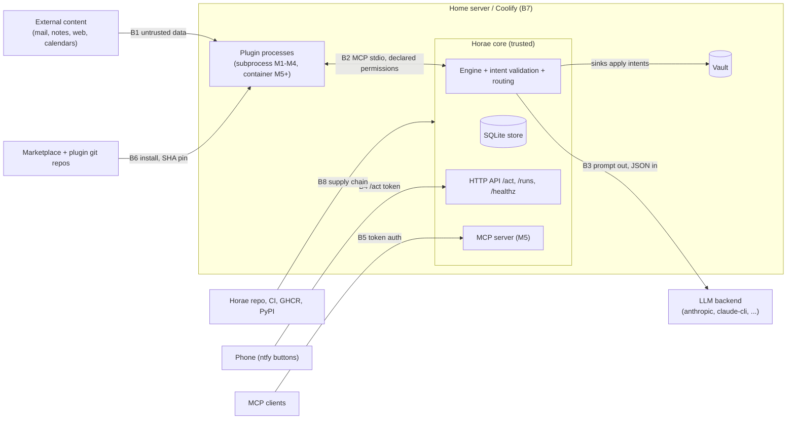

# Security model and threat model

- **Issue:** [#14](https://github.com/horae-dev/horae/issues/14) (M0). Supersedes the design note
  [0014](design/0014-threat-model-note.md); the maintainer's answers to its questions are on
  [PR #84](https://github.com/horae-dev/horae/pull/84).
- **Sources:** [PLAN.md](PLAN.md) §2, §3.3–3.5, §4, §7, §9, §10;
  [ADRs 0001–0006](adr/README.md); [schemas decisions](../schemas/README.md#decisions); the code in
  `src/horae/` and its tests.
- **Reporting a vulnerability:** see [Reporting a vulnerability](#reporting-a-vulnerability). Do not
  open a public issue.

This document says what Horae protects, from whom, and how: every threat names its control (code,
ADR or schemas decision), the test that pins it (an existing test file, or the issue that must add
one), the enforcement tier, and whether it is implemented, planned or an accepted risk. A control
without a test is not counted as implemented.

## 1. Scope and security promise

Horae is a **single-user**, self-hosted runtime ([PLAN §2.3](PLAN.md): no multi-tenancy, no SaaS).
The promise of [PLAN §2.2](PLAN.md) is what this model defends:

- control flow is declared, never chosen by an LLM; the LLM step has no tools
  ([ADR 0001](adr/0001-pipelines-not-agent-loops.md));
- plugins and the LLM never write; they propose intents from a closed set, which the core
  validates, diffs, journals and applies through a sink
  ([ADR 0002](adr/0002-intents-applied-by-the-core.md));
- a plugin gets only what its manifest declares, approved at install and pinned in `horae.lock`
  ([ADR 0003](adr/0003-mcp-as-the-plugin-protocol.md),
  [ADR 0004](adr/0004-git-marketplace-with-sha-pinning.md));
- untrusted content stays data: it can fill fields, never choose an action, a recipient or a URL
  that was not already in the input set (PLAN §2.1, tenet 5).

## 2. Method

**STRIDE per trust boundary** (confirmed on PR #84), with assets and attacker models as front
matter.

- Horae's controls are boundary-shaped (plugin host, LLM backend, `/act`, marketplace client,
  container runtime), so each boundary is walked once with STRIDE (Spoofing, Tampering,
  Repudiation, Information disclosure, Denial of service, Elevation of privilege).
- Every row has a **tier**: **D** = *declared* (M1–M4: subprocess plugins, clean environment,
  intents checked against the manifest) or **I** = *isolated* (M5+: one container per plugin,
  egress proxy, declared mounts, read-only, non-root). The residual risk before M5 is written
  down, not implied.
- Privacy threats (LLM inputs sent to a cloud backend, run-record retention) are Information
  disclosure rows; a separate LINDDUN pass was not worth it.
- **Status** is one of: **implemented** (code and a test on `main`), **planned #N** (the story
  that delivers it, with the acceptance criterion to add listed in
  [§10](#10-story-updates-requested) when it is missing), **accepted risk** (see
  [§7](#7-accepted-risks)).

## 3. Assets

| ID | Asset | Where it lives |
|---|---|---|
| A1 | Plugin secrets (`GITHUB_TOKEN`, CalDAV app passwords, IMAP credentials) | `/run/secrets` files (default) or explicit `{env: VAR}` references ([decision 25](../schemas/README.md#decisions)) |
| A2 | LLM credentials: API keys, `CLAUDE_CODE_OAUTH_TOKEN` or the user's logged-in Claude Code | secrets, Claude Code config ([ADR 0005](adr/0005-claude-cli-backend-and-its-terms.md)) |
| A3 | `/act` HMAC key | `HORAE_ACT_KEY`: `<secrets.dir>/HORAE_ACT_KEY`, else the environment (PLAN §3.5, [decision 54](../schemas/README.md#decisions) E) |
| A4 | Vault content (notes, tasks): personal and family data | vault mount, LiveSync CouchDB |
| A5 | Store: run records with LLM inputs, journal with note bytes before and after, LLM cache, task index, notification state | `<state_dir>/horae.db` ([ADR 0006](adr/0006-sqlite-as-the-store.md)) |
| A6 | Instance definition: `horae.yaml`, `pipelines/`, `horae.lock` (approved permissions) | instance repo, state |
| A7 | Integrity of what runs: Horae image, plugin code at a pinned commit, plugin venvs | GHCR, git, plugin directory |
| A8 | Outbound channels: ntfy topics, `http.post` targets, the MCP server | network |
| A9 | The host: home server, Docker, Coolify, other resources on shared networks | PLAN §7 |
| A10 | Budget: LLM spend per step and per day | provider account |

## 4. Trust boundaries

| Boundary | Between | Choke point |
|---|---|---|
| B1 | External content → plugins, LLM, notes | `horae.intents` validation, engine routing (`horae.engine.executor`), sinks |
| B2 | Plugin process ↔ core | plugin host (#24), `horae.intents.validate` |
| B3 | Core ↔ LLM backend | backend adapters (#28–#30), schema validation (#31) |
| B4 | Phone ↔ `/act` | `/act` endpoint (#38), SSO middleware (#41) |
| B5 | MCP clients ↔ Horae's MCP server | MCP server auth (#56) |
| B6 | Marketplace and git → installed plugin | `horae plugin add` (#43–#48), `horae.lock` |
| B7 | Horae ↔ host (Docker, Coolify, neighbours, backups) | compose files (#41), container runtime (#49) |
| B8 | Horae's own supply chain → image | CI (#11), image build (#40), release (#58) |

## 5. Attacker models

| ID | Attacker | Capability | Goal |
|---|---|---|---|
| M1 | Content author | Writes text Horae reads (email, shared calendar, web page, a note) | Prompt injection: add an action, recipient or URL; break out of a field; exfiltrate via a link |
| M2 | Malicious or compromised plugin | Arbitrary code inside a plugin process, within its declared manifest | Steal secrets, reach undeclared hosts or paths, propose undeclared intents |
| M3 | Marketplace or git-host compromise | Can change `marketplace.json`, a tag, a repo | Get malicious code installed or upgraded |
| M4 | Network or notification-path observer | Sees ntfy payloads, push relays, logs, link previews | Replay or forge `/act` tokens; read data in transit |
| M5 | Upstream dependency compromise | Malicious release of a Python package, action or base image | Code execution in CI or in the Horae image |
| M6 | Neighbour on the host | Another Coolify resource or container on a shared network | Reach Horae's API, store or plugins |
| M7 | Curious LLM provider or provider breach | Sees prompts and responses | Disclosure of personal data (A4) |

**Not defended against:** a malicious operator or root on the host; multi-tenant attacks (single
user, PLAN §2.3); physical access to the server.

## 6. Threats per boundary

Columns: **Threat → Control** (where it lives) **→ Test** (existing test file, or the issue that
must add it) **→ Tier → Status**. IDs `T01`–`T29` keep the numbering of design note 0014; `T30`
and later are new.

### B1: untrusted content → plugins, LLM, notes

| ID | STRIDE | Threat | Control | Test | Tier | Status |
|---|---|---|---|---|---|---|
| T01 | T, E | Injected text makes the LLM or a plugin add an intent, a recipient or a URL | Closed intent set ([ADR 0002](adr/0002-intents-applied-by-the-core.md)); at most one tool-less `llm` step ([ADR 0001](adr/0001-pipelines-not-agent-loops.md), [decision 14](../schemas/README.md#decisions)); routing binds every target to a trusted `act`/`notify` entry, untrusted data never chooses between entries (`intent_ambiguous`), `task.update_status` only for a fingerprint present in the collected input ([decision 30](../schemas/README.md#decisions), `horae.engine.executor`), and, for a skill that opts in with `task_fingerprint`, a `task.create` only for `prefix` + an id of its viewed input, else a `guard` violation ([decision 67](../schemas/README.md#decisions), `horae.engine.guard`); LLM output validated against the skill's full output schema (not the provider's transformed copy) in a killable child process, with one repair retry whose errors carry only a path, a keyword and Horae's own words (never a value of the output, so no second-order injection), else `degraded`; an invalid output's intents are dropped and never routed, and a validator timeout or failure is never a pass: the step degrades at once (`validator_unavailable`, no repair, the attempt's cost charged); the validator is `ModelBackends`' default, only an explicit `UNVALIDATED` (test doubles) skips it ([decision 44](../schemas/README.md#decisions), #31); a cached output is validated again by the same validator on every reuse (an invalid entry, or one the validator cannot check, is a miss and is deleted) and its intents are validated and routed again in the reusing pipeline ([decision 45](../schemas/README.md#decisions) F and C, #32); the action guard on every LLM proposal, fresh or reused, after schema validation and before routing (`horae.engine.guard`, [decision 46](../schemas/README.md#decisions), #35): at most the skill's `intents: {type: max}` per type, every URL in note, task, notification and `http.post` text an exact string of the viewed input, a violation degrades the whole step (nothing routed) with a content-free `guard` violation naming only the pipeline's `skill:<namespace>/<skill>`, a refused cache entry is a miss and is deleted (`discard` is a member of the `LlmCache` port, so mypy enforces it; `NoDiscardCache` is the documented no-op) | `tests/test_engine.py` (`test_explicit_target_must_match_the_binding`, `test_task_status_needs_a_collected_fingerprint`, `test_two_notifiers_for_the_same_type_are_ambiguous`), `tests/test_contracts.py`, `tests/test_llm_validate.py` (`test_an_output_invalid_twice_is_never_applied`, `test_the_repair_prompt_holds_only_the_validation_errors`, `test_errors_name_the_path_and_keyword_and_never_a_value`, `test_a_slow_validation_is_killed_and_the_loop_stays_responsive`, `test_a_failing_worker_is_an_error_never_a_pass`, `test_a_validator_failure_degrades_at_once_without_a_repair`, `test_the_production_backends_install_the_validator`), `tests/test_llm_anthropic.py` (`test_the_validator_enforces_a_constraint_transform_schema_moved`), `tests/test_llm_cache.py` (`test_a_cached_output_is_validated_again_on_read`, `test_cross_pipeline_reuse_rechecks_the_bindings`, `test_a_cached_entry_the_validator_refuses_is_a_miss_and_deleted`), `tests/test_action_guard.py` (`test_an_injected_url_or_embed_degrades_the_whole_step`, `test_urls_must_be_in_the_input`, `test_a_guarded_cache_hit_is_a_miss_and_is_deleted`, `test_per_type_limits`, `test_the_source_must_be_a_skill_reference`), `tests/test_engine_skills.py` (`test_intent_limits_are_enforced_per_step`), `tests/test_llm_skip_guard.py` (`test_an_invented_id_is_refused_as_a_guard_violation`); #52 (injection fixture) | D | implemented (routing, closed set, schema validation #31, cache re-validation #32, action guard #35); planned #52 (plugin proposals) |
| T02 | T | Untrusted text breaks out of its field in the note: owned-block markers, line breaks in headings, Obsidian Tasks signifiers (`📅 ⏰ ✅ 🔁`), terminal control characters in `horae diff` | Note paths reject `.` segments ([decision 4](../schemas/README.md#decisions)); `horae.apply.notes.check_text` refuses markers in content and markers or line breaks in headings; `horae.apply.render.safe` escapes Cc, Cf, Zl, Zp in diff output; notification links `https://` or `obsidian://` only ([decision 7](../schemas/README.md#decisions)) and only under a trusted `link_prefix` ([decision 30](../schemas/README.md#decisions)); task links (`task.create` `link`) `https://` only, a host name (no IP literal), no user info, backslash, or control, format or separator character (Unicode `Cc`, `Cf`, `Zs`, `Zl`, `Zp`, lone surrogates), routed only under the `mode: tasks` entry's trusted `https://` `link_prefix`, and written by `horae_sdk.tasks.task_line` after the escaped title as a fixed-text Markdown link, followed by the `⏰` reminder and then the Tasks date fields (so a trailing `⏰` cannot hide `📅`; readers accept both orders, [decision 53](../schemas/README.md#decisions)) and, with a fingerprint, a last `^h-` block id (48 bits: a sink's index must fail closed on a collision) whose destination is percent-encoded (`( ) [ ] < >`, backtick, `$`, non-ASCII, a stray `%`, the `&` of an entity, the second `:` of `::` and `=` of `==`), so neither the title nor the URL can forge a link, a field or a pair, and a destination over 4096 characters is left out of the line ([decision 52](../schemas/README.md#decisions), #122; line order and block id, decision 53, #127); in LLM text, control and format characters (tab, zero-width, bidi), Markdown images and Obsidian `![[…]]` embeds, any tag-like token other than an exact attribute-less inert tag (`<b>`, `
`, ` `…) or a plain autolink, link destinations or tags holding whitespace or a backslash (every check also runs with Markdown escapes removed), `javascript:` / `vbscript:` / `data:` / `file:` / `blob:` links and protocol-relative (`//`, `\\`) links are always refused, also entity-encoded, in mixed case or split by whitespace, and a text still holding entities after three decoding passes is refused (fails closed); link definitions are found behind blockquote and list prefixes, footnotes get no exemption; the Obsidian rendering surface in note and notification text: Dataview, Templater, Mermaid, script, HTML, button and query code fences, Templater `<%` `%>` markers, Dataview inline queries, Mermaid `click` directives, wikilinks to URLs and, in note content, a frontmatter block are refused (provisional hardening, [decision 46](../schemas/README.md#decisions), #35); in LLM `note.*` text (content and heading, on the source as written, inside code too), task checkbox list items (any status character, ordered markers with any number of digits, behind list, blockquote and callout prefixes), any Tasks signifier (with or without U+FE0F), any wikilink, Dataview inline field (`::`), `%%` comment, `#tag` and plain-text `horae:begin` / `horae:end` marker (the apply recogniser, so the step degrades instead of apply failing) are refused, and a skill with `links: none` gets no link, autolink or bare URL in its note text even from its input ([decision 55](../schemas/README.md#decisions), #128); Tasks signifier and Markdown escaping of task titles: `horae_sdk.tasks.escape_title` (signifiers as character references, markup backslash-escaped, no `::` / `%%` / `==` pair, no bare-URL autolink, idempotent, total), used by the SDK's `intents.task_create` and by `tasks.task_line` for sinks writing Tasks syntax (#42, [decision 50](../schemas/README.md#decisions)) | `tests/test_apply.py` (`test_untrusted_content_cannot_hold_a_marker`, `test_untrusted_headings_cannot_hold_a_marker_or_a_line_break`, `test_text_output_escapes_untrusted_control_characters`), `tests/test_engine.py` (`test_notification_links_need_a_trusted_prefix`, `test_task_links_need_a_trusted_prefix`, `test_invalid_task_link_prefix_is_a_plan_error`), `tests/test_action_guard.py` (`test_embeds_are_refused_even_with_a_known_url`, `test_script_data_file_and_relative_links_are_refused`, `test_html_outside_the_inert_allowlist_or_with_attributes_is_refused`, `test_control_and_format_characters_are_refused`, `test_tag_like_tokens_must_be_exact_inert_tags_or_autolinks`, `test_random_obfuscations_never_pass`, `test_backslashes_and_markdown_escapes_never_hide_a_link`, `test_obsidian_active_constructs_are_refused`, `test_a_frontmatter_block_is_refused_in_note_content_only`, `test_blockquote_and_list_prefixed_link_definitions_are_checked`, `test_footnotes_get_no_exemption_from_the_url_checks`, `test_entity_decoding_fails_closed`, `test_one_mib_for_the_obsidian_scans_in_linear_time`, `test_the_issue_payloads_are_refused`, `test_note_structure_is_refused_in_note_text`, `test_benign_markdown_passes_in_note_text`, `test_a_plain_marker_degrades_the_step_and_apply_never_runs`, `test_links_none_refuses_every_link`, `test_the_guard_marker_is_the_apply_marker`), `tests/test_engine_skills.py` (`test_a_skill_with_links_none_refuses_a_link_from_the_input`), `sdk/tests/test_sdk_tasks.py` (`test_the_guard_signifiers_are_the_sdk_signifiers`, `test_an_escaped_title_never_trips_the_guard_note_structure_rules`); `sdk/tests/test_sdk_tasks.py` (`test_a_title_with_every_signifier_and_markdown_is_inert`, `test_the_intent_builder_escapes_and_the_core_accepts_it`, `test_a_tasks_sink_line_holds_only_its_own_fields`, `test_escaping_is_idempotent_and_inert`, `test_escaping_hostile_alphabets`, `test_the_ported_regexes_see_every_hostile_field`), `sdk/tests/test_sdk_tasks.py` (`test_the_title_cannot_forge_or_break_the_link`, `test_a_link_destination_is_inert_and_the_same_url`, `test_hostile_link_paths_stay_inert`, `test_any_link_text_stays_inert`, `test_a_link_too_long_once_encoded_is_left_out`, `test_the_reminder_comes_before_the_tasks_date_fields`, `test_a_hostile_title_fingerprint_and_link_leave_only_the_due_field`), `sdk/tests/test_sdk_intents.py` (`test_task_links_refuse_control_format_and_separator_characters_anywhere`, `test_the_sdk_pattern_is_the_core_pattern`), `sdk/tests/test_sdk_e2e.py` (`test_a_tasks_sink_written_with_the_sdk_escapes_titles_end_to_end`) | D | implemented (markers, paths, links, terminal, embeds #35; signifier escaping in the SDK #42, a plugin not built with the SDK must escape itself; task links #122, a Tasks sink not built with the SDK must encode the link itself) |
| T30 | T, E | A note intent writes outside the vault or into a note Horae does not own (symlink, `..`, hidden file, someone else's note) | Note intents (`note.*`) touch owned notes only (task status edits in user notes are T35): `*.assistant.md`, decided on the path resolved without following symlinks ([decision 32](../schemas/README.md#decisions) D2); `LocalSink` / `LocalFileSink` open every segment `O_NOFOLLOW` relative to the parent descriptor, compare-and-swap on the planned SHA-256 (`src/horae/apply/local.py`). **Undo (#139, [decision 59](../schemas/README.md#decisions) D)**: `Sink.restore(..., force=False)` lets a sink restore a note the user edited outside Horae's owned block only for `force`, which is the user's explicit `horae undo --force` (a CLI flag, a parameter of `undo_run`): never set from a plugin's answer, a journalled detail, a note's content or a default, sent to a plugin only when true, and never lifting the compare-and-swap, the path rules or the vault check (`sink_mismatch`) | `tests/test_apply.py` (`test_only_owned_notes_are_created_or_appended_to`, `test_local_sink_never_follows_symlinks`), `tests/test_local_file_sink.py`, `tests/test_undo_task_status.py` (`test_force_reaches_a_sink_only_when_the_user_asked`, `test_details_can_never_set_force`), `tests/test_mcp_sink.py` (`test_force_is_sent_only_when_the_user_asked_for_it`) | D | implemented |

### B2: plugin process ↔ core

| ID | STRIDE | Threat | Control | Test | Tier | Status |
|---|---|---|---|---|---|---|
| T03 | I | A plugin reads the secrets of another plugin or of the core | Secrets resolved per name from `/run/secrets/<NAME>` only, env only through an explicit `{env: VAR}` reference ([decision 25](../schemas/README.md#decisions), `horae.secrets.SecretResolver`); secret names reject loader variables and `HORAE_` ([decision 8](../schemas/README.md#decisions)); the LLM backends (`anthropic`, `openai-compatible`, `ollama`) take their key only from the alias' declared `secret`, never from `ANTHROPIC_API_KEY`, `OPENAI_API_KEY`, `OLLAMA_HOST` or any other ambient variable (decisions 38 and 40); clean child environment with only declared secrets (`permissions.secrets`, which must resolve, and `permissions.optional_secrets`, injected only when they resolve and granted by `horae.lock` like any secret: [decision 56](../schemas/README.md#decisions)) and the full deny list (`NODE_OPTIONS`, `*_PROXY`, `GIT_*`…) owned by the host ([decision 28](../schemas/README.md#decisions), #24) | `tests/test_secrets.py` (`test_default_lookup_is_the_secrets_directory_only`, `test_invalid_names_are_refused_before_any_lookup`), `tests/test_llm_backends_shared.py` (`test_the_ambient_environment_is_ignored`, `test_an_unresolvable_secret_fails_without_a_request`, every backend); probe plugin: #24 | D | implemented (resolution, LLM backends); planned #24 (clean environment) |
| T04 | I | Before M5 a plugin, running as the same uid, reads `/run/secrets`, the store, other venvs or `horae.yaml` from the filesystem | **Refuse non-first-party plugins until M5** (maintainer decision, PR #84): only marketplace entries with `tier: first-party` (PLAN §4) install while the runtime is `subprocess`: `horae plugin add` refuses any other tier before fetching anything (`horae.marketplace.approval.require_installable`, which a direct install from a git URL calls with no tier and is refused the same way, before anything is fetched; [decision 70](../schemas/README.md#decisions) E, [decision 71](../schemas/README.md#decisions) B); behind that gate a direct install never fetches the commit by its id: it must be reachable from the repository's own branches or tags, so a fork's or pull request's commit served through the same URL is refused ([decision 71](../schemas/README.md#decisions) C); with `runtime: container` (#49, [decision 74](../schemas/README.md#provisional-decisions-49-pending-maintainer-review)) a plugin sees only its own directory, read-only (not `/run/secrets`, the store, other venvs or `horae.yaml`), and its declared paths approved in `horae.lock`, each checked and mounted at the same path ([decision 78](../schemas/README.md#provisional-decisions-51-pending-maintainer-review), T51) | `tests/test_plugin_approval.py` (`test_a_community_plugin_is_refused_before_m5`, `test_the_tier_rule_is_shared_with_direct_installs`), `tests/test_plugin_direct.py` (`test_a_direct_install_is_refused_before_m5_before_anything_is_fetched`, `test_a_commit_no_branch_or_tag_reaches_is_refused`, `test_a_commit_a_branch_or_tag_reaches_is_installed`); `tests/test_plugin_container_live.py` (`test_only_declared_paths_are_visible_and_each_behaves_as_declared`); #52 | D→I | implemented #46, #48, #51 (container runtime) |
| T05 | I | A plugin exfiltrates to an undeclared host (or injected text makes the LLM write a URL that leaks data when the note renders or a link is tapped) | Egress only through the allow-listing proxy built from `permissions.network` (M5); before M5, T04's refusal limits this to first-party code, and a plugin can refuse a host the user did not approve by checking `_meta["horae/network"]` (the locked `permissions.network`) with the SDK's `host_allowed(url)` ([decision 63](../schemas/README.md#decisions), #131; a self-check, not isolation: a malicious plugin ignores it), and a local-network service only on an exact `host:port` of the locked `permissions.network_local` (`_meta["horae/network_local"]`, plain `http` allowed there only; [decision 66](../schemas/README.md#decisions), #132); with `runtime: container` a plugin's only route out is its own egress proxy, started per plugin start from its locked `network` and `network_local` (`CONNECT` to a `network` host on 443 only, `CONNECT` or plain `http` to an exact local grant, IP literals only as a local grant, everything else `403` and recorded as `egress_blocked`; [decision 76](../schemas/README.md#provisional-decisions-50-pending-maintainer-review), which replaces decision 66 F's per-grant routes); **residual**: an approved host can still receive whatever the plugin sends it, and the process runtime has no proxy; LLM text may hold only URLs copied exactly from its viewed input (`obsidian:` URIs included) and never an embed that fetches on render, a wikilink to a URL or an active Obsidian block (Dataview, Templater, Mermaid, query) that reads or fetches on render ([decision 46](../schemas/README.md#decisions), #35) | `tests/test_egress_proxy.py` (`test_an_undeclared_host_is_blocked_and_recorded`, `test_a_declared_host_works_over_https_connect`, `test_a_declared_host_is_https_on_443_only`, `test_a_report_never_holds_the_url`), `tests/test_plugin_container_live.py` (`test_egress_goes_through_the_proxy_and_only_where_the_lock_allows`), `tests/test_plugin_container.py` (`test_blocked_attempts_become_violations_of_the_call`, `test_blocked_attempts_are_kept_when_the_call_fails`); #52; `tests/test_plugin_network_meta.py`, `sdk/tests/test_sdk_network.py`, `tests/test_local_network_grants.py`, `sdk/tests/test_sdk_network_local.py`; `tests/test_action_guard.py` (`test_urls_must_be_in_the_input`, `test_embeds_are_refused_even_with_a_known_url`, `test_obsidian_uris_must_be_exactly_in_the_input`, `test_obsidian_active_constructs_are_refused`) | I | implemented for LLM text (#35) and for container plugins (#50); accepted risk in D tier (first-party only, process runtime) |
| T06 | E | A plugin proposes an intent it did not declare, or `http.post` to an undeclared host | `horae.intents.validate`: every intent checked against `permissions.intents`, `http.post` host checked with the same parsed host (`horae.contracts.url_host`) as the manifest; one invalid intent rejects the batch; permissions checked before routing; a `task.create` `link` (an `https://` URL on a host name, never an IP literal, no user info) is routed only under the `mode: tasks` entry's trusted `link_prefix` (never without one), and when an LLM skill proposes it, it must be exactly a URL of the input the model was shown (the action guard), so a plugin or an injected input cannot point a task at a host the pipeline did not name ([decision 52](../schemas/README.md#decisions), #122); an LLM skill cannot create a task through note text either (no checkbox line or Tasks signifier in `note.*` text), and a skill declaring `links: none` cannot write a link at all, so an input URL cannot ride the input allowance into its note ([decision 55](../schemas/README.md#decisions), #128) | `tests/test_intent_validation.py` (`test_undeclared_intent_fails_the_step`, `test_http_post_to_undeclared_host_fails`, `test_host_undeclared_names_the_parsed_host`), `tests/test_engine.py` (`test_permissions_are_checked_before_routing`, `test_task_links_need_a_trusted_prefix`, `test_an_llm_task_link_must_come_from_the_input`), `tests/test_action_guard.py` (`test_every_free_text_field_is_guarded`, `test_targets_and_known_links_pass`, `test_the_issue_payloads_are_refused`, `test_links_none_refuses_every_link`), `tests/test_skills.py` (`test_links_option`, `test_links_option_in_the_json_schema`), `sdk/tests/test_sdk_intents.py` (`test_task_links_are_checked_like_the_core`, `test_task_links_refuse_ip_literal_hosts_and_agree`); #52 | D | implemented |
| T07 | I | `http.post` to a declared name that resolves to a private or link-local address (SSRF, DNS rebinding); a redirect to an undeclared host | URLs are `https` only, no IP literals or `localhost` ([decision 6](../schemas/README.md#decisions)); resolution through the egress proxy blocking private ranges and no redirects (schemas README, "Contracts constrain shape"). A LAN or loopback service is reachable only through an explicit `permissions.network_local` grant ([decision 66](../schemas/README.md#decisions), #132): `host:port` with an explicit port, a canonical loopback/RFC 1918/ULA/link-local literal or a `.local`/`.lan`/`.internal`/`.home.arpa` name, never a public address or name, a wildcard, or a cloud metadata address or name (`169.254.169.254`, `169.254.170.23`, `fd00:ec2::254`, `metadata.google.internal`, `instance-data.*`); matched exactly by the SDK (no DNS, so a public name never matches a local grant). **Container plugins (#50, [decision 76](../schemas/README.md#provisional-decisions-50-pending-maintainer-review) E):** the egress proxy resolves every name itself, refuses the request when **any** answer is outside what the grant allows (a public name: only globally routable addresses, never private, CGNAT, documentation, site-local, loopback, link-local or an IPv6 address embedding an IPv4 one (mapped, compatible, NAT64, 6to4); a local name: only decision 66 B's private ranges, never link-local, which only a literal grant reaches; a metadata address, Azure's 168.63.129.16 included, or loopback never), and connects to the checked IPv4 address, never the name again, so a second resolution cannot rebind it; IP literals pass only as an exact local grant (legacy numeric forms like `127.1` are refused); each redirect is a new request, checked again. **Residual:** the process runtime has no proxy, so there a granted local name can still resolve to a metadata or public address and a plugin that resolves names itself must keep refusing a resolved metadata address (plugin-ntfy does) | `tests/test_contracts.py` (URL rules); `tests/test_local_network_grants.py`, `sdk/tests/test_sdk_network_local.py` (local grants); `tests/test_egress_proxy.py` (`test_resolved_addresses_are_checked_and_pinned`, `test_a_private_address_is_refused_without_a_grant_and_allowed_with_one`, `test_dns_rebinding_cannot_swap_the_checked_address`, `test_a_rebinding_answer_mixing_public_and_private_is_refused`, `test_ip_literals_are_refused_unless_granted`, `test_a_local_name_resolving_elsewhere_is_refused`, `test_a_loopback_grant_never_reaches_the_proxy_itself`) | D/I | implemented (contract, local grants); implemented for container plugins #50 |
| T08 | D | A plugin hangs, floods its output or crashes the run; a skill's output schema or an LLM output makes the validation hang, eat memory or flood its answer | Run timeout `runs.timeout_s` with a 5 s grace ([decision 31](../schemas/README.md#decisions)); every sink call bounded by `call_timeout_s` ([decision 34](../schemas/README.md#decisions)); stderr capped at 64 KiB per step (`horae.engine.executor`); intent payloads bounded (`MAX_INTENTS`, `MAX_BODY`, nesting 64); tool-call timeouts (#24); the LLM output validator runs in a killable child process (`python -I -B`, empty environment, `cwd` `/`, its own session, `RLIMIT_CPU` and a 256 MiB `RLIMIT_AS` on Linux), within the step's deadline, its answer read with a 64 KiB bound, and the loader caps nested `anyOf` / `oneOf` alternatives at 1024 paths ([decision 44](../schemas/README.md#decisions) C, G; #31); with `runtime: container`, CPU, memory (no swap), PID, `/tmp` and open-file limits per plugin, and a memory kill reported as `oom_killed` ([decision 78](../schemas/README.md#provisional-decisions-51-pending-maintainer-review) D, E; T52) | `tests/test_runner.py` (`test_run_timeout_stops_the_step_and_marks_the_run`), `tests/test_undo_hardening.py` (`test_a_sink_call_past_its_timeout_stops_the_apply`), `tests/test_engine.py` (`test_stderr_is_shared_between_calls_head_and_tail`), `tests/test_intent_validation.py` (`test_huge_payloads_are_rejected_fast`), `tests/test_llm_validate.py` (`test_a_slow_validation_is_killed_and_the_loop_stays_responsive`, `test_an_error_heavy_validation_hits_the_worker_memory_ceiling`, `test_nested_alternatives_through_defs_are_refused_by_the_loader`, `test_an_endless_answer_is_read_with_a_bound_and_killed`, `test_the_worker_is_isolated`); `tests/test_plugin_container_live.py` (`test_the_pid_limit_holds_against_a_fork_loop`, `test_a_memory_limit_kill_is_reported_as_oom_killed`); #24 | D/I | implemented (run, sink, size bounds, LLM output validator #31, container limits #51); planned #24 |
| T09 | I | Declared secret values land in logs, stderr captures, error messages or run records | `horae.secrets.Secret` redacts `repr`, `str`, `format` and serialization, refuses pickling and copying into a subclass; resolution logs nothing; errors name the secret, never the value; `horae doctor` prints only the exception type on an internal error ([decision 27](../schemas/README.md#decisions)) and never echoes a key that may be a pasted secret ([decision 29](../schemas/README.md#decisions)); a crashed run records the exception type only ([decision 31](../schemas/README.md#decisions)); LLM backend errors are written by Horae (status and a short API error type, never the provider's text) and raised with no `__cause__` / `__context__` leading to the request that holds the key, and `horae doctor` warns when an alias sends its `secret` to an `http://` `base_url` ([decision 40](../schemas/README.md#decisions) M); the plugin host redacts stderr, messages, outputs and intents (#24, decision 35). **Redaction everywhere (#53, [decision 43](../schemas/README.md#decisions))**: a declared secret shorter than 8 bytes is refused when it is resolved (`horae doctor` reports it as an error, a run needing it is refused; decision 43 H, superseding decision 35 D); every resolved secret joins a process registry (`horae.secrets.redact`), primed with every secret the instance names; a log record factory scrubs **every** logger (message redacted, arguments and tracebacks dropped), warnings are captured into it, and `sys.excepthook` / `threading.excepthook` redact what they print; the HTTP loggers are pinned at `WARNING`; the store redacts the **free text** of every table before writing it (an allowlist: step output, parameters, error messages, stderr, input data, intent payload fields, variables, LLM output and schema errors, notification and task text) and flags the hit as a `secret_in_output` violation on the run (kept in a `secret_flags` table until the record is saved, so another `Store` still records it; a colliding redacted key is renamed, not lost); identifiers the system needs (run ids, pipeline and plugin names, kinds, timestamps, digests, journal targets, fingerprints) and a number equal to a secret are kept as written and flagged; an LLM cache entry holding a secret (string, key or number) is refused (not cached); every writable connection sets `PRAGMA secure_delete = FAST` (a one-off `VACUUM` for older databases: [retention and backups](operations/retention-and-backups.md)); a `--var` or a rendered parameter holding a secret (also as a number) refuses the run at plan time, a skill prompt or output schema holding one refuses the `llm` step before anything is sent (`params_invalid`, name only); the LLM layer redacts errors, stderr and responses; every CLI output, text and JSON, goes through the redactor, before escaping and before truncation. **Documented exceptions**: the journalled `before` bytes (and those a forced undo overwrote) are the user's own note and are kept byte for byte so that undo restores it exactly: a secret the user wrote in a note is stored in the journal as it was; the `after` bytes Horae wrote (and a sink's `actual_after`) are kept too, flagged only for a secret not already in `before` (maintainer decision); a secret equal to an identifier stays in the store (flagged), never in logs or CLI output | `tests/test_secrets.py` (`test_secret_never_shows_its_value`, `test_resolution_logs_nothing`, `test_bad_secret_files_fail_without_keeping_the_value`), `tests/test_doctor.py`, `tests/test_llm_backends_shared.py` (`test_logging_stays_quiet_and_the_secret_never_leaks`, `test_http_errors_are_mapped`), `tests/test_llm_wiring.py` (`test_doctor_warns_about_a_key_sent_over_http`), `tests/test_secret_redaction.py` (`test_every_table_redacts_free_text_and_flags_identifiers`, `test_every_encoding_is_redacted_in_the_store`, `test_every_logger_is_scrubbed_with_no_host_open`, `test_warnings_are_captured_and_scrubbed`, `test_uncaught_exceptions_are_reported_redacted`, `test_a_short_secret_is_refused_at_resolution_without_its_value`, `test_doctor_reports_a_short_secret_as_an_error`, `test_secrets_equal_to_structural_words_never_break_a_run_or_undo`, `test_journal_after_is_flagged_only_for_a_secret_new_since_before`, `test_findings_survive_another_store_instance_and_abandon_drops_them`, `test_a_parameter_holding_a_secret_refuses_the_run`, `test_safe_redacts_before_it_escapes_and_before_text_is_cut`, `test_an_llm_cache_entry_holding_a_secret_is_not_cached`, `test_journal_before_bytes_restore_byte_exact`, `test_the_walking_skeleton_never_stores_logs_or_prints_an_echoed_secret`, with an independent decoding oracle), `tests/test_plugin_host.py` (`test_a_short_declared_secret_is_refused_and_never_shown`) | D | implemented (#24, #53) |
| T31 | T | A source plugin has side effects during `horae run --dry-run` (it writes or posts itself) | A dry run calls no sink and applies nothing ([decision 32](../schemas/README.md#decisions) D5); what the plugin process itself does is outside the guard (see [§7](#7-accepted-risks)); read-only filesystem and egress proxy in M5 | `tests/test_dry_run.py` (`test_the_engine_calls_no_sink_during_a_dry_run`, `test_horae_diff_writes_nothing`); #49, #50 | D→I | implemented (core); accepted risk in D tier |

### B3: core ↔ LLM backend

| ID | STRIDE | Threat | Control | Test | Tier | Status |
|---|---|---|---|---|---|---|
| T10 | I | A secret or personal data inside source output is sent to a cloud LLM, or to an endpoint other than the one declared | **De-identification (#34, [decision 47](../schemas/README.md#decisions))**: the fields a skill classifies in its input view (`person`, `email`, `phone`, `place`, `amount`, `free_text`) are pseudonymized before any **cloud** alias (`ModelAlias.local`, explicit; default: `ollama` local, every other backend cloud; never inferred from `base_url`): `[PERSON_1]`-style pseudonyms, stable per run and deterministic from the input, amounts as buckets, and in every other string and object key of the viewed input the known values: the instance vocabulary (a file in `secrets.dir`, never in the instance repo), the classed values and a person's name parts, matched token by token after NFKC (format characters dropped, case- and accent-folded so `Zoe`, `ZOÉ` and an NFD `Zoé` are `Zoé` ([decision 68](../schemas/README.md#decisions) A), any white-space run equal, whole letter runs only, so `Léo` never matches inside `Léonard`), a phone by its last 9 digits whatever the separators, an amount's renderings as its bucket; pseudonym-shaped input text is neutralized first; keys under a token class become pseudonyms; a classed value over 1 KiB is withheld; the mapping exists only in memory (the record keeps what the provider saw, a digest and counts; the cache stores the pseudonymized output; the ledger holds no data); the accepted output and intents are re-identified after validation, after the call and its cost are recorded, and before routing (as text: a string stays a string; the growth is summed first and an output that would pass 256 KiB is `output_too_large`; unknown or mangled pseudonyms are left and noted); a cached or replayed output is reused only with the same de-identified input digest; a classified request to a cloud alias that was not de-identified is refused (`deid_required`), an unreadable vocabulary degrades the step (`deid_unavailable`) and is a `horae doctor` error. **Plugin-declared personal fields** (#162, [decision 68](../schemas/README.md#decisions)): a source or transform declares the paths of its output that hold personal data (`provides.personal_fields`, recorded in `horae.lock`; the union of the manifest's and the lock's is in force, so neither can drop one); the plan follows them to the `llm` step (`[].data.<path>` after a `collect`, a declaring transform's own paths after it), where the core classes them `person` and looks for their values in every string, **whatever the skill declares**, so a skill without classes no longer sends them; it fails closed for a cloud alias, before anything is sent, when an undeclared transform moved them (planning), when an output contradicts a declared path's shape, when a value is too long to be found in text, or when a value would still be sent in clear; a local alias is unchanged; `horae eval` applies the skill's own plugin's declarations to a case. **No secret in a request (T10)**: render, then send (decision 38): before any backend sends, the exact frozen body (`RenderedRequest.body()`) is scanned for every secret the instance declares (primed, #53) and every other resolved one, in all its encodings (raw bytes and decoded JSON strings, keys, numbers); a match refuses the attempt with `secret_in_request` (names only; the log gives their count), nothing is sent or billed (the ledger releases the reservation), the step is `degraded` and a `secret_in_request` violation is recorded. The engine runs the same check on the **real viewed input before de-identification** ([decision 47](../schemas/README.md#decisions) J, after the security review of PR #110): pseudonymization could rewrite part of a secret (a classed value or an amount rendering inside it) so that the rendered-body scan no longer matched while the rest was sent; a match degrades the step the same way before anything is pseudonymized, rendered, sent or billed, and the pseudonymizer additionally never replaces a match overlapping a resolved secret; `horae eval` runs the same check on each case, offline and live. Limits: values in unclassed fields that equal no known value are sent as they are (the input view is the primary control); matching misses nicknames, initials, typos and transliterations, values of fewer than 2 characters and name parts of fewer than 3 letters, and a number under a personal path is protected only where the path is located; `horae doctor` warns about an `ollama` alias with `local` unset that points at a non-local host or a `-cloud` model. Each alias sends to one endpoint only: `anthropic` to `/v1/messages`, `openai-compatible` to `<base_url>/chat/completions` (OpenRouter, Mistral, vLLM...), `ollama` to `<base_url>/api/chat`; any other origin, path or query is refused, no redirect is followed, no ambient proxy is used, and a `base_url` with `.` / `..` segments or `%2F` / `%2E` / `%5C` is refused ([decision 40](../schemas/README.md#decisions) B, N). `http://` is allowed to loopback, private and single-label host names only (decision 24) **and** is checked when connecting: every resolved address must be loopback, RFC 1918 or IPv6 ULA (not link-local or CGNAT), then the connection goes to that address (no rebinding) ([decision 40](../schemas/README.md#decisions) L). OpenRouter routing to sub-providers is not configurable yet | `tests/test_llm_backends_shared.py` (`test_a_tampered_request_is_refused_with_its_reason`, `test_a_redirect_is_not_followed`, `test_an_http_endpoint_resolving_off_the_lan_is_refused`, `test_an_http_backend_resolving_to_a_public_address_sends_nothing`), `tests/test_llm_openai_ollama.py` (`test_plain_http_to_a_public_host_is_refused`, `test_a_base_url_path_that_could_traverse_is_refused`), `tests/test_deid.py` (`test_classed_fields_never_reach_a_cloud_request`, `test_a_local_alias_is_sent_the_viewed_input_unchanged`, `test_without_a_policy_a_classified_cloud_request_is_refused`, `test_the_store_keeps_no_original_of_a_classed_value`, `test_a_request_holding_a_secret_is_refused_by_every_backend`, `test_a_refused_request_is_not_billed`, `test_the_engine_degrades_and_records_a_violation`), `tests/test_deid_hardening.py` (`test_known_values_are_found_through_evasions`, `test_a_phone_is_found_whatever_its_separators`, `test_an_amount_written_in_text_becomes_its_bucket`, `test_pseudonym_shaped_input_is_neutralized`, `test_a_repeated_pseudonym_is_refused_before_substituting`, `test_a_declared_secret_never_resolved_is_still_refused`, `test_a_secret_overlapping_a_classed_value_is_refused_before_deid`, `test_the_pseudonymizer_never_rewrites_part_of_a_secret`, `test_matching_is_fast_on_a_large_input_and_a_full_vocabulary`), `tests/test_evals.py` (`test_a_secret_in_the_viewed_input_is_refused_before_deid_live`, `test_a_secret_in_the_viewed_input_is_refused_before_deid_offline`), `tests/test_deid_personal.py` (`test_every_accent_and_case_form_of_a_name_is_matched`, `test_a_name_is_never_matched_inside_a_word`, `test_a_skill_without_classes_no_longer_sends_declared_names`, `test_a_local_alias_is_sent_the_viewed_input_unchanged`, `test_an_undeclared_transform_fails_closed_before_any_call`, `test_an_output_of_the_wrong_shape_fails_closed`, `test_a_personal_value_left_in_clear_fails_closed`, `test_the_host_enforces_the_manifest_and_the_lock_together`, `test_an_eval_case_is_de_identified_like_a_run`) | D | implemented (endpoints, LAN check, #34 de-identification and secret check, #162 accent folding and personal fields) |
| T11 | I, E | `claude-cli` exposes user configuration, tools or the OAuth token | Token mode only: `CLAUDE_CODE_OAUTH_TOKEN` from the alias' declared `secret`, revealed into the child's environment only; exact environment (fixed `PATH`, empty per-call `HOME` / `TMPDIR`, `LANG`, `TZ`, the auto-update / telemetry / non-essential-traffic / `CLAUDE.md` / auto-memory / extended-thinking switches, `GIT_CEILING_DIRECTORIES`, `CLAUDE_CODE_MAX_OUTPUT_TOKENS`; nothing inherited), empty per-call working directory under the Horae-owned 0700 `<state_dir>/llm-runs` (not the shared system temporary directory), umask 077, own process group (killed and the workspace removed on timeout and on cancellation), argv only (no shell; `send` accepts only the exact argv template, same length); `--tools ""`, `--strict-mcp-config` with an empty `--mcp-config`, `--setting-sources ""`, `--no-session-persistence`, `--disable-slash-commands`, `--permission-mode dontAsk`, `--max-turns 1`, `--system-prompt`; untrusted input on stdin, never in argv; timeout with SIGTERM then SIGKILL to the group, stdout capped at `response_cap(4 × max_tokens)` (1 to 8 MiB, as T33; Claude Code retries a truncated output up to 3 times by itself, so the reservation covers 4 outputs, #113), stderr capped (its tail drained after the exit) and redacted; a success needs `subtype: "success"` and reported output within `max_tokens`; `price` required (doctor error, refused at the first call) so every call has a dollar reservation (T12); version pinned to **Claude Code `>=2.1.284,<2.2`** (refused outside it, `horae doctor` checks it); Horae never handles OAuth ([ADR 0005](adr/0005-claude-cli-backend-and-its-terms.md), [decision 42](../schemas/README.md#decisions)); the live isolation test, each negative assertion with a positive control, is re-run against each release before the range is bumped, its output in the bump PR's body. **Accepted residuals**: administrator-managed settings (`/etc/claude-code/managed-settings.json`, `managed-mcp.json`, their macOS `/Library/Application Support/ClaudeCode/` twins; `horae doctor` warns when one exists, never reads it) and remote-managed settings pushed by the plan's organisation can add hooks, environment variables and MCP servers that no flag turns off (set by the machine's administrator or the organisation, both already trusted with the token); that the auto-update / telemetry / non-essential-traffic switches stop that traffic is not verified (no network capture in the live test) | `tests/test_llm_claude_cli.py` (fake `claude`: `test_the_environment_is_exactly_the_allowlist`, `test_home_tmp_and_cwd_are_private_empty_and_removed`, `test_no_shell_ever`, `test_a_timeout_kills_the_whole_group`, `test_an_oversized_stdout_is_refused`, `test_a_version_outside_the_range_is_refused`, `test_the_token_is_redacted_from_stderr_and_errors`, `test_the_workspace_is_under_the_private_work_dir`, `test_a_cancelled_call_kills_the_group_and_removes_the_workspace`, `test_the_stderr_tail_is_drained_after_the_exit`, `test_an_output_over_the_limit_is_output_invalid_with_its_usage`, `test_an_alias_without_a_price_runs_nothing`, `test_extended_thinking_is_off`, `test_the_reservation_covers_every_output_attempt`, `test_an_output_truncated_at_the_limit_is_output_invalid_with_its_usage`, `test_the_truncation_signal_is_the_reported_output`, `test_a_retried_truncation_is_charged_every_output`, `test_unfenced_strips_exactly_one_enclosing_fence`, `test_unfenced_is_linear_on_a_large_whitespace_result`, `test_an_unusable_output_attempts_fails_closed`), `tests/test_llm_wiring.py` (`test_doctor_warns_about_managed_claude_code_settings`), `tests/test_llm_backends_shared.py` (`test_claude_cli_*`, `test_every_built_in_backend_declares_the_expected_output_attempts`), `tests/test_llm_claude_cli_live.py` (`live`, manual: each flag's behaviour with a positive control, including `test_live_a_completion_through_the_backend` (a fenced answer parsed), `test_live_extended_thinking_is_off` (with its control) and `test_live_the_output_limit_is_honoured` (the retried truncation is `output_invalid` within 4 × `max_tokens`); **last run: Claude Code 2.1.284, 17 passed, every positive control fired**, #113, decision 42's amendment) | D | implemented #29, #113 (isolation flags and switches verified live on 2.1.284) |
| T12 | D | Runaway spend (loop, injection-inflated input), or spend hidden by a provider that under-reports its usage | One LLM step, `on_unchanged_input: skip` ([decision 15](../schemas/README.md#decisions)); a pre-flight check that the attempt can afford one output token and `max_tokens` sized from the step budget (decision 38 B); reported usage is untrusted: counts above `10**12` are unusable and charged conservatively (the input bound and the whole `max_tokens`), and a usable report is floored at a quarter of the request bytes and of the output bytes ([decision 40](../schemas/README.md#decisions) K); a failed call is charged too (`output_invalid` carries its usage); budgets per step and per day with a usage ledger, the day's allowance reserved before each call so that concurrent runs cannot jointly exceed it, a settled cost above its reservation flagged ([decision 41](../schemas/README.md#decisions), #33); a `claude-cli` alias must have a `price` (its notional cost is known only after the call), and its reported output above `max_tokens` is `output_invalid`, charged as reported ([decision 42](../schemas/README.md#decisions) A, F); input-hash cache, the $0 path: an unchanged input makes no call within `cache.ttl_s` (default 7 days) and a hit is charged zero, an expired entry asks the model once per `ttl_s` ([decision 45](../schemas/README.md#decisions), #32); provider spend limits (#63) | `tests/test_contracts.py` (budget fields required), `tests/test_llm_backends_shared.py` (`test_an_exhausted_budget_sends_nothing`, `test_absurd_token_counts_are_charged_conservatively`, `test_a_zero_usage_is_floored_by_the_request_and_output_sizes`, `test_missing_usage_is_charged_conservatively`), `tests/test_budgets.py` (step and daily ceilings, two processes), `tests/test_llm_claude_cli.py` (`test_an_alias_without_a_price_runs_nothing`), `tests/test_llm_cache.py` (`test_unchanged_input_makes_no_llm_call`, `test_unchanged_input_makes_no_call_across_processes`) | D | implemented (pre-flight, untrusted usage), done #33, #32; planned #63 |
| T33 | D | A malicious or compromised LLM endpoint exhausts memory or crashes the run with its response (huge or chunked body, gzip bomb, non-UTF-8, absurd numbers, an unexpected shape) | `accept-encoding: identity`; every backend's transport is wrapped by `BoundedTransport`: a success body at most `min(8 MiB, max(1 MiB, 64 × max_tokens))` bytes once decoded, refused on its `content-length` or as soon as it passes the cap; `gzip` / `deflate` inflated by Horae in bounded steps, other encodings refused; error bodies cut at 64 KiB; strict UTF-8 and strict JSON; any unexpected failure reading the result is `output_invalid` with the conservative usage, never a crash ([decision 40](../schemas/README.md#decisions) I, J); the `claude-cli` process's stdout has the same cap and the same strict parsing ([decision 42](../schemas/README.md#decisions)) | `tests/test_llm_backends_shared.py` (`test_a_gzip_bomb_is_refused_with_bounded_memory`, `test_a_body_announced_over_the_cap_is_refused_unread`, `test_a_streamed_body_over_the_cap_is_refused`, `test_an_error_body_is_cut_at_64_kib`, `test_a_body_that_is_not_utf8_is_output_invalid`, `test_an_unexpected_failure_reading_the_result_is_output_invalid`), `tests/test_llm_claude_cli.py` (`test_an_oversized_stdout_is_refused`) | D | implemented |

### B4: phone ↔ `/act`

| ID | STRIDE | Threat | Control | Test | Tier | Status |
|---|---|---|---|---|---|---|
| T13 | S | A stolen or replayed `/act` token | **Signed single-use links (#38, [decision 54](../schemas/README.md#decisions))**: a fixed binary token (version, key id, kind, expiry, 128-bit nonce, a digest of the task's `(status, due, snoozed_until)`, snooze duration, fingerprint) with an untruncated HMAC-SHA256, one base64url segment of at most 267 characters, decoded strictly (one spelling, the MAC checked with `compare_digest` before any field); a closed set of kinds (`task.done`, `task.snooze` 1h / 3h / tomorrow 09:00), the `task.update_status` built by the core, applied through the instance's one `mode: tasks` entry: no other intent type is reachable; **single use**: the nonce inserted in the transaction that journals the change, under the apply lock, before the sink is called (a primary-key conflict is "used"; a crash leaves it used: at most once); 24 h expiry, and a token expiring more than 24 h 05 min ahead refused; bound to the task's state: a task changed since the notification is refused as stale and the token used up; no secret, URL or title in the token (the fingerprint is readable: signed, not encrypted); the base URL from `horae.yaml` `http.public_url` only; **rate limited** (10 a minute per client, burst 5, before any decoding or store access, an IPv6 client by its /64; 60 a minute overall, charged only for a token whose MAC verified, so invalid tokens never block valid ones; a refused token costs its client 3; `X-Forwarded-For` trusted only from `http.trusted_proxies`, at least /8 or /32, the right-most untrusted hop); a used token's row is kept 24 h 05 min past its expiry (a clock stepped back cannot re-enable it); the button labels are the core's (`Done`, `Snooze 1h`, `Snooze 3h`, `Tomorrow`), never the proposer's; no button for a closed task, nor a `Done` for a recurring one; a sink that changed nothing (a recurring task) leaves the task index alone; every refused token gets the same 404 (only 429 and 503 differ); logs name a token by the first 8 hex digits of SHA-256(nonce), never the token. Residual: whoever holds a valid link (shoulder, screenshot, shared phone, a push relay) can use it once within 24 h, bounded by its kind and the task's state; Traefik logs paths before Horae sees them (#41 must turn that off for `/act`) | `tests/test_act_token.py` (`test_an_expired_token_is_refused`, `test_a_token_expiring_too_far_ahead_is_refused`, `test_a_token_decodes_to_kind_fingerprint_numbers_only` (property test), `test_a_forged_or_tampered_token_is_refused` (every bit flip of payload and MAC), `test_truncated_oversized_and_non_base64_tokens_are_refused`, `test_one_token_has_one_spelling`, `test_a_link_cannot_reach_another_intent_or_field`), `tests/test_act_api.py` (`test_a_token_applies_once_and_is_refused_after`, `test_two_concurrent_posts_apply_once` (threads), `test_two_processes_apply_once` (processes), `test_the_nonce_alone_refuses_a_concurrent_second_use`, `test_a_crash_after_consume_never_applies_twice`, `test_a_stale_task_is_refused_and_consumes_the_token`, `test_a_sink_failure_consumes_the_token`, `test_a_busy_apply_lock_is_503_and_consumes_nothing`, `test_every_invalid_token_gets_the_same_response`, `test_the_token_never_appears_in_logs_or_the_store` (caplog, stderr, database and WAL), `test_the_intent_is_built_by_the_core_from_the_kind`, `test_a_clock_stepped_back_never_reenables_a_used_token`, `test_a_sink_that_changes_nothing_leaves_the_index_alone`, `test_invalid_tokens_never_drain_the_global_limit`), `tests/test_act_limit.py` (`test_per_ip_limit_returns_429`, `test_global_limit_returns_429`, `test_invalid_tokens_cost_more`, `test_forwarded_for_is_ignored_from_an_untrusted_peer`, `test_the_client_behind_the_cloudflare_tunnel_and_traefik`, `test_rotating_addresses_inside_one_ipv6_64_share_a_bucket`, `test_a_rotating_ipv6_flood_of_invalid_tokens_never_blocks_a_valid_one`), `tests/test_act_mint.py` (`test_buttons_route_only_for_a_task_the_run_collected`, `test_the_journal_and_the_record_hold_no_minted_link`, `test_a_minted_button_applies_once_end_to_end`, `test_a_lying_label_never_reaches_the_notifier`, `test_no_button_for_a_closed_task`, `test_no_done_button_for_a_recurring_task`, `test_the_runner_checks_the_route_like_serve`, `test_a_trusted_proxy_network_cannot_be_too_wide`), `tests/test_act_store.py` (`test_upgrading_a_v7_store_with_data_keeps_every_row_and_key`) | D | implemented (#38) |
| T14 | T | A link preview or prefetch consumes a single-use token; CSRF on `/act` | `GET /act/<token>` verifies and reads the store read-only: it shows a confirmation page (the action, the task's title escaped and cut to 120 characters, its due date) and writes nothing (no nonce, run, lock or log line with the token); `HEAD` is 405; `POST` applies ([decision 54](../schemas/README.md#decisions) J). CSRF: the token in the path is the credential; an `Origin` header, when present, must be `http.public_url`'s origin (`:443` normalised; `null` refused) and `Sec-Fetch-Site`, when present, `same-origin` or `none` (the ntfy app's native `http` action sends neither, maintainer decision 1); the confirmation page has `Referrer-Policy: strict-origin`, so a browser's form `POST` carries the origin (under `no-referrer` it sends `Origin: null`) and never the token's path; no cookie is set or read. Every `/act` page: CSP `default-src 'none'; style-src 'sha256-…'; form-action 'self'; frame-ancestors 'none'; base-uri 'none'`, `no-store`, `no-referrer` (the confirmation page `strict-origin`), `nosniff`, `noindex`, no script, external asset or Open Graph tag | `tests/test_act_api.py` (`test_a_get_leaves_the_token_usable`, `test_get_writes_nothing_to_the_store`, `test_a_cross_origin_post_is_refused`, `test_a_native_client_post_without_origin_applies`, `test_several_origin_headers_are_refused`, `test_the_page_has_no_script_or_external_asset_and_strict_csp`, `test_the_inline_style_matches_its_hash`, `test_the_page_shows_the_title_only`, `test_the_confirmation_form_submits_like_a_browser`, `test_a_page_without_a_referrer_could_not_submit`, `test_the_origin_matches_a_public_url_with_its_default_port`) | D | implemented (#38); iOS behaviour of ntfy buttons: #72 |
| T15 | I | `/act` is reachable without SSO (PLAN §7); a misconfiguration exempts more than `/act/`; the API (`/healthz`, `/runs`) leaks secrets, paths or configuration, is reachable by a neighbour (M6) or a browser page (CORS, caching, framing, DNS rebinding of a page's own name to 127.0.0.1), or writes to the store | **Only `/act/` bypasses SSO; `/runs`, `/healthz` and everything else are behind SSO (#41)**: the Coolify template (`deploy/coolify/docker-compose.yaml`) has no Coolify domain and three routers of its own on the public host (`HORAE_PUBLIC_HOST`), named after `HORAE_TRAEFIK_NAME` so each copy is unique: the whole host through a forwardAuth middleware that Traefik's file configuration defines (`HORAE_SSO_MIDDLEWARE`, default `authentik@file`, never empty), `PathRegexp(^/act/[A-Za-z0-9_-]{98,267}$)` without it at a higher priority (the link's shape only: `/act/`, `/act/x`, `/act/<link>/x` stay behind SSO) and with Traefik's access log off for that router (the link is in the path; Cloudflare and `cloudflared` at `debug` may still log it), and `PathPrefix(/outpost.goauthentik.io/)` to the authentik outpost service (`sso@file`), never to Horae; **secure transport by default** (the `https` entry point, `tls=true`), the reference server's Cloudflare Tunnel layout (`http` entry point, TLS ended by Cloudflare) an explicit opt-in, only while port 80 is unreachable from the Internet (only `cloudflared` reaches it; Cloudflare's *Always Use HTTPS*; a redirect-to-https middleware on any public `http` router); the plain compose override (`deploy/compose/traefik.yaml`) defines its own forwardAuth by label with the same two Horae routers; a misconfiguration fails closed (Coolify's label escaping leaves hosts and entry points literal: nothing is served; a middleware name the file provider lacks makes Traefik refuse the main router; two copies with the same name clash and Traefik drops their routers). **Horae stays on its resource's own network** (no `networks:`, no `traefik.docker.network`): Coolify creates one network per resource and connects its proxy to every one of them, so that network holds only the proxy and Horae's own containers, and Traefik uses it as the only network it shares with Horae; a server-wide network that every label-routed app joins (the reference server's `traefik-network`, with media and download containers on it) is **not acceptable**, since every container on it would reach port 8080 without SSO, so the least trusted app on the server would read the API, and Horae does not join it. Settings that still fail open for neighbours or other hosts: another network added to Horae, "Connect to predefined network" (the shared `coolify` network), and a domain set on the service (Coolify's generated routers have no SSO; on the public host they lose to the template's explicit priorities, on another host they are open). **Forwarded headers**: no entry point carrying Horae's routers may trust forwarded headers (no `forwardedHeaders.trustedIPs`, no `insecure`), so that Traefik is expected to replace every client-supplied `X-Forwarded-*` before forwardAuth (a spoofed `X-Forwarded-Uri` through the public path is a mandatory check on the server); the preferred middleware is a Horae-only one with `trustForwardHeader: false`; the reference server's shared middleware has `trustForwardHeader: true`, safe only under that condition: if `trustedIPs` ever includes `cloudflared`'s address or network, or `insecure` is set, a client's `X-Forwarded-Uri` / `X-Forwarded-Host` passes through Cloudflare and the tunnel to authentik, which could decide on another path or host than the one routed; a forwardAuth the templates define by label keeps `trustForwardHeader=false`; Traefik routes on the cleaned path (`sanitizePath`, default on: `/act/../runs`, `/act/%2e%2e/runs`, `/act/..%2Fruns`, `//act/../runs` are `/runs`, through SSO) and the app never cleans one (such a path reaching it raw is `404`; no path-converter route or mount under `/act`, a rule for #38); Coolify injects the resource's whole `.env` into every service, so the one-off `horae-init` (same image and user) receives the secrets too; no published port (plain compose: `127.0.0.1` only); `HORAE_ALLOWED_HOSTS` set to the public host ([operations/coolify.md](operations/coolify.md), [operations/compose.md](operations/compose.md)). **`/act` (#38, [decision 54](../schemas/README.md#decisions) M)** is exactly `/act/{token}` (one path segment, no path converter, mount or prefix router under `/act`): `%2F`, `..` or a trailing segment never reaches `/runs` or `/healthz` (every other path under `/act` is the same 404 page), and it reads no SSO or forwarded-user header (`tests/test_act_api.py`: `test_only_the_exact_act_route_is_served_without_sso`, sent raw so dot segments reach the app, `test_act_reads_no_sso_or_forwarded_user_header`, `test_the_host_check_still_applies_to_act`). **The API (#37, [decision 51](../schemas/README.md#decisions))** has no authentication of its own and must never be exposed without the proxy: `horae serve` binds `127.0.0.1` by default (`--host` / `HORAE_HOST`; the image sets `0.0.0.0` for the proxy on the container network and only `EXPOSE`s the port); `GET` routes only, read-only store access (`Store.open(read_only=True, immutable=False)`: plain `mode=ro`, `query_only`, a WAL reader that never blocks the scheduler and is never torn by its checkpoints; at most an empty `-wal` and a `-shm` left behind, which the next writer removes); runs shown as `horae runs --json` shows them (never the run record, `pid` or `host`); every body, errors included, redacted as data then as text with the process registry (primed with every secret the instance names); error bodies written by Horae (an exception's type only, a parameter's name only, never a request value, a path or an exception message); `/healthz` gives a closed store reason and the scheduler state, no path or configuration; `Cache-Control: no-store`, `nosniff`, CSP `default-src 'none'; frame-ancestors 'none'`, `Referrer-Policy: no-referrer` (the `/act` confirmation page: `strict-origin`), `X-Frame-Options: DENY` on every response from the app; no CORS; no slash redirect; OpenAPI and docs pages disabled; no `Server` header, no access log, no proxy-header rewriting; **a `Host` check against DNS rebinding**: only `localhost`, `127.0.0.1`, `::1` and the `--allowed-host` names (`HORAE_ALLOWED_HOSTS`, the proxy's public hostname; exact match, no wildcard) are served, anything else (missing, malformed or repeated `Host` too) is `400 invalid_host` ("host not allowed (see HORAE_ALLOWED_HOSTS)") before any route, the host never echoed; `_` allowed in names (Docker service names); a wrong setting is visible: a start-up warning when listening on `0.0.0.0` / `::` with no allowed host, and each refused value logged once (`ascii()`-escaped, truncated, at most 32 values, redacted); **the Docker network is trusted**: the Host check stops browsers, not a neighbour container, which can send any `Host` directly, so #41's template must put Horae on a network shared only with the proxy; the `/healthz` body (the scheduler state) is kept as is, behind SSO (#41, decision 51 C); page cursors are total (any tampered cursor is `400`, never `500`) | `tests/test_api.py` (`test_no_response_ever_holds_a_secret`, with a secret planted raw in a run's error, a journal entry, a run id, a pipeline name, the scheduler state and the request; `test_the_api_is_read_only`, `test_reading_does_not_wait_for_a_writer`, `test_a_tampered_cursor_is_400_never_500`, `test_each_refused_host_is_logged_once_sanitised_and_bounded`, `test_a_trailing_slash_is_404_not_a_redirect`, `test_every_response_has_the_security_headers`, `test_no_cors_preflight_and_no_docs`, `test_bad_parameters_are_refused_without_echoing_them`, `test_an_internal_error_shows_only_its_type`, `test_healthz_is_503_when_the_store_cannot_be_read`, `test_a_request_for_another_host_is_refused`, `test_loopback_and_configured_hosts_are_accepted`, `test_several_host_headers_are_refused`), `tests/test_api_server.py` (`test_serve_announces_the_api_and_binds_loopback_by_default`, `test_the_api_answers_on_a_real_socket_and_stops_with_the_scheduler` with a rebinding `Host` on the real socket, `test_a_bad_allowed_host_is_a_usage_error`, `test_a_wildcard_bind_without_an_allowed_host_warns`), `tests/test_store_lifecycle.py` (`test_plain_read_only_reads_are_correct_while_a_writer_checkpoints_on_close`); the image's `HEALTHCHECK` (loopback `Host`) in `scripts/smoke-image.sh`; SSO exemption against the rendered templates: `tests/test_deploy_templates.py` (`test_coolify_only_act_is_exempt_from_sso` (default and tunnel modes), `test_coolify_is_secure_by_default`, `test_coolify_the_act_router_matches_only_the_link_shape_and_logs_nothing`, `test_coolify_settings_keep_only_act_exempt`, `test_coolify_the_sso_middleware_is_never_empty`, `test_coolify_a_missing_shared_middleware_fails_closed`, `test_coolify_with_escaped_labels_nothing_is_served`, `test_coolify_a_domain_set_by_mistake_does_not_bypass_sso_on_the_public_host`, `test_coolify_publishes_no_port_and_stays_on_its_resource_network`, `test_coolify_a_cert_resolver_is_added_to_every_router_only_when_set`, `test_coolify_an_empty_optional_setting_falls_back_to_its_default`, `test_coolify_two_horae_with_the_same_name_fail_closed`, `test_coolify_two_horae_with_their_own_names_both_work`, `test_the_shared_middleware_trusts_forward_headers_only_safely_behind_an_untrusted_peer`, `test_compose_with_traefik_only_act_is_exempt_from_sso`, `test_compose_binds_only_to_loopback`, `test_sanitize_path_models_traefik`; the compose override's `trustForwardHeader=false` asserted with its routing), `tests/test_api.py` (`test_traversals_out_of_act_are_404`, raw ASGI scopes), `docker compose config` in `ci.yml` job `deploy` | D | implemented (#37, #41); the Coolify deployment itself is verified by hand (#41) |
| T16 | S | The HMAC key leaks or is never rotated | A dedicated secret, `HORAE_ACT_KEY` (`<secrets.dir>/HORAE_ACT_KEY`, else the environment variable), at least 32 bytes, read by `SecretResolver.resolve_core`: `HORAE_*` is reserved for the core, so no `secrets.refs` entry, plugin or child environment can name it, and no `secrets.refs` `env` / `file` or `deidentification.vocabulary` may point at its variable or file; `horae doctor` warns when it comes from the environment (a same-uid plugin can read the core's environment through `/proc`: prefer the file); redacted everywhere like any secret; a derived key id (`HMAC(key, "horae-act/kid")[:4]`); one key at a time, no grace window: rotating it (new value, restart) refuses every outstanding token; missing: `/act` is 503 and notifications are sent without buttons; set but unusable: `horae serve` refuses to start and `horae doctor` reports an error ([decision 54](../schemas/README.md#decisions) E). Residual: before M5 a same-uid plugin could read the key from `/run/secrets` or the process environment (T04) | `tests/test_act_token.py` (`test_rotating_the_key_refuses_every_outstanding_token`, `test_a_short_key_is_refused`, `test_the_key_is_read_from_its_file_then_the_environment`, `test_the_resolved_key_is_redacted_everywhere`, `test_the_kid_is_derived_from_the_key_and_reveals_nothing`), `tests/test_act_api.py` (`test_rotating_the_key_refuses_every_outstanding_token`, `test_without_a_key_act_is_503`), `tests/test_act_mint.py` (`test_serve_turns_act_on_only_when_everything_is_set`, `test_doctor_reports_an_unusable_key`, `test_doctor_warns_when_the_key_comes_from_the_environment`, `test_no_reference_may_name_a_core_secret`) | D | implemented (#38) |

### B5: MCP clients ↔ Horae's MCP server

| ID | STRIDE | Threat | Control | Test | Tier | Status |
|---|---|---|---|---|---|---|
| T17 | S, E, T, I | An MCP client runs a pipeline, changes state, or reads more than it should; note text returned to the client carries instructions for it (prompt injection) | **Read-only tools (#54, [decision 65](../schemas/README.md#provisional-decisions-54-pending-maintainer-review))**: `horae mcp serve` speaks MCP over stdio only, started by the client, and opens no socket over stdio; its optional HTTP transport needs a token (T42, #56); it exposes three tools, `tasks.today`, `brief.latest` and `runs.recent`, which open the store `mode=ro` per call (no write, no migration, no new file; a missing store reads as empty) and take no path, command or secret; run documents are the API's `run_json` (no record, step output, LLM text, journal bytes, pid or host); results are strict pydantic contracts exported as `schemas/mcp/*` and published as each tool's `outputSchema`; lists and strings are capped (`MAX_TASKS`, `MAX_RUNS`, `MAX_BRIEF_TARGETS`, title, target and error lengths); note text (task titles, targets) and run errors are untrusted: redacted with the process registry, reduced to one printable line, clipped, marked `x-untrusted` in the schema, and declared as data in every tool description and in the server instructions; no note body and no `/act` token or link is ever returned; a store failure is a fixed `store_unreadable` error with no path. Token auth, hashed and revocable (#56) for any network transport; `pipeline.run` only as a dry run plus an expiring approval the user gives at the terminal (#55, T49). **Residual**: the client is an LLM and the marked text still reaches its context, so it can be steered by a hostile title; the read tools cannot change anything and `pipeline.run` applies nothing without the user, but a client with other tools can. | `tests/test_mcp_server.py` (`test_the_client_lists_exactly_the_three_read_only_tools`, `test_no_tool_writes_the_store_is_unchanged`, `test_untrusted_text_is_data_clipped_to_one_line`, `test_the_tasks_list_is_capped`, `test_an_unreadable_store_is_a_fixed_error_without_path`, `test_claude_code_style_client_over_stdio_with_the_real_command`); manual check with Claude Code in [docs/mcp.md](mcp.md) | I | implemented: read-only tools #54, HTTP authentication #56 (T46, T47), approval-gated `pipeline.run` #55 (T49, T50) |
| T46 | S, E, I | Someone other than the user's MCP client reaches the MCP server over the network: a request with no, a guessed, a stolen-then-revoked or an expired token; a token enumerated through different answers or timing; a browser page reaching the loopback listener (DNS rebinding); a token with `read` only calling `pipeline.run` (#55) | **Bearer tokens (#56, [decision 75](../schemas/README.md#provisional-decisions-56-pending-maintainer-review))**: stdio needs none (the user's own client starts the process, decision 75 B); `horae mcp serve --http` requires `Authorization: Bearer hmcp_…` on every request and path (`horae.mcp_auth.TokenAuth`), never in a query string; tokens are 256 random bits; the store is read on every request, so a revocation applies to the next one; every row's digest is compared with `hmac.compare_digest` without stopping at a match, and only then revocation and expiry: missing, malformed, unknown, wrong, revoked and expired tokens cost the same work and get one identical `401 invalid_token`; an unreadable store is `503` (fail closed); refusals are logged as a count, at most one line a minute (no log flooding); the listener binds `127.0.0.1` by default, refuses to start with no usable token, warns on a non-loopback address (clear text without a TLS proxy), and keeps the SDK's Host/Origin check on (loopback names and `--allowed-host` only); stateless (no MCP session to hijack); each tool checks its scope (`read`; `pipeline.run` reserved for #55, which never approves) and an HTTP call without an authenticated user gets no scope | `tests/test_mcp_auth.py` (`test_every_bad_request_gets_the_same_401`, `test_missing_malformed_and_wrong_tokens_are_refused`, `test_a_revoked_token_is_refused_from_the_next_request`, `test_revocation_applies_to_the_next_request`, `test_an_expired_token_is_refused`, `test_every_row_is_compared_in_constant_time_whatever_the_token`, `test_every_path_needs_a_token`, `test_a_token_is_not_accepted_in_the_query_string`, `test_a_foreign_host_header_is_refused_even_with_a_token`, `test_a_token_without_the_read_scope_cannot_call_a_tool`, `test_a_read_only_token_is_refused_what_needs_pipeline_run`, `test_a_flood_of_bad_tokens_logs_one_line`, `test_the_http_server_refuses_to_start_without_a_usable_token`, `test_the_real_command_serves_http_on_loopback_with_a_token`) | I | implemented #56; no rate limit (decision 75 H) |
| T47 | I | An MCP token leaks: from the store or a backup, from logs (a request header, an error), from `horae mcp token list` or from the CLI's output after creation | Only `SHA-256(label ‖ token)` is stored (decision 75 A: a fast hash is enough for a 256-bit random value), in the store (0600, state directory 0700); the token is printed once by `create` and never again; `list` shows name, scopes, times and status, never a token or digest; nothing logs the header, uvicorn's access log is off, and the log record factory replaces anything shaped like a token (`hmcp_…`, `horae.secrets.logs.MCP_TOKEN_SHAPE`) as a last resort; the `hmcp_` prefix lets secret scanners (gitleaks) and people recognise a leaked one; revoke it with `horae mcp token revoke NAME` | `tests/test_mcp_auth.py` (`test_the_store_keeps_a_labelled_sha256_never_the_token`, `test_the_store_file_is_private`, `test_list_never_shows_a_secret`, `test_no_token_reaches_the_logs`, `test_the_log_scrubber_replaces_anything_shaped_like_a_token`, `test_create_prints_the_token_once_and_stores_its_digest`) | I | implemented #56 |
| T49 | S, E, T, R | An MCP client gets a pipeline applied without the user: a model steered by note text, or a stolen `pipeline.run` token, approves its own request; an approval is replayed, used twice or after the user forgot it; what is applied differs from what the user reviewed (the vault, the pipeline, its plugins or models changed in between) | **Approval-gated `pipeline.run` (#55, [decision 77](../schemas/README.md#provisional-decisions-55-pending-maintainer-review))**: the tool needs the scope `pipeline.run` and only makes a **dry run** (no sink `apply`, no note, task, notification or HTTP call) plus an approval id; the MCP server has no approve, deny or revoke tool and does not import the approving code; approval is `horae approval approve <id>` on the instance, a channel an MCP-only or HTTP client cannot reach; it shows the whole change set (HTTP bodies in full; a binary or too-large note change refuses, `not_reviewable`) and needs an interactive terminal and the user retyping a 6-character code printed with it (friction against approving by habit, not a boundary); it is bound to a SHA-256 of the pipeline, configuration and lockfile digests (the current ones at approval), the run context and input hash, every intent with its route and the planned change set (note before/after digests and diffs, task changes, notifications with their sent state, HTTP calls); the apply never re-runs the pipeline: the dry run is copied into a new run, re-planned **under the apply lock** and applied only if the digest still matches (`hmac.compare_digest`), else the run fails `approval_mismatch` with nothing applied; single use by a compare-and-set claim (`pending → approving`, refused once expired or once the requesting token is revoked) taken with the pipeline lock held; TTL 1 to 60 minutes (default 15) set by the server; deny, revoke (`--all`, or `horae mcp token revoke`, which revokes the token's pending approvals in the same transaction) and expiry apply nothing; a signal during the apply settles the approval from the saved run, and one a crash left `approving` is settled under the pipeline lock from its run (else `failed`, interrupted); every transition is journalled (`approval_events`) in the same transaction; the applied run is journalled and undoable like any run. **Residual**: an agent that has a shell as the same user can approve: it can allocate a pseudo-terminal (`pty.fork()`, `script`, `expect`) and type the code it reads (reproduced in review); the TTY check and the code are friction, not a boundary, and such an agent can already run `horae run` (decision 75 B), so do not give one client both this MCP server and a shell as you if you rely on the approval; a user approving without reading is also outside this control | `tests/test_approval.py` (`test_pipeline_run_applies_nothing_without_approval`, `test_an_approved_plan_is_applied_once_as_a_new_run`, `test_two_concurrent_approvals_of_one_id_apply_once`, `test_an_approval_expires`, `test_an_approval_expiring_after_the_review_applies_nothing`, `test_a_changed_note_refuses_the_plan`, `test_a_changed_configuration_refuses_the_plan`, `test_a_change_after_the_review_is_refused_under_the_apply_lock`, `test_approving_needs_an_interactive_terminal`, `test_a_denied_approval_applies_nothing`, `test_revoke_all_ends_every_pending_approval`, `test_a_revoked_token_revokes_its_pending_approvals`, `test_list_and_show_report_every_outcome`, `test_the_mcp_surface_exposes_no_approve_path`, `test_approving_takes_the_retyped_code_not_yes`, `test_a_cancellation_during_the_apply_records_what_was_applied`, `test_http_bodies_are_shown_in_full`, `test_a_change_that_cannot_be_shown_cannot_be_approved`, `test_revoking_the_token_between_review_and_apply_applies_nothing`, `test_the_claim_checks_the_token_too`, `test_an_approval_left_approving_by_a_crash_is_settled`), `tests/test_mcp_auth.py` (`test_a_read_token_cannot_call_pipeline_run`) | I | implemented #55 (provisional; numbering may change with #50) |
| T50 | D | An MCP client with `pipeline.run` floods the user with approval requests, or spends the LLM budget and plugin time on dry runs | Per requester (a token, or stdio): at most 3 approvals planning or pending and 12 requests per rolling hour, checked and recorded in one transaction before any dry run starts (`too_many_pending`, `rate_limited`); a dry run is charged to the daily LLM budgets like any run (decision 41); one run of a pipeline at a time (its lock); `horae approval revoke --all` and token revocation (same transaction) end what is pending. **Residual**: within the caps a client can still spend up to 12 dry runs an hour | `tests/test_approval.py` (`test_a_requester_has_a_bounded_number_of_pending_approvals`, `test_a_requester_is_rate_limited_per_hour`) | I | implemented #55 (provisional; numbering may change with #50) |

### B6: marketplace and git → installed plugin

| ID | STRIDE | Threat | Control | Test | Tier | Status |
|---|---|---|---|---|---|---|
| T18 | T | A moved tag or rewritten branch changes installed code | `horae.lock` `commit` is a full 40- or 64-hex id, never a tag or short SHA ([decision 20](../schemas/README.md#decisions), `horae.contracts.lockfile`); checkout of the pinned SHA, refusal on tag/SHA mismatch ([ADR 0004](adr/0004-git-marketplace-with-sha-pinning.md)) | `tests/test_contracts.py` (lockfile examples), `tests/test_plugin_install.py` (`test_a_tag_moved_to_another_commit_is_refused`, `test_a_sha_of_another_commit_is_refused`, `test_an_index_sha_that_does_not_exist_is_refused`, `test_a_branch_named_like_the_tag_does_not_stand_in_for_it`); #48 | D | implemented (#44, [decision 62](../schemas/README.md#decisions)); planned #48 |
| T19 | T, E | A compromised marketplace points a name at a malicious commit | Permission approval at install is the main defence ([ADR 0004](adr/0004-git-marketplace-with-sha-pinning.md)): `horae plugin add` shows every permission the pinned commit's `plugin.yaml` asks for (local network apart, intents explained) and installs nothing without an interactive yes, or `--yes` against a `horae.lock` entry with the same version, commit and identical permissions; no terminal is a refusal; the approved entry is written to `horae.lock` atomically and canonically ([decision 70](../schemas/README.md#decisions)); non-first-party refused before M5 (T04); signed tags are "later" (PLAN §4) | `tests/test_plugin_approval.py` (`test_the_prompt_groups_and_labels_every_permission_and_writes_the_lock`, `test_declining_installs_nothing_and_keeps_the_lock`, `test_without_a_terminal_and_without_yes_the_install_is_refused`, `test_yes_is_refused_unless_the_lock_entry_matches_exactly`, `test_yes_reinstalls_exactly_what_the_lock_approves`, `test_the_lock_text_is_canonical_and_byte_stable`, `test_adding_a_plugin_changes_only_its_own_entry`) | D | implemented #46; accepted risk (no signed tags yet) |
| T20 | E | An upgrade silently widens permissions; a run uses permissions that were not approved | **Permission diff and re-approval (#47, [decision 73](../schemas/README.md#provisional-decisions-47-pending-maintainer-review))**: `horae plugin upgrade` compares the new manifest with the `horae.lock` entry item by item (repository, source, hosts, local endpoints, secrets, intents, paths, personal fields, pack pipelines by digest); anything added, a changed pipeline, a dropped personal field or another repository needs an interactive approval (default no), `--yes` passes only when nothing widens; hosts and local endpoints carry over only if the user added them with `--allow-host` / `--allow-local`, recorded in the lock entry (`user_grants`, never inferred from the unverified installed `plugin.yaml`; an entry with no record carries nothing and says so, #175); the tier rule applies again, a downgrade needs `--allow-downgrade`, a release moved to another commit is refused, a direct install stays refused before M5; the new tree and venv are built beside the old one and swapped in only after approval, with the lock written last and every step undone on failure. A run refuses plugins whose manifest asks for more than the lock grants or whose installed tree is not the locked one (the install record's name, version, repo and commit must be the lock entry's; `HostRegistry.from_directory`, [decision 70](../schemas/README.md#decisions) F; a plugin without a record, such as the built-in ones, is checked by its manifest only); `horae plugin audit` reports every such drift (exit 4); run records carry `lock_digest` and replay refuses a changed lock ([decision 33](../schemas/README.md#decisions)) | `tests/test_runner.py` (`test_the_record_keeps_lock_config_digests_models_and_definition`), `tests/test_replay.py`, `tests/test_plugin_approval.py` (`test_run_refuses_a_tree_that_is_not_the_locked_one`, `test_run_refuses_a_lock_pinning_another_commit`, `test_run_refuses_a_manifest_asking_for_more_than_the_lock`), `tests/test_plugin_upgrade.py` (the widening matrix, rollback, `test_a_rewritten_installed_manifest_does_not_turn_declared_hosts_into_user_grants`, `test_a_lock_without_a_record_carries_nothing_and_says_so`), `tests/test_plugin_remove_audit.py` (audit drift) | D | implemented (digests, #46; upgrade diff and audit, #47) |
| T21 | T | A malicious URL or protocol in a clone (`ext::`, `file://`, option injection) | Lockfile `repo` is `https://` only ([decision 6](../schemas/README.md#decisions), [decision 20](../schemas/README.md#decisions)); `git clone -- <repo>` with `protocol.allow` restricted to `https` ([ADR 0004](adr/0004-git-marketplace-with-sha-pinning.md)) | `tests/test_contracts.py`, `tests/test_plugin_install.py` (`test_the_default_installer_refuses_non_https_urls_before_running_git`, `test_every_git_call_allows_https_only_and_puts_urls_after_dashes`, `test_real_git_never_runs_a_hostile_remote`, `test_file_urls_are_refused_by_git_without_the_test_seam`) | D | implemented (#44) |
| T22 | T | Plugin dependencies are resolved unpinned at install time, pulled from an index the environment or the user's uv config chose, shared between plugins, or fetched at run time | **Per-plugin venv (#45, [decision 69](../schemas/README.md#provisional-decisions-45-pending-maintainer-review))**: a plugin must ship `pyproject.toml` and a committed `uv.lock`, else refused; every package but the plugin's own project comes from an index or URL with at least one wheel and a `sha256` hash per file (an sdist-only package, a `git` source or another in-tree package is refused, by name); `uv sync --locked --no-dev --no-editable --no-build-package=<each dependency>` (dependencies install from hashed wheels only and are never built; never re-resolves or rewrites the lock, a lock that no longer matches `pyproject.toml` is refused, every file checked against its hash) into the plugin's own relocatable venv in the scratch tree, before the atomic rename (a failure leaves nothing); uv runs with `--no-config`, `UV_NO_CONFIG=1`, an environment built from scratch (no inherited `UV_*`/`PIP_*`: only `*_PROXY` and `SSL_CERT_*`), no Python download, the instance's cache, a 600 s timeout per call and a 1 GiB budget on what the install writes (venv, uv's temporary directory, cache growth); at run time every plugin child has `UV_OFFLINE=1`, `UV_PYTHON_DOWNLOADS=never`, `PIP_NO_INDEX=1` and runs from its venv (`VIRTUAL_ENV`, `PATH`), so nothing is fetched | `tests/test_plugin_venv.py` (`test_two_plugins_with_conflicting_dependencies_both_install_and_run` (index and cache removed before the run), `test_a_plugin_without_a_lock_file_is_refused_and_leaves_nothing`, `test_a_lock_that_no_longer_matches_the_project_is_refused`, `test_a_file_that_does_not_match_its_locked_hash_is_refused`, `test_a_lock_entry_without_a_hash_or_from_outside_the_tree_is_refused`, `test_a_venv_over_its_size_budget_is_refused`, `test_uv_inherits_no_index_setting_only_the_proxy`, `test_an_upgrade_installs_a_fresh_venv_from_the_new_lock`), `tests/test_cli_plugin.py` (`test_add_refuses_a_plugin_without_a_lock_file_and_leaves_nothing`) | D | implemented (#45) |
| T39 | E, T | A build backend runs code at install time, before the plugin's permissions are approved: a dependency shipped as an sdist only (its backend is arbitrary), the plugin's own hostile `build-backend`, an in-tree `backend-path`, an extra build requirement that hooks the build, `setup.py`, a hatch build hook | **Dependencies are never built**: the lock must give each one a hashed wheel (an sdist-only package is refused by name before uv runs) and `uv sync` gets `--no-build-package` for every dependency, so a dependency without a wheel for this machine is refused rather than built. For the plugin's own project, the only build: build backend allow-list (`hatchling`, `setuptools`, `uv_build`, `flit_core`, `pdm-backend`); `build-system.requires` may name only that backend (and `wheel` for setuptools), no direct URL; `backend-path` and virtual projects refused ([decision 69](../schemas/README.md#provisional-decisions-45-pending-maintainer-review) B). **Residual**: an allowed backend still runs the project's own build code as the Horae user, and the backend's version is resolved, not hash-pinned (build requirements are not in `uv.lock`); `uv_build` (carried by uv, nothing fetched) is recommended. Narrowed by refusing non-first-party plugins before M5 (T04) | `tests/test_plugin_venv.py` (`test_a_dependency_with_only_an_sdist_is_refused_before_anything_runs`, `test_a_dependency_is_never_built_even_when_no_wheel_fits` (an sdist whose backend would write a marker: never written), `test_an_sdist_only_dependency_is_refused_by_name`, `test_a_build_backend_that_is_not_allowed_is_refused_before_uv_runs`, `test_every_allowed_backend_with_its_own_requirement_passes`) | D→I | implemented (allow-list, #45); accepted risk until M5 isolation (#51, #52) |
| T40 | T, E, S | A malicious pipeline pack schedules pipelines the user never approved or that were edited after approval, escapes its directory, or misleads the approval prompt | The approval prompt lists each pipeline with its trigger, every tool and skill it calls, each call's parameters (act and notify targets, paths, URLs, topics), each `llm` step's model and budget, and a warning for calls to other plugins (not refused: packs exist to call them); `horae.lock` pins a SHA-256 per pipeline, `--yes` refuses a changed one, and the loader parses the very bytes it hashed (no second read); pipelines load only while the pack is listed under `plugins:` and locked, and a directory whose lock entry approves none is ignored; files must be plain regular `<name>.yaml` (no symlink, checked in the git tree too), names are ASCII `PipelineName`s that must not clash with the user's own, a pack directory is never overwritten; packs are recognised by structure, not by name, and the plugin name `pipelines` is refused ([decision 72](../schemas/README.md#provisional-decisions-133-pending-maintainer-review)). **Residual**: the final placement is exclusive (`renameat2(RENAME_NOREPLACE)` on Linux, an exclusive `mkdir` elsewhere; a directory that appears at the target, even an empty one, is refused rather than replaced, #173); a concurrent writer of `pipelines/` can still tamper with the scratch directory, but that actor can add top-level pipelines anyway | `tests/test_plugin_pipelines.py` | D | implemented #133 |
| T41 | T, I, D | `horae plugin remove` or an upgrade deletes or overwrites files that are not the plugin's (a symlinked tree or pack directory, a tampered install record naming `horae.yaml`, a pipeline the user edited), deletes a secret another plugin needs, or leaves the instance broken | Remove refuses a plugin still enabled in `horae.yaml`; the tree must be a real directory with an install record naming the plugin (never a symlink); in `pipelines/<plugin>/` only files the lock approves **and** the record lists as exactly `pipelines/<plugin>/<name>.yaml`, regular files opened with `O_NOFOLLOW` through an `O_NOFOLLOW` directory descriptor, still with their locked SHA-256, are deleted (anything else is kept and listed; an upgrade refuses instead); secrets are kept unless `--delete-secrets`, which deletes only single-link regular files that no other locked plugin, manifest under `plugins/`, `secrets.refs` entry, model, monitor, core secret, vocabulary or `{file:}` reference reaches (by name, case-insensitively, and by device and inode), keeping everything when a manifest cannot be read, never printing a value; files under the plugin's paths and the run history are never deleted; the lock is written before anything is deleted and the tree is moved back if it fails ([decision 73](../schemas/README.md#provisional-decisions-47-pending-maintainer-review) G to J). **Residual**: the checks and the deletes are not race-free against another process of the same user writing the instance meanwhile | `tests/test_plugin_remove_audit.py` | D | implemented #47 |
| T23 | R | No trace of which plugin did what | Run records carry each plugin's version and commit, `lock_digest`, `intents[].proposed_by` and `applied_by` ([decision 21](../schemas/README.md#decisions), [decision 30](../schemas/README.md#decisions)); the journal records `applied_by` and `sink_identity` ([decision 34](../schemas/README.md#decisions)); `horae plugin audit` (#47) | `tests/test_engine.py` (`test_run_record_rejects_impossible_routes`), `tests/test_undo_hardening.py` (`test_the_journal_records_where_each_change_was_written`); #47 | D | implemented (records, journal); planned #47 |
| T36 | S, T | A marketplace index is hostile or tampered: unknown keys, a short SHA, an `http://`, `ext::` or `file://` `repo`, a huge file, two indexes claiming one name | An index is **untrusted data**: `horae.marketplace` validates every fetched index with the strict `MarketplaceIndex` contract (`extra=forbid`, https `repo`, 40-hex SHA, at most 4 MiB) and keeps the last valid copy otherwise; it can only point to a repository and a SHA, never carry code or permissions. **#44 re-verifies the tag and the SHA** at install and **#46 shows the permissions** for approval, so a compromised index cannot install anything unapproved. A name in two indexes under different repositories is a conflict error, chosen only by an explicit `marketplace_pins` in `horae.yaml` ([decision 61](../schemas/README.md#decisions)) | `tests/test_marketplace.py`, `tests/test_cli_plugin.py` | D | implemented (#43) |
| T37 | T, E | Git fetches the index over a non-https transport, or runs code from the environment or the user's git config | `git` runs with `protocol.allow=never` and only `https` allowed, `GIT_CONFIG_GLOBAL=/dev/null`, `GIT_CONFIG_SYSTEM=/dev/null`, no prompt, an allow-listed environment, a timeout, `--` before the URL; the `https` transport is not configurable (only tests inject `file`); a shallow (tip-only) bare clone, built aside and moved into place when complete, is read with `git show`, never checked out | `tests/test_marketplace.py` (`test_real_git_refuses_file_and_ext_by_default`, `test_the_default_client_only_ever_uses_https`) | D | implemented (#43) |
| T38 | T, E, D | Installing a plugin runs code from its repository or escapes the plugin directory: a git hook, a submodule fetched from elsewhere, an LFS or filter smudge, a symlink pointing outside the tree, a `..` or `.git` path, a huge tree, a half-written install that the host then loads | Checkout with no hook (`core.hooksPath=/dev/null`, every git call), `--no-recurse-submodules`, `GIT_LFS_SKIP_SMUDGE=1` and no filter config (global and system config `/dev/null`, the repository's never cloned), `core.symlinks=false` plus refusal of a symlink that is absolute or climbs out, `protectHFS`/`protectNTFS`, no `.`/`..`/`.git` segment, limits on fetched bytes, entries and content; only the tree is installed (no `.git`); `plugin.yaml` validated and matching the resolved name and version; the install directory is derived from the validated name only, built in a scratch directory and renamed into place ([decision 62](../schemas/README.md#decisions)). The plugin is not enabled until #46 locks its approved permissions | `tests/test_plugin_install.py` (`test_no_hook_runs_even_from_a_planted_template`, `test_a_submodule_is_never_fetched`, `test_a_filter_named_by_gitattributes_never_runs`, `test_a_symlink_escaping_the_tree_is_refused`, `test_tree_limits_are_enforced`, `test_an_invalid_plugin_yaml_is_refused`, `test_a_name_or_version_mismatch_is_refused`, `test_a_killed_install_leaves_no_plugin_and_is_cleaned_up_later`) | D | implemented (#44) |

### B7: Horae ↔ host

| ID | STRIDE | Threat | Control | Test | Tier | Status |
|---|---|---|---|---|---|---|
| T26 | E | The container runtime needs the Docker socket: a Horae compromise becomes host root | The published image ships no Docker CLI and mounts no socket, so a containerised Horae cannot start plugin containers unless the operator chooses to; the options (socket mount = host root, socket proxy, rootless engine, sidecar) and their risks are in [operations/plugin-containers.md](operations/plugin-containers.md#horae-inside-docker-coolify-compose) ([decision 74](../schemas/README.md#provisional-decisions-49-pending-maintainer-review) J); otherwise keeping the core small and reviewed | documentation (#49) | I | **accepted risk** ([§7](#7-accepted-risks)) |
| T27 | I | A neighbour container on a shared Coolify network reaches Horae or its plugins | With `runtime: container` each plugin is alone on its own network `horae-plugin-<name>`: `--internal`, inter-container traffic off, created and checked by Horae (a network of that name with other properties is refused, never repaired), so no neighbour shares it ([decision 74](../schemas/README.md#provisional-decisions-49-pending-maintainer-review) D); `mcp-http` is `https` only ([decision 6](../schemas/README.md#decisions)); fallback bearer token and IP allow-list for cross-resource networking (#74) | `tests/test_plugin_container.py` (`test_only_an_isolated_network_is_accepted`, `test_an_existing_network_that_is_not_isolated_is_refused_and_kept`), `tests/test_plugin_container_live.py` (`test_a_network_that_is_not_internal_is_refused`); #74 | D/I | implemented #49 (container runtime); risk #74 |
| T42 | I, E | A plugin container reaches the host's own services (Horae's API on a bare-metal install, sshd, a database) through its network's gateway, or another plugin's container | The plugin network sets `com.docker.network.bridge.inhibit_ipv4=true` (the host gets no address on it: on a plain internal network the gateway is the host and every `0.0.0.0` listener answers, measured on Docker 29) and is `--internal`, one network per plugin, checked on every run: these options, the `dev.horae.network=plugin` label, no `ConfigOnly`/`ConfigFrom`, and no attached container but the plugin's own and **its own** egress proxy (`dev.horae.egress-proxy=<name>`; another plugin's proxy is refused); inter-container traffic is on so the plugin reaches that proxy ([decision 74](../schemas/README.md#provisional-decisions-49-pending-maintainer-review) D, amended by [decision 76](../schemas/README.md#provisional-decisions-50-pending-maintainer-review) C). The host's services on the egress side are private addresses, reachable only through an explicit `network_local` grant of that address and port | `tests/test_plugin_container.py` (`test_only_an_isolated_network_is_accepted`, `test_a_foreign_container_on_the_network_is_refused`), `tests/test_plugin_egress.py` (`test_a_proxy_may_join_its_own_plugin_network_only`), `tests/test_plugin_container_live.py` (`test_the_container_has_no_egress_and_cannot_reach_the_host`: a host listener on `0.0.0.0`, a documentation address and DNS all unreachable) | I | implemented #49, #50 |
| T43 | I | A plugin's secrets leak through the container runtime: the command line (`ps`), the container's configuration (`docker inspect`), the daemon's logs, or Horae's own environment | Secrets travel as the first stdin line to a fixed launcher that `execve`s the plugin with exactly that environment; `docker run` carries none (`-e`, `--env-file` never used); `--log-driver none`; the Docker CLI gets an allow-listed environment (engine connection only); the engine must be a local `unix://` socket (a `tcp://` or `ssh://` `DOCKER_HOST` or context is refused); Horae's buffer is zeroed once written, best effort only (copies remain in the Python heap) ([decision 74](../schemas/README.md#provisional-decisions-49-pending-maintainer-review) E). **Residual**: root on the host reads any process's environment; secret copies stay in Horae's heap until collected | `tests/test_plugin_container.py` (`test_no_secret_reaches_the_command_line`, `test_the_engine_gets_its_connection_settings_only`, `test_the_launcher_reads_one_line_and_execs_with_exactly_that_environment`, `test_secrets_in_the_preamble_are_zeroed_once_sent`, `test_only_a_local_engine_is_used`), `tests/test_plugin_container_live.py` (`test_docker_inspect_shows_the_hardening_and_no_secret`) | I | implemented #49 |
| T44 | E, I | `runtime: container` is set but the plugin silently runs as a process (no engine, missing image, failed start), or the container is weaker than configured (root, writable root filesystem or mounts, capabilities, seccomp off, a host network) | **Fail closed**: anything missing is `runtime_unavailable`, the plugin is unavailable for the run and the process runtime is never used instead; the command line is built in one place (`run_argv`) with every hardening flag and nothing that widens it; Horae refuses to start a container as root; the image is pinned by digest and never pulled at run time; the venv must be the image interpreter's ([decision 74](../schemas/README.md#provisional-decisions-49-pending-maintainer-review) C, F, G, H) | `tests/test_plugin_container.py` (`test_every_hardening_flag_is_present`, `test_nothing_widens_the_container`, `test_without_declared_paths_the_only_mount_is_the_plugin_directory_read_only`, `test_no_engine_means_no_plugin_never_a_process`, `test_a_missing_image_fails_closed`, `test_root_never_starts_a_container`, `test_the_image_must_be_pinned_by_digest`), `tests/test_plugin_container_live.py` (`test_the_sandbox_seen_from_inside`, `test_a_missing_image_fails_closed`) | I | implemented #49 |
| T45 | D, E | A plugin outlives its run (ignores end-of-file and signals, or starts processes that leave its group with `setsid`) | In a container Docker's init is PID 1 and Horae always runs `docker rm --force` once the CLI is gone, which removes every process of the container ([decision 74](../schemas/README.md#provisional-decisions-49-pending-maintainer-review) I). **Residual**: a Horae killed with `SIGKILL` leaves the container until its plugin exits on end-of-file (`docker ps --filter label=dev.horae.plugin`) | `tests/test_plugin_container_live.py` (`test_a_plugin_that_ignores_eof_and_sigterm_is_removed`) | I | implemented #49 |
| T48 | E, I, D, T | A plugin abuses or escapes its egress proxy: uses another plugin's allow-list; reaches the proxy's own loopback, a metadata service or the host through it; smuggles a second host in a request (user info, absolute URL tricks, `Host` header); injects lines into the run record or Horae's log through a refused host name, or leaks a secret there; floods it; or runs while its proxy is missing or weaker than configured | One proxy per plugin start, its policy only the plugin's locked lists, joining only that plugin's network (label value checked), listening only on its own address there, and serving **only the plugin container it was bound to** (the host sends that container's address once its handshake is done; every other client, a sibling run's included, is dropped without an answer); hardened like a plugin container plus `nobody`, `--pids-limit`, `--memory`, `net.ipv4.ip_forward=0`, no mount, no environment; `enable_icc=false` on `horae-egress` is not relied on (not enforced on every engine); the decision is taken on the parsed `CONNECT` authority or absolute-form host, never on a header, and user info, a backslash, a fragment and non-canonical literals are refused; loopback and metadata addresses are refused whatever the grant; every refusal (policy, unparsable target as `malformed_target` without the host, failed resolution) reports only a parsed host, a port and a fixed reason code, at most 200 listed per minute with the rest counted and reported every second (a flood cannot silence later attempts), re-checked by the host (shape, range) and redacted before they become `egress_blocked` violations; bounded head, timeouts and 64 connections; a proxy that does not report ready means the plugin is not started, and it is removed with the plugin ([decision 76](../schemas/README.md#provisional-decisions-50-pending-maintainer-review) B, E to H). **Residual**: a plugin cannot connect out before its handshake is done; a Horae killed with `SIGKILL` leaves its proxy until its stdin closes | `tests/test_plugin_egress.py` (`test_the_proxy_container_is_hardened_like_a_plugin`, `test_a_proxy_may_join_its_own_plugin_network_only`, `test_reports_are_checked_again_by_the_host`, `test_reports_are_kept_until_taken_and_capped`, `test_only_a_plain_labelled_bridge_is_the_egress_network`), `tests/test_egress_proxy.py` (`test_requests_are_parsed_strictly`, `test_authorities_are_parsed_strictly`, `test_malformed_and_oversized_requests_are_refused`, `test_plain_http_is_forwarded_to_a_local_grant_only`, `test_reports_are_capped_per_window_and_never_silenced`, `test_only_the_admitted_plugin_container_may_use_the_proxy`, `test_the_proxy_listens_on_its_plugin_network_address_only`, `test_ip_literals_are_refused_unless_granted`), `tests/test_plugin_container.py` (`test_the_proxy_serves_the_plugin_container_only`, `test_a_proxy_that_cannot_be_bound_to_the_plugin_means_no_plugin`, `test_a_proxy_that_does_not_start_means_no_plugin`, `test_a_proxy_without_an_address_on_the_plugin_network_means_no_plugin`, `test_an_egress_network_that_is_not_ours_is_refused_and_kept`, `test_blocked_attempts_become_violations_of_the_call`), `tests/test_plugin_container_live.py` (`test_egress_goes_through_the_proxy_and_only_where_the_lock_allows`, `test_a_sibling_run_cannot_use_another_runs_proxy`) | I | implemented #50 |
| T51 | I, T, E | A container plugin reads or writes host paths it was not granted: an undeclared path, a sensitive one (the instance's configuration, lock, state, secrets, plugins, the Docker socket, credential directories, system directories), one reached through a symbolic link or a filesystem mounted below a granted path, writes to a read-only grant, or widens a grant through nesting | Only the paths **approved in `horae.lock`** are mounted, each at the same path, read-only unless granted `write`, with `bind-recursive=disabled`, parents first so each nested path keeps its own access; every path is checked before anything starts and one refusal refuses the plugin (`runtime_unavailable`): `--mount` metacharacters, any symbolic link in it (canonical paths only), not a directory or regular file, outside the instance and `container.mount_roots`, or being, containing or lying inside a sensitive path (lexical and real forms; the engine's own socket added), or lying strictly inside another container plugin's writable path, or (for a writable path) being or holding one, or being or holding a git repository (both compared as strings and as file identities, so a case variant or an alias is caught; an unreadable other path refuses); checked again right before `docker run`, and after the start, before the egress proxy admits the container: `docker inspect` must show exactly the checked mounts and each path must still be the same file, else the plugin is stopped ([decision 78](../schemas/README.md#provisional-decisions-51-pending-maintainer-review) A to C). **Residual**: a swap of a path component for a link and back, in the instant between the last check and the engine's mount, by a writer of a parent that is not a container plugin (process plugin, a concurrent run of the same plugin, the user): `docker inspect` shows paths, not files; a writable parent can rename the directories above a read-only child (its contents stay read-only; the sweep quarantines the plugin) | `tests/test_plugin_mounts.py` (`test_declared_paths_are_mounted_at_the_same_path_read_only_unless_writable`, `test_nested_declarations_are_ordered_parent_first_and_keep_their_access`, `test_mount_metacharacters_are_refused`, `test_a_symbolic_link_is_refused_wherever_it_is`, `test_a_path_outside_the_instance_and_mount_roots_is_refused`, `test_the_instance_controls_are_never_mounted`, `test_a_path_containing_a_sensitive_one_is_refused`, `test_the_docker_socket_and_its_directory_are_refused`, `test_system_paths_are_sensitive`, `test_one_refused_path_refuses_the_plugin`, `test_a_recheck_refuses_a_path_replaced_since_it_was_checked`, `test_a_path_inside_another_plugins_writable_path_is_refused`, `test_an_alias_of_another_plugins_writable_path_is_recognised`, `test_a_case_variant_of_another_plugins_writable_path_is_recognised`, `test_a_case_variant_of_a_sensitive_path_is_refused`, `test_shell_start_up_files_and_auto_start_folders_are_sensitive`, `test_home_and_its_ancestors_are_refused_as_mount_roots`, `test_a_writable_git_repository_is_refused`, `test_a_git_entry_in_another_case_is_refused`, `test_a_writable_path_inside_a_git_work_tree_is_refused`, `test_a_deep_git_repository_below_a_writable_path_is_refused`, `test_the_git_walk_refuses_at_its_bound`, `test_two_container_plugins_never_write_the_same_tree`, `test_the_started_container_must_have_exactly_the_planned_mounts`), `tests/test_plugin_container.py` (`test_declared_paths_and_limits_reach_the_run_command`, `test_a_path_that_cannot_be_mounted_means_no_plugin_and_no_proxy`, `test_without_an_instance_a_declared_path_is_refused`, `test_a_container_whose_mounts_are_not_the_checked_ones_is_stopped`, `test_a_path_inside_another_container_plugins_writable_path_is_refused`), `tests/test_plugin_container_live.py` (`test_only_declared_paths_are_visible_and_each_behaves_as_declared`: an undeclared path invisible, a read-only path refusing writes, a writable path written; `test_an_unsafe_declared_path_means_the_plugin_does_not_start`); #52 | I | implemented #51 |
| T52 | D | A container plugin exhausts the host: a fork bomb, a memory hog, a CPU spin, a full `/tmp`, open-file exhaustion; or its out-of-memory kill is mistaken for a bug | Per-plugin limits set by the operator only (`plugin_defaults.limits`, `plugins.<name>.limits`; not in the manifest or the lock), bounded in the schema: `--cpus` (default 1.0), `--memory` with `--memory-swap` equal (512 MiB, no swap), `--pids-limit` (128), `/tmp` tmpfs size (64 MiB, less than the memory it counts against), `--ulimit nofile` (1024); a memory kill is read from `docker inspect` (`.State.OOMKilled`) before the container is removed and fails the call or start as `oom_killed` ([decision 78](../schemas/README.md#provisional-decisions-51-pending-maintainer-review) D, E) | `tests/test_plugin_mounts.py` (`test_the_default_limits_and_their_flags`, `test_run_argv_carries_the_limits_and_the_declared_mounts`, `test_limits_are_set_per_plugin_over_the_defaults`, `test_limits_are_bounded`, `test_a_plugin_override_is_checked_merged_with_the_defaults`), `tests/test_plugin_container.py` (`test_a_memory_kill_during_a_call_is_reported_as_oom_killed`, `test_a_memory_kill_during_the_start_is_reported_as_oom_killed`, `test_a_crash_without_a_memory_kill_stays_a_crash`, `test_leftover_stopped_containers_of_the_plugin_are_removed_never_running_ones`), `tests/test_plugin_container_live.py` (`test_the_pid_limit_holds_against_a_fork_loop`, `test_a_memory_limit_kill_is_reported_as_oom_killed`) | I | implemented #51 |
| T53 | E, T, D | A container plugin leaves a trap in a writable path for the host: a symbolic link to `~/.ssh/authorized_keys` or into a read-only grant that Horae, Obsidian or a process-runtime plugin then follows, a FIFO that blocks a reader, a set-user-ID program that runs as Horae's user, a device node | Docker's bind mounts take no `nosuid`/`nodev`/`nosymfollow`, so: no capability (no `mknod`, no `CAP_FSETID`), non-root, `no-new-privileges`; and once the container is removed, a **sweep** of each writable path undoes what was created or changed during the run (`st_ctime`, which a plugin cannot set back; a user's older files are never touched): links are removed strictly (an absolute target, a `..` component, or a kernel resolution, `realpath` after the container exited, landing where the plugin could not write itself; chains and `..` through linked directories are resolved, never read lexically), Horae's own note writer (`LocalFileSink`) never follows a link on any component (`O_NOFOLLOW` per component), FIFOs, sockets and devices removed, set-user-ID (and a file's set-group-ID) bits cleared, each logged at WARNING; the writable mount itself is checked too. **No race**: the sweep works through directory descriptors (`O_DIRECTORY|O_NOFOLLOW`, `unlink`/`readlink` relative to them, `fchmod` only after `fstat` matches `lstat`), a per-plugin run lock refuses a concurrent run of the same plugin from `docker run` until its sweep ends, and no two container plugins write the same tree; a sweep-pending marker written before `docker run` and removed only after a clean sweep quarantines a plugin whose sweep never ran. **Fail closed**: whatever the sweep cannot check or undo (a replaced declared path, a directory it cannot list, an entry on another device that is not a host mount point, more than 100 000 new or 2 000 000 entries, a container that could not be removed) quarantines the plugin (`<state_dir>/quarantine/<plugin>`): its next start is refused until the operator removes the file ([decision 78](../schemas/README.md#provisional-decisions-51-pending-maintainer-review) C). **Residual**: while the plugin runs, its writes are on the host as written | `tests/test_plugin_mounts.py` (`test_the_sweep_undoes_what_the_plugin_left_in_its_writable_paths`, `test_a_link_into_a_read_only_child_of_a_writable_path_is_removed`, `test_a_two_hop_chain_of_links_cannot_escape`, `test_a_link_resolving_out_through_a_linked_directory_is_removed`, `test_a_dotdot_through_an_old_linked_directory_is_removed`, `test_the_sweep_leaves_read_only_paths_and_reports_a_replaced_path`, `test_the_sweep_fails_closed_at_its_bounds`, `test_the_sweep_logs_a_flood_as_a_count`, `test_the_sweep_checks_a_writable_mount_itself`, `test_an_entry_on_another_device_fails_the_sweep_unless_it_is_a_mount_point`, `test_a_directory_the_sweep_cannot_list_fails_it`, `test_quarantine_refuses_the_next_start_until_its_file_is_removed`, `test_a_name_swapped_for_a_link_before_its_chmod_is_never_followed`, `test_a_parent_swapped_during_the_sweep_does_not_redirect_an_unlink`, `test_a_directory_swapped_after_it_was_queued_is_not_walked`, `test_one_run_at_a_time_holds_a_plugins_writable_paths`, `test_the_pending_marker_is_exclusive_and_refuses_a_start`, `test_a_new_git_entry_fails_the_sweep`), `tests/test_plugin_container.py` (`test_a_failed_sweep_quarantines_the_plugin_until_the_operator_clears_it`, `test_a_run_whose_sweep_never_ran_quarantines_the_plugin`, `test_a_clean_sweep_removes_the_pending_marker`, `test_a_quarantine_that_cannot_be_written_keeps_the_pending_marker`, `test_a_quarantine_written_while_waiting_for_the_run_lock_is_seen`), `tests/test_plugin_container_live.py` (`test_only_declared_paths_are_visible_and_each_behaves_as_declared`: the planted link and FIFO are gone after the run, `mknod` is refused) | I | implemented #51 |
| T28 | I | Backups or long-lived run records leak LLM inputs, journal note bytes and vault data | State directory 0700, database and its `-wal`/`-shm` 0600 (`Store.open`, umask 0077); `Store.prune_runs` deletes old runs with their steps, journal and unreferenced blobs; LLM cache retention: entries expire after `cache.ttl_s` (default 7 days), at most `cache.max_entries` (default 1000) are kept, both purged at the start of every non-dry run, the entries of an undone run are deleted, and `horae cache purge` deletes on demand ([decision 45](../schemas/README.md#decisions), #32); interim operator guidance in [operations/retention-and-backups.md](operations/retention-and-backups.md); a retention workflow to revisit in [design note 0014a](design/0014a-retention-workflow.md) | `tests/test_store.py` (`test_state_files_are_private`, `test_prune_runs_cascades_and_collects_orphan_blobs`), `tests/test_llm_cache.py` (`test_runs_purge_expired_and_surplus_entries`, `test_horae_cache_purge`, `test_undo_invalidates_the_entry_of_the_run`) | D | implemented (file modes, pruning API, LLM cache expiry and purge #32); accepted risk until 0014a is decided |
| T29 | I | The vault CouchDB is exposed without SSO | LiveSync E2EE and path obfuscation on (PLAN §7) | #64, #65 (manual); risk #71 | D | planned #64, #65 |
| T32 | T | Two processes apply or undo at once and corrupt a note or the journal | Per-pipeline `flock` and the instance-wide apply lock (lock files 0600, directory 0700, `O_NOFOLLOW`) ([decision 31](../schemas/README.md#decisions), [decision 34](../schemas/README.md#decisions)); compare-and-swap writes | `tests/test_runner.py` (`test_lock_files_are_private_and_probing_creates_nothing`, `test_two_processes_one_pipeline_the_second_exits_with_a_lock_message`), `tests/test_undo_hardening.py` (`test_a_run_waits_for_the_apply_lock_then_fails`) | D | implemented |
| T34 | I, D, S | The push-monitor ping (#39) leaks the push URL and its token (logs, errors, output), is sent through an ambient proxy or redirected, reaches a host off the LAN over plain `http`, hangs or floods a run, or a failing monitor fails runs; scheduled runs overlap manual ones | The URL is a **secret** (`scheduler.monitors.<pipeline>.secret`, resolved like any secret, primed for redaction; `horae doctor` resolves it and checks its shape with the ping's own validator, never echoing it), never written in `horae.yaml`; Horae writes every warning itself (pipeline and a closed reason, never the URL, response or exception text); the URL must be a `BackendUrl` (`https://` anywhere, `http://` only to loopback, private or single-label hosts) and an `http://` host is re-checked at connect time (`LanOnlyNetwork`, no rebinding); one `GET`, `trust_env=False` (no proxy, `.netrc`, `SSL_CERT_*`), TLS verified, no redirect, no retry, 10 s for the whole exchange, body bounded at 64 KiB (`BoundedTransport`) and unused; a ping failure never changes a run's outcome or exit code; the ping of an interrupted `horae run` is bounded to 2 s and a second signal to `horae serve` stops waiting for pings; a scheduled run takes the same per-pipeline `flock` as `horae run`, scheduled runs are serialised by default (`scheduler.max_concurrent: 1`) and every apply holds the instance's apply lock, and a fire time while the pipeline runs is skipped and logged; an invalid `HORAE_SCHEDULER` is refused by `horae serve` and reported by `horae doctor` ([decision 49](../schemas/README.md#decisions) D, D3, E2, F) | `tests/test_push_monitor.py` (`test_a_failed_ping_is_a_warning_and_the_run_still_succeeds`, `test_a_slow_monitor_is_bounded`, `test_an_unreachable_monitor_is_a_warning`, `test_an_ambient_proxy_is_ignored`, `test_a_url_outside_the_network_rules_is_refused_without_showing_it`, `test_the_url_is_redacted_if_it_is_ever_printed`, `test_a_scheduled_run_never_overlaps_a_manual_run`, `test_the_ping_of_an_interrupted_run_is_bounded`), `tests/test_scheduler.py` (`test_a_fire_time_while_the_previous_run_runs_is_skipped_and_recorded`, `test_a_run_locked_by_another_process_is_skipped_without_a_ping`, `test_scheduled_runs_are_serialised_first_in_first_out`, `test_doctor_checks_the_push_url_and_horae_scheduler`), `tests/test_cli_serve.py` (`test_a_second_signal_stops_waiting_for_the_pings`) | D | implemented (#39) |
| T35 | T, E, R | A task status edit (`task.update_status`, plugin-obsidian#4) changes the wrong line of a user's note, a line the user changed meanwhile, or a line forged by an LLM-written note, or turns a recurring task into a finished one | The sink edits exactly one line, found by its stable key or by the Horae block id `^h-…` through the provenance index (note path + line SHA-256, writer-exclusive task notes); compare-and-swap on the note SHA-256 and the line SHA-256, re-checked just before an atomic rename; ambiguous or unknown-uniqueness keys refused (`task_ambiguous`); owned blocks and unrecorded `*.assistant.md` lines are never user tasks; a recurring task is not closed (`recurring: "tick in Obsidian"`). **Undo (#139, [decision 59](../schemas/README.md#decisions))**: the core journals the sink's answer to a status change that said `changed: true` and the task index entry it replaced, and hands the answer back only to the sink that gave it (`sink_mismatch` otherwise); the sink puts the task back with its own compare-and-swap, and a task edited since is refused (`changed`, "use --force") unless the user ran `horae undo --force`; a later run's change to the same task is `newer_run` | plugin-obsidian `tests/test_task_sink.py`, `tests/test_task_provenance.py`, `tests/test_open_tasks.py`; `tests/test_undo_task_status.py` | D | implemented (plugin-obsidian#4); undo of status edits: core side implemented (#139), the plugin side (`restore_status` operation, `before_line` in the details) is a plugin-obsidian follow-up |

### B8: Horae's own supply chain

| ID | STRIDE | Threat | Control | Test | Tier | Status |
|---|---|---|---|---|---|---|
| T24 | T | A compromised dependency, action or base image in Horae | `uv.lock` and Renovate; actions pinned to commit SHAs, checksum-verified gitleaks, CodeQL (`.github/workflows/ci.yml`, #11); multi-stage image pinned by digest, non-root, tini as PID 1, no pip/ensurepip/uv, read-only root filesystem, smoke-tested on every PR (`Dockerfile`, `scripts/smoke-image.sh`, `ci.yml` job `image`); published (amd64 and arm64) only after CI OK on `main`, each platform smoke-tested before the push, pushed by digest with an SPDX SBOM and provenance checked per platform, **signed with cosign (keyless) and the signature verified before any tag is applied** (`ci.yml` job `publish`); release tags never rebuild: they re-tag the signed `main` digest of a commit on `main` after verifying its signature (`.github/workflows/image.yml`, [operations/container-image.md](operations/container-image.md), #40; maintainer decision, PR #84; was M8 in #58); PyPI trusted publishing (#58); org 2FA and push protection (#62) | CI itself (#11); `scripts/smoke-image.sh`, the `cosign verify` steps of `ci.yml` job `publish` and of `image.yml` (#40; they run only on pushes to main and on tags); #58, #62 | — | implemented (#11, #40); planned #58, #62 |
| T25 | T | Insecure security code written by agents | Human-led stories and Graft sensitive paths (`graft.yaml`, [AGENTS.md](../AGENTS.md#review)), `docs/security.md` added to them (maintainer decision, PR #84); malicious-plugin suite (#52); risk #69 | `tests/test_graft_policy.py`; #52, #61 | — | implemented (policy); planned #52, #61 |

## 7. Accepted risks

Recorded as accepted by the maintainer (PR #84) or by an accepted decision. Each is revisited at the
milestone named.

1. **Docker socket = host root (T26), until further notice.** The M5 container runtime (#49) needs
   to start containers; with the Docker socket mounted, code execution in the Horae core is root on
   the host. A socket proxy or rootless Docker were considered and not required for now. Keep the
   core's attack surface small (B2 and B4 are the entry points) and keep Horae on a host that holds
   nothing more valuable than what Horae already reads. The published image mounts no socket and
   ships no Docker CLI: the operator opts in, with the options and risks of
   [operations/plugin-containers.md](operations/plugin-containers.md#horae-inside-docker-coolify-compose).
2. **The dry-run write guard does not cover `ctypes`, C extensions or plugin subprocesses (T31).**
   `tests/test_dry_run.py` proves that the core writes nothing but its own store during a dry run:
   Python-level writes, metadata changes, sockets, name resolution, SQLite connections and process
   creation ([decision 32](../schemas/README.md#decisions) D5). Writes made below Python, and
   anything a plugin process does itself, are outside it. A dry run guarantees that no intent is
   applied, not that a plugin has no side effects; the M5 read-only filesystem and egress proxy
   narrow this.
3. **`/proc/<horae-pid>/environ` before M5.** A plugin subprocess running as Horae's uid can read
   Horae's environment. Mitigated by file-based secrets: a secret is read from
   `/run/secrets/<NAME>` unless an explicit `{env: VAR}` reference says otherwise
   ([decision 25](../schemas/README.md#decisions)), so a deployment that uses secret files keeps
   secret values out of the environment. The files themselves stay readable by the same uid until
   M5 mounts, which is why non-first-party plugins are refused before M5 (T04).
4. **First-party trust in the D tier (T04, T05).** Between M1 and M4 a plugin is a subprocess with
   the core's uid and network: the D tier constrains what it can make the core do, not what the
   process can do. Accepted for first-party plugins only (PLAN §3.3, ADR 0003); others are refused
   until M5. `runtime: process` remains the default after #49; `runtime: container` removes the
   filesystem, process and network exposure for the plugins it is set on.
5. **No signed marketplace tags (T19).** Approval of permissions at install and SHA pinning are the
   defence; signed tags are "later" (PLAN §4).
6. **Retention is manual (T28).** Until the workflow of [design note
   0014a](design/0014a-retention-workflow.md) is decided, pruning and backup encryption are operator
   tasks ([operations/retention-and-backups.md](operations/retention-and-backups.md)).
7. **A secret written in a note is journalled as it is (T09, #53).** Undo restores a note byte for
   byte, so the store keeps the note's `before` bytes (and the bytes a forced undo overwrote)
   without redaction ([decision 43](../schemas/README.md#decisions) C, maintainer answer 2 on
   PR #100). A secret the user pasted in a note Horae changes is therefore in the store, as it
   is in the vault; the `after` bytes Horae wrote are kept too, and a secret there is recorded
   as a `secret_in_output` violation only when it is not already in `before` (maintainer
   decision on PR #106). Identifiers the system needs (a run id, a pipeline or plugin name, a
   journal target, a task fingerprint...) are kept as written too and flagged, never rewritten
   ([decision 43](../schemas/README.md#decisions) B): a secret equal to one of them is in the
   store (not in the logs or the CLI output). The rest of what the store writes, its free
   text, is redacted.

## 8. Out of scope (for now)

- **M6, existing MCP services** (`plugin-mcp-brief`, the finance and training coaches, joining
  their Coolify networks) and **M7, mail and school** (`plugin-imap`, `plugin-gmail`,
  `plugin-school-fr`, school credentials, Proton Mail Bridge). Their boundaries are added to this
  document when those milestones start (maintainer decision, PR #84).
- A malicious operator or root on the host, multi-tenancy and physical access (see §5).

## 9. Reporting a vulnerability

**Do not open a public issue.** Use GitHub's private vulnerability reporting: the **Security** tab
of this repository, then **Report a vulnerability**. The policy (what to include, response time,
scope, supported versions) is the organisation's
[`SECURITY.md`](https://github.com/horae-dev/.github/blob/main/SECURITY.md), which GitHub applies to
every `horae-dev` repository.

**Keeping this document current:** a PR that adds or changes a control on a boundary updates its
row (control, test, status). A new boundary, plugin runtime or interface gets its rows before it is
merged. `docs/security.md` is a Graft sensitive path, so changes need the maintainer.

## 10. Story updates requested

The maintainer chose to extend existing stories rather than open new ones (PR #84). Acceptance
criteria to add, per issue:

- **#42 Plugin SDK (Python)**, T02:
  - [x] Intent builders escape the Obsidian Tasks emoji signifiers (`📅`, `⏰`, `✅`, `🔁`, `➕`,
        `⏳`, `🛫`, priorities) and Markdown in task titles, and sinks writing Tasks syntax use
        them (tested with a title holding every signifier; rules and trade-offs in
        [decision 50](../schemas/README.md#decisions))
- **#46 Permission approval and lockfile**, T04:
  - [x] While plugins run as subprocesses (before M5), installing a marketplace plugin whose tier is
        not `first-party` is refused (tested; [decision 70](../schemas/README.md#decisions) E)
- **#48 Direct install from a git URL**, T04:
  - [ ] Before M5, a direct install (no marketplace tier) is refused (tested)
- **#34 De-identification transform**, T10:
  - [x] A request to a cloud backend that contains the value of any resolved secret is refused
        before it is sent, and the run is marked `degraded` without logging the value (tested)
- **#162 Accent folding and plugin-declared personal fields**, T10:
  - [x] A declared name reaches no cloud request in any accent or case form, also for a skill
        without classes, and a step whose personal fields cannot be located is refused before
        anything is sent (tested; [decision 68](../schemas/README.md#decisions))
- **#38 Signed single-use action links (/act)**, T14, T16:
  - [x] `GET /act/<token>` only shows a confirmation page and consumes nothing; `POST` applies
        (tested: a GET, as a link preview does, leaves the token usable;
        [decision 54](../schemas/README.md#decisions))
  - [x] The HMAC key is a dedicated secret; rotating it invalidates every outstanding token (tested)
- **#41 Coolify template and plain compose**, T15:
  - [x] Only `/act/` is exempt from the SSO middleware; `/runs` and `/healthz` require SSO, and
        the outpost path reaches authentik, never Horae (tested against the rendered template in
        the reference layout, tunnel and file-provider middleware:
        `tests/test_deploy_templates.py`)
  - [x] Forwarded headers: no entry point carrying Horae's routers trusts forwarded headers (no
        `forwardedHeaders.trustedIPs`, no `insecure`); a Horae-only middleware with
        `trustForwardHeader: false` is the preferred setup, a shared one with `true` is safe only
        under that condition ([operations/coolify.md](operations/coolify.md#forwarded-headers))
  - [x] Secure transport by default (`https`, TLS); the tunnel's plain `http` is an opt-in, only
        with port 80 closed to the Internet (tested in both modes)
  - [x] Horae on a Docker network shared only with the proxy (a neighbour container can send
        any `Host` straight to port 8080; decision 51 B): plain compose, a network for Horae and
        Traefik only; Coolify, the resource's own network, which Coolify connects the proxy to
        and no other app joins (no `traefik.docker.network`), never a shared `traefik-network`
        ([operations/coolify.md](operations/coolify.md#the-network))
  - [ ] On the real server (maintainer): the checklist of
        [operations/coolify.md](operations/coolify.md#verify-on-the-server) (sign-in and the
        outpost callback end to end, `/act/` without sign-in, the encoded traversals and a
        spoofed `X-Forwarded-Uri`, no forwarded-header trust on the entry points, the scheme
        authentik sees in the tunnel mode, the resource network holding only the proxy and
        Horae, no other router above priority 1000 on the host, port 80 closed in the tunnel
        mode, no Coolify-generated router)
- **#44 Install from git with pinned commit**, T21:
  - [x] Clones run as `git clone -- <repo>` with `protocol.allow` limited to `https`; `ext::`,
        `file://` and option-like URLs are refused (tested)
- **#45 Per-plugin virtual environments**, T22:
  - [x] A plugin's dependencies install only from its committed lock file with hashes
        (`uv sync --locked`); a plugin without one is refused (tested)
- **#49 Per-plugin container runtime**, T26:
  - [x] The deployment docs state that mounting the Docker socket makes a Horae compromise
        equivalent to host root, an accepted risk (docs/security.md §7;
        [operations/plugin-containers.md](operations/plugin-containers.md#horae-inside-docker-coolify-compose))
- **#29 claude-cli backend with isolation**, T11:
  - [ ] The isolation test is re-run against each new Claude Code release before the pinned
        version is bumped
  - [ ] The bump re-verifies how many times the release retries a truncated output
        (`OUTPUT_ATTEMPTS`, 4 on 2.1.284: the reservation covers that many outputs, #113)
  - [ ] Every negative assertion of the live test has a positive control that fired in the
        same run (its output pasted in the PR)
- **#40 Container image and GHCR publishing**, T24:
  - [ ] `edge` and release images are signed with cosign and the signature is verified in CI
- **#53 Secret redaction in logs and run records**, T09: move from **M5 Hard isolation** to **M1
  Walking skeleton** (or M2 at the latest); its AC is unchanged.

Also suggested (from the table, not in the maintainer's answers):

- **#50 Egress allow-list proxy**, T07:
  - [x] A declared host that resolves to a private, loopback or link-local address is blocked
        (tested)
  - [x] A local name resolving to a metadata or public address is refused
        ([decision 66](../schemas/README.md#decisions) G). Changed by [decision 76](../schemas/README.md#provisional-decisions-50-pending-maintainer-review) D: the
        proxy is exposed as `HORAE_EGRESS_PROXY` **and** the standard `HTTPS_PROXY` /
        `HTTP_PROXY`, and each `network_local` grant goes through the proxy, limited to its
        exact host and port, instead of a per-grant route (which would need privileges Horae
        does not have)
